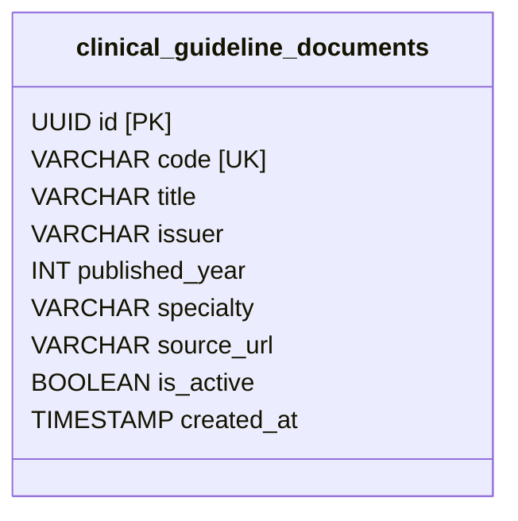
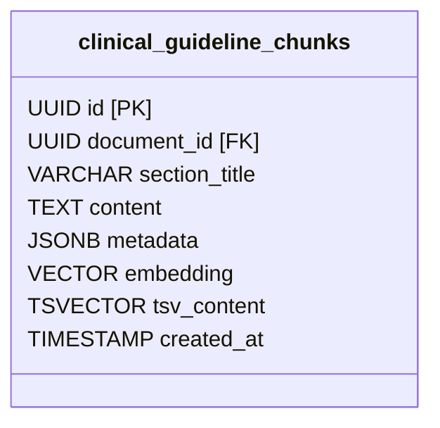
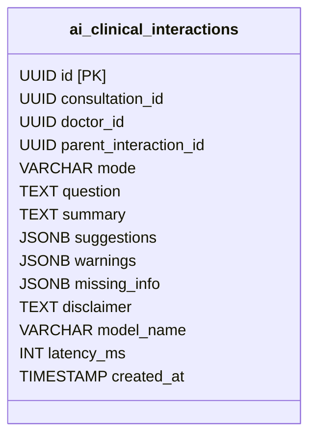
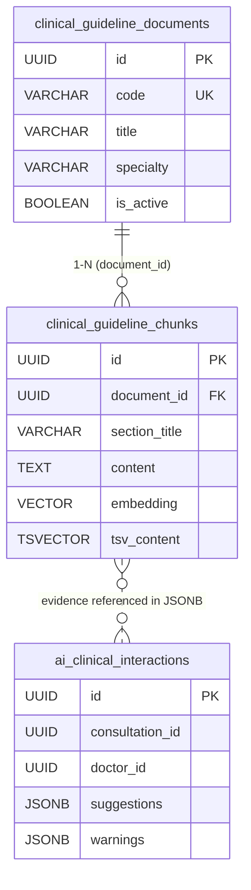

# Thiết Kế Cơ Sở Dữ Liệu Phân Hệ AI Lâm Sàng & RAG (`careflow_ai`)
### Tài liệu giải trình chi tiết: Cấu trúc, Quan hệ & Lý do thiết kế ("Why this, Why not that")

> **Vị trí**: `.planning/ai-service/ai-service-db.md`  
> **Đi kèm tệp DBML**: [`.planning/ai-service/ai-service-db.dbml`](./ai-service-db.dbml)  
> **Tài liệu lý thuyết Vector & HNSW**: [`.planning/ai-service/theory.md`](./theory.md)  
> **Dịch vụ sở hữu**: `careflow-ai-service`  
> **Hệ quản trị CSDL**: PostgreSQL 16 tích hợp Extension `pgvector`  
> **Mục tiêu tài liệu**: Giúp bạn hiểu cặn kẽ từng bảng, từng trường dữ liệu, mối quan hệ và có sẵn các câu trả lời phản biện xuất sắc khi được hỏi *"Tại sao lại làm như thế này mà không làm như thế kia?"*.

---

## MỤC LỤC
1. [Tổng Quan Kiến Trúc CSDL & Lựa Chọn Công Nghệ](#1-tổng-quan-kiến-trúc-csdl--lựa-chọn-công-nghệ)
2. [Chi Tiết Bảng 1: `clinical_guideline_documents`](#2-chi-tiết-bảng-1-clinical_guideline_documents)
3. [Chi Tiết Bảng 2: `clinical_guideline_chunks`](#3-chi-tiết-bảng-2-clinical_guideline_chunks)
4. [Chi Tiết Bảng 3: `ai_clinical_interactions`](#4-chi-tiết-bảng-3-ai_clinical_interactions)
5. [Mối Quan Hệ Giữa Các Bảng (Entity Relationships)](#5-mối-quan-hệ-giữa-các-bảng-entity-relationships)
6. [Cẩm Nang Vấn Đáp Phản Biện: "Why This, Why Not That?"](#6-cẩm-nang-vấn-đáp-phản-biện-why-this-why-not-that)

---

## 1. Tổng Quan Kiến Trúc CSDL & Lựa Chọn Công Nghệ

### 1.1. Tại sao lại dùng PostgreSQL 16 + `pgvector`?
* **"Why this?"**:
  - **Tất cả trong một (All-in-One)**: Lưu được cả dữ liệu quan hệ (bảng phác đồ), dữ liệu bán cấu trúc (`JSONB`), dữ liệu văn bản tìm kiếm (`TSVECTOR`) và vector đa chiều (`VECTOR(768)`).
  - **Hỗ trợ Hybrid Search**: Cho phép viết 1 câu SQL kết hợp cả điều kiện lọc cứng quan hệ (`WHERE specialty = 'HO_HAP'`), tìm kiếm từ khóa (`tsvector @@ to_tsquery(...)`) và tìm kiếm ngữ nghĩa vector (`ORDER BY embedding <=> :query`).
  - **Đảm bảo chuẩn ACID & Bảo mật**: PostgreSQL cực kỳ ổn định, bảo mật chuẩn doanh nghiệp, sao lưu (backup/restore) dễ dàng.
* **"Why not that?" (Tại sao không dùng Pinecone, Milvus, Qdrant, Chroma?)**:
  - *Pinecone*: Dịch vụ SaaS trả phí trên đám mây, dữ liệu y tế nhạy cảm không được tùy tiện đẩy ra ngoài biên giới; chi phí đắt đỏ.
  - *Milvus / Qdrant*: Phải dựng thêm một cụm server riêng, tốn thêm RAM/CPU, phức tạp hóa hạ tầng triển khai. Đội ngũ phải đồng bộ dữ liệu giữa DB quan hệ và Vector DB (dễ bị lệch dữ liệu).
  - *Chroma*: Phù hợp làm demo thử nghiệm nhỏ bằng Python, không tối ưu cho môi trường Production đa luồng của hệ thống bệnh viện lớn.

### 1.2. Tại sao `careflow_ai` là một Database riêng biệt?
* **Tuân thủ mẫu thiết kế Microservices (Database-per-Service)**:
  - Database của khám bệnh (`careflow_consultation`) và bệnh nhân (`careflow_patient`) phục vụ giao dịch nghiệp vụ tốc độ cao (OLTP).
  - Việc tính toán vector, quét chỉ mục đa chiều tiêu tốn CPU và RAM. Nếu nhét chung vào DB khám bệnh, khi bác sĩ tra cứu AI nặng có thể làm treo cả hệ thống khám bệnh.
  - Tách riêng giúp `careflow_ai` có thể scale độc lập, bảo trì hoặc nâng cấp mà không ảnh hưởng tới ca khám của bệnh viện.

---

## 2. Chi Tiết Bảng 1: `clinical_guideline_documents`

Bảng này đóng vai trò là **"Sổ lưu trữ hồ sơ tài liệu gốc"** từ Bộ Y Tế và Hội đồng Dược thư Quốc gia.



### Ý nghĩa từng trường (Field Details):
| Tên trường | Kiểu dữ liệu | Ràng buộc | Giải thích mục đích nghiệp vụ |
|---|---|---|---|
| `id` | `UUID` | `PRIMARY KEY` | Định danh duy nhất toàn cầu cho văn bản phác đồ. Dùng `UUID` tránh bị lộ quy mô dữ liệu và dễ tích hợp phân tán. |
| `code` | `VARCHAR(100)` | `UNIQUE, NOT NULL` | Số hiệu quyết định văn bản pháp lý, ví dụ: `BYT-QD-4800-HOHAP`, `BYT-QD-5948-DDI`. Dùng để đối chiếu và tránh nạp trùng tài liệu. |
| `title` | `VARCHAR(500)` | `NOT NULL` | Tên đầy đủ của phác đồ, vd: *"Hướng dẫn chẩn đoán và điều trị bệnh Hô hấp"*. Phục vụ hiển thị trích dẫn cho bác sĩ. |
| `issuer` | `VARCHAR(255)` | `NOT NULL` | Cơ quan ban hành (mặc định: `'Bộ Y Tế Việt Nam'`). Khẳng định tính pháp lý chính thống. |
| `published_year` | `INT` | `NOT NULL` | Năm ban hành (vd: 2020, 2023). Giúp bác sĩ biết tài liệu mới hay cũ. |
| `specialty` | `VARCHAR(100)` | `NOT NULL` | Chuyên khoa lâm sàng (vd: `HO_HAP`, `TIM_MACH`, `NOI_TIET`, `DUOC_LAM_SANG`). Cực kỳ quan trọng để lọc trước khi tìm kiếm. |
| `source_url` | `VARCHAR(1000)` | `NULL` | Đường link dẫn tới văn bản gốc trên cổng thông tin Cục Quản lý Khám chữa bệnh (`kcb.vn`). |
| `is_active` | `BOOLEAN` | `DEFAULT TRUE` | Trạng thái hiệu lực. Khi Bộ Y Tế ra phác đồ mới thay thế, chuyển thành `FALSE` để AI không trích dẫn phác đồ cũ đã bị bãi bỏ. |
| `created_at` | `TIMESTAMP` | `DEFAULT now()` | Thời điểm nạp tài liệu vào hệ thống. |

---

## 3. Chi Tiết Bảng 2: `clinical_guideline_chunks`

Bảng này là **"Trái tim của hệ thống RAG"**. Mỗi văn bản phác đồ hàng trăm trang sẽ được bóc tách và chia nhỏ thành nhiều đoạn trích ngắn (chunks) chứa thông tin hoàn chỉnh.



### Ý nghĩa từng trường (Field Details):
| Tên trường | Kiểu dữ liệu | Ràng buộc | Giải thích mục đích nghiệp vụ |
|---|---|---|---|
| `id` | `UUID` | `PRIMARY KEY` | Định danh duy nhất cho từng chunk. |
| `document_id` | `UUID` | `FK -> documents.id` | Khóa ngoại liên kết ngược về tài liệu cha. Kèm `ON DELETE CASCADE` (xóa tài liệu gốc sẽ tự động dọn sạch chunks). |
| `section_title` | `VARCHAR(300)` | `NULL` | Tiêu đề mục phân cấp kèm kỹ thuật **Breadcrumbs**, ví dụ: `[QĐ 4800 > Viêm phổi cộng đồng > Kháng sinh ban đầu]`. |
| `content` | `TEXT` | `NOT NULL` | Nội dung văn bản chi tiết của đoạn phác đồ (khoảng 400 – 800 tokens). Đây là dữ liệu sẽ được nhồi vào Prompt cho LLM đọc. |
| `metadata` | `JSONB` | `DEFAULT '{}'` | Thuộc tính phân loại dạng linh hoạt: chứa mảng mã bệnh `["J18", "I10"]`, danh sách hoạt chất `["Amoxicillin"]`, mức độ cảnh báo nguy hiểm. |
| `embedding` | `VECTOR(768)` | `NOT NULL` | Tọa độ không gian 768 chiều sinh ra từ Google `text-embedding-004` (hoặc 1024 chiều từ BGE-M3) để máy tính hiểu được "ngữ nghĩa". |
| `tsv_content` | `TSVECTOR` | `GENERATED ALWAYS` | Cột tự động băm text thành các token phục vụ Full-Text Search BM25 (bắt chính xác 100% các từ khóa viết tắt hoặc tên thuốc khó). |
| `created_at` | `TIMESTAMP` | `DEFAULT now()` | Thời điểm tạo chunk. |

### Các chỉ mục (Indexes) đặc thù của bảng Chunks:
1. **`idx_clinical_chunks_hnsw` (Chỉ mục HNSW)**:
   - Dùng thuật toán đồ thị đa tầng `hnsw (embedding vector_cosine_ops)` với tham số `m = 16, ef_construction = 64`.
   - Giúp tìm kiếm các đoạn có nghĩa tương tự câu hỏi của bác sĩ với tốc độ chớp nhoáng **$< 15\text{ms}$** và độ chính xác (Recall) trên **$98\%$**.
2. **`idx_clinical_chunks_tsv` (Chỉ mục GIN trên `tsv_content`)**:
   - Dùng để tìm kiếm từ khóa chính xác dạng Google Search, không để sót các tên thuốc đặc hiệu.
3. **`idx_clinical_chunks_meta` (Chỉ mục GIN trên `metadata`)**:
   - Cho phép lọc cực nhanh: `WHERE metadata @> '{"icd10": ["J18"]}'`.

---

## 4. Chi Tiết Bảng 3: `ai_clinical_interactions`

Bảng này đóng vai trò là **"Hộp đen giám sát y tế (Clinical Audit Trail)"**, thực thi đúng yêu cầu của hợp đồng dịch vụ [**CF-SVC-12**](../../docs/service-contracts/12-ai-clinical-assistant.md).



### Ý nghĩa từng trường (Field Details):
| Tên trường | Kiểu dữ liệu | Giải thích mục đích nghiệp vụ |
|---|---|---|
| `id` | `UUID (PK)` | Chính là `interactionId` trả về trong response API, dùng để truy vấn lại lịch sử ca khám (`GET /api/ai/interactions/{id}`). |
| `consultation_id` | `UUID` | ID của ca khám bệnh (liên kết logic tới `careflow-consultation-service`). |
| `doctor_id` | `UUID` | ID của Bác sĩ đã yêu cầu AI hỗ trợ (để truy trách nhiệm chuyên môn). |
| `parent_interaction_id` | `UUID` | Nếu bác sĩ chat nhiều câu liên tiếp trong 1 ca khám, trường này lưu ID câu hỏi trước để tạo chuỗi hội thoại có ngữ cảnh. |
| `mode` | `VARCHAR(50)` | Chế độ chạy: `LLM_PROVIDER` (gọi AI Gemini thật) hoặc `MOCK_RULE_BASED` (chế độ dự phòng khi mất mạng). |
| `question` | `TEXT` | Câu hỏi hoặc yêu cầu cụ thể của Bác sĩ. |
| `summary` | `TEXT` | Tóm tắt ca bệnh do AI trích xuất từ dữ liệu lâm sàng. |
| `suggestions` | `JSONB` | Mảng danh sách các chẩn đoán phân biệt, phác đồ đề xuất kèm các bằng chứng trích dẫn (`evidenceRefs`). |
| `warnings` | `JSONB` | Mảng các cảnh báo tương tác thuốc DDI, dị ứng chéo hoặc chống chỉ định phát hiện được. |
| `missing_info` | `JSONB` | Danh sách thông tin lâm sàng/xét nghiệm mà bác sĩ chưa nhập (vd: *"Chưa có chỉ số SpO2"*, *"Chưa hỏi tiền sử dạ dày"*). |
| `disclaimer` | `TEXT` | Tuyên bố miễn trừ trách nhiệm y tế: *"Chỉ là gợi ý hỗ trợ. Bác sĩ chịu trách nhiệm quyết định lâm sàng cuối cùng."* |
| `model_name` | `VARCHAR(100)` | Tên và phiên bản AI đã phục vụ (vd: `gemini-2.5-flash`), phục vụ đánh giá so sánh chất lượng model. |
| `latency_ms` | `INT` | Thời gian từ lúc nhận request đến khi trả lời (tính bằng mili-giây). Dùng để giám sát SLA ($< 2000\text{ms}$). |
| `created_at` | `TIMESTAMP` | Thời điểm ghi nhận tương tác. |

---

## 5. Mối Quan Hệ Giữa Các Bảng (Entity Relationships)



### 1. Quan hệ Vật lý (Foreign Key): `documents` $\rightarrow$ `chunks` (1 - Nhiều)
- Một tài liệu phác đồ (ví dụ Quyết định 4800) được chia thành **hàng chục đến hàng trăm chunks**.
- Thiết lập: `FOREIGN KEY (document_id) REFERENCES clinical_guideline_documents(id) ON DELETE CASCADE`.
- Khi cần xóa bỏ một văn bản phác đồ cũ, toàn bộ chunks của nó sẽ được xóa sạch tự động, không để lại rác trong bộ nhớ vector.

### 2. Quan hệ Logic: `chunks` $\rightarrow$ `ai_clinical_interactions`
- Khi AI gợi ý cho bác sĩ, nó không tạo khóa ngoại cứng với bảng chunks mà lưu thông tin nguồn vào cấu trúc `evidenceRefs` bên trong cột `JSONB suggestions`:
  ```json
  "evidenceRefs": [
    {
      "sourceType": "CLINICAL_GUIDELINE",
      "sourceCode": "BYT-QD-4800-HOHAP",
      "section": "Viêm phổi cộng đồng > Kháng sinh ban đầu"
    }
  ]
  ```
- **Lý do**: Đảm bảo lịch sử tương tác của ca khám bệnh trong quá khứ là bất biến (immutable), dù tài liệu phác đồ gốc sau này có bị chỉnh sửa hay cập nhật thì lịch sử ca khám đã lưu vẫn phản ánh trung thực những gì bác sĩ nhìn thấy tại thời điểm đó.

---

## 6. Cẩm Nang Vấn Đáp Phản Biện: "Why This, Why Not That?"

Dưới đây là các câu hỏi "xoáy" thường gặp và câu trả lời chuẩn xác nhất giúp bạn tự tin giải trình:

---

### Câu hỏi 1: Tại sao phải tách thành 2 bảng (`documents` và `chunks`) mà không gộp chung vào 1 bảng phẳng?
* **Trả lời**:
  - **Tránh trùng lặp dữ liệu khổng lồ (Deduplication)**: Một tài liệu có 500 chunks. Nếu gộp chung, 500 dòng đó sẽ lặp lại 500 lần các chuỗi văn bản giống hệt nhau như tên quyết định, số hiệu, năm ban hành, tên cơ quan ban hành $\rightarrow$ Tốn dung lượng đĩa và làm chậm bảng.
  - **Tối ưu tốc độ tìm kiếm (Metadata Pre-filtering)**: Cho phép truy vấn bảng cha nhỏ gọn trước (`SELECT id FROM documents WHERE specialty = 'HO_HAP'`), rồi chỉ so sánh vector trên các chunks thuộc về các `document_id` đó. Giúp thu hẹp không gian tìm kiếm từ 20.000 chunks xuống còn 200 chunks, tốc độ tăng gấp hàng chục lần.
  - **Quản lý vòng đời phác đồ**: Khi Bộ Y Tế ra phác đồ mới thay thế phác đồ cũ, ta chỉ cần sửa đúng 1 cờ `is_active = FALSE` trên 1 dòng duy nhất ở bảng `documents`, thay vì phải chạy câu lệnh update hàng nghìn dòng chunk.

---

### Câu hỏi 2: Tại sao không embed nguyên cả file PDF dài 100 trang thành 1 vector duy nhất mà phải cắt nhỏ thành các Chunk 400 - 800 tokens?
* **Trả lời**:
  - **Hiện tượng loãng thông tin (Information Dilution)**: Mô hình nhúng (Embedding Model) nén ngữ nghĩa của văn bản vào một vector có số chiều cố định (768 số thực). Nếu nhồi 100 trang sách vào 768 số đó, các thông tin cụ thể (như liều dùng thuốc `500mg`, chống chỉ định suy thận) sẽ bị bẹp dúm và biến mất.
  - **Vấn đề kích thước Context Window của LLM**: Khi bác sĩ hỏi về một triệu chứng, ta chỉ cần nhồi đúng 1 đoạn trích 500 chữ liên quan trực tiếp vào câu hỏi của Gemini. Nếu nạp cả tài liệu 100 trang sẽ làm tràn cửa sổ ngữ cảnh, tốn chi phí token và khiến mô hình bị ảo giác (*Lost in the Middle*).
  - **Độ dài 400 - 800 tokens** là tỷ lệ vàng trong ngành: đủ dài để trọn vẹn một ý y khoa (Triệu chứng + Phác đồ + Liều dùng), nhưng đủ ngắn để giữ độ nét ngữ nghĩa sắc bén.

---

### Câu hỏi 3: Cột `section_title` lưu Breadcrumbs Context Injection để làm gì?
* **Trả lời**:
  - Khi cắt nhỏ văn bản, một chunk chỉ có câu: *"Uống 1 viên x 2 lần/ngày sau bữa ăn"*.
  - Nếu embed trơ trọi câu này, vector search sẽ không thể biết đây là liều lượng của thuốc gì, dùng cho bệnh gì!
  - **Breadcrumbs Context Injection** giải quyết triệt để vấn đề này bằng cách tự động bơm ngữ cảnh cha vào đầu đoạn trước khi embed:
    `[Quyết định 4800/QĐ-BYT > Viêm phổi cộng đồng > Kháng sinh Clarithromycin 500mg]`
    `Uống 1 viên x 2 lần/ngày sau bữa ăn...`
  - Giờ đây, khi bác sĩ tìm kiếm từ khóa *"Viêm phổi"* hay *"Clarithromycin"*, vector search sẽ bắt trúng đoạn trích này ngay lập tức.

---

### Câu hỏi 4: Tại sao trong bảng `chunks` lại có cả cột Vector (`embedding`) và cột `tsv_content`? Dùng 1 cái không được sao?
* **Trả lời**:
  - Đây chính là kỹ thuật **Hybrid Search (Tìm kiếm Lai)** — tiêu chuẩn bắt buộc trong Y tế:
    - **Vector Search (Dense Retrieval)**: Rất giỏi hiểu ngữ nghĩa tương đồng (ví dụ hỏi *"người bệnh khó thở, sốt cao"* sẽ tự động tìm ra phác đồ *"Viêm phổi cấp"* dù từ ngữ không trùng khớp). Tuy nhiên, Vector Search lại rất dở khi phân biệt các từ viết tắt kỹ thuật hoặc tên thuốc hiếm (ví dụ nó có thể nhầm `Cefuroxime` với `Cefotaxime` vì hai từ này nghe giống nhau).
    - **Full-Text Search BM25 (`tsv_content`)**: Cực kỳ chính xác trong việc bắt đúng từng chữ (exact match) như tên hoạt chất `Amoxicillin` hay mã bệnh `J18`.
  - Kết hợp cả hai qua thuật toán **Reciprocal Rank Fusion (RRF $k=60$)** giúp hệ thống đạt độ chính xác kép: vừa hiểu đúng ý bác sĩ, vừa không bao giờ nhặt nhầm tên thuốc.

---

### Câu hỏi 5: Tại sao chọn chỉ mục HNSW mà không dùng IVFFlat cho vector?
* **Trả lời**:
  - **IVFFlat**: Gom vector thành các cụm (Voronoi cells). Nếu vector rơi vào ranh giới giữa 2 cụm, nó sẽ bị bỏ sót. Trong y tế, **bỏ sót 1 chống chỉ định thuốc có thể dẫn đến tử vong**. Hơn nữa, IVFFlat bắt buộc phải có sẵn dữ liệu đầy đủ rồi mới tạo được index (không hỗ trợ thêm tài liệu mới linh hoạt).
  - **HNSW (Hierarchical Navigable Small World)**: Xây dựng đồ thị liên kết đa tầng. Độ chính xác (Recall) đạt **$>98\%$**, tốc độ truy vấn ổn định dưới **$15\text{ms}$**, và cho phép nạp thêm phác đồ mới liên tục (*streaming insert*) mà không bao giờ phải rebuild lại index.

---

### Câu hỏi 6: Tại sao không tạo bảng riêng cho 701 cặp tương tác thuốc (DDI) mà lại nhét vào `metadata` JSONB của bảng chunks?
* **Trả lời**:
  - **Tránh bùng nổ quan hệ phức tạp (Over-normalization)**: Nếu tạo bảng `ddi_rules(drug_a, drug_b, level, mechanism...)`, ta lại phải viết thêm hàng chục API quản lý, CRUD và tạo câu lệnh SQL JOIN chéo 4–5 bảng khi bác sĩ kê đơn.
  - **Tận dụng sức mạnh của JSONB + GIN Index**: PostgreSQL xử lý JSONB với tốc độ tương đương cột quan hệ bình thường. Nhét vào JSONB cho phép một chunk chứa nhiều cặp hoạt chất, và câu truy vấn `metadata @> '{"drugs": ["Simvastatin"]}'` chạy chỉ mất vài mili-giây mà cấu trúc database lại cực kỳ gọn gàng (chỉ đúng 3 bảng).

---

### Câu hỏi 7: Tại sao bảng `ai_clinical_interactions` lưu `suggestions` và `warnings` dạng `JSONB` thay vì tạo các bảng chi tiết chuẩn hóa (Normalized)?
* **Trả lời**:
  - **Bản chất của AI Output là Bán cấu trúc & Tiến hóa liên tục**: Hôm nay câu trả lời của AI gồm 3 trường (`diagnose`, `treatment`, `evidence`), ngày mai có thể bổ sung thêm trường `icd10_probability` hay `lab_recommendations`. Dùng `JSONB` giúp schema mềm dẻo, không bị vỡ mỗi khi tinh chỉnh cấu trúc prompt.
  - **Tính Bất Biến (Immutable Audit Record)**: Khi ca khám kết thúc, dữ liệu tương tác AI là một "bản chụp nguyên trạng" (snapshot) để lưu trữ vĩnh viễn. Việc lưu trọn vẹn JSON payload giúp truy vấn lịch sử chỉ với 1 câu lệnh `SELECT` duy nhất theo `interactionId` (cực nhanh, không cần JOIN nhiều bảng).
