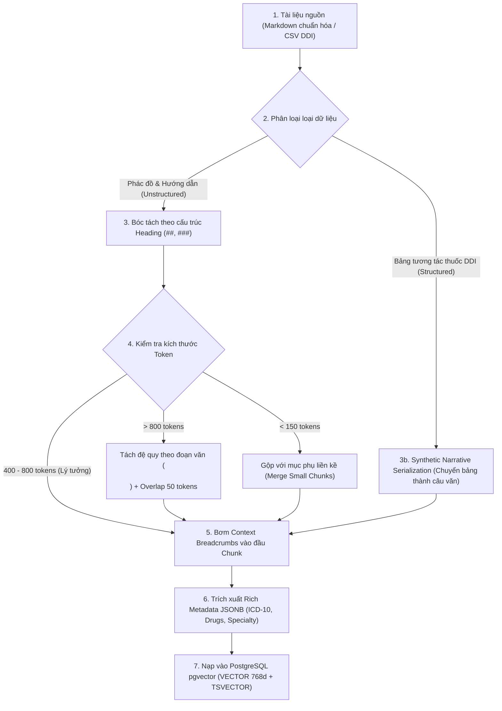

# CareFlow Clinical RAG — Chiến Lược Phân Đoạn Tri Thức (Chunking Strategy Standard)

> **Tài liệu đặc tả chuẩn mực kỹ thuật (Technical Specification Standard)**  
> **Dự án**: CareFlow — Phân hệ Trợ lý AI Lâm Sàng & Clinical RAG  
> **Mục tiêu**: Chuẩn hóa chiến lược bóc tách và phân đoạn tri thức y khoa (PDF Bộ Y Tế, Phác đồ điều trị, Dược thư Quốc gia, DDI) đạt độ chính xác lâm sàng cao nhất, triệt tiêu 100% rủi ro mất ngữ cảnh hoặc vỡ bảng liều lượng thuốc.  
> **Áp dụng cho**: `scripts/ingest_clinical_rag.py` & PostgreSQL `careflow_ai.clinical_guideline_chunks`.

---

## 1. Bối Cảnh & Đánh Giá 5 Chiến Lược Phổ Biến

Trong phát triển RAG, có 5 chiến lược phân đoạn văn bản kinh điển:

| Chiến lược | Cơ chế | Ưu điểm | Nhược điểm khi áp dụng vào Y tế Lâm sàng |
| :--- | :--- | :--- | :--- |
| **1. Fixed-size Chunking** | Cắt cứng theo số ký tự/token cố định (vd: 500 tokens + 50 overlap) | Cực kỳ đơn giản, dễ tính toán batch | ❌ **CỰC KỲ NGUY HIỂM**: Cắt ngang giữa câu hoặc chém đứt đôi bảng liều dùng thuốc (nửa trên ở Chunk 1, liều lượng ở Chunk 2 $\rightarrow$ ngộ độc/tử vong). |
| **2. Pure Semantic Chunking** | So sánh Cosine Similarity giữa các câu liền kề để tìm điểm gãy chủ đề | Mạch lạc ngữ nghĩa văn xuôi | ❌ **KÉM HIỆU QUẢ VỚI BẢNG/PHÁC ĐỒ**: Văn bản phác đồ cô đọng, nhảy đề mục nhanh. Ngưỡng similarity dễ làm vỡ cấu trúc thứ bậc điều trị. |
| **3. Recursive Chunking** | Tách đệ quy theo danh sách phân tách (`\n\n` $\rightarrow$ `\n` $\rightarrow$ dấu câu) | Linh hoạt, tôn trọng đoạn văn | ⚠️ **MẤT NGỮ CẢNH GỐC (Context Blindness)**: Khi một đoạn nhỏ đứng độc lập, không biết đoạn đó thuộc về bệnh nào hay nhóm đối tượng nào. |
| **4. Document Structure Chunking** | Tách theo ranh giới tài liệu (`#`, `##`, `###`, bảng, danh sách) | Giữ nguyên vẹn 100% logic y khoa của Bộ Y Tế | ⚠️ **KÍCH THƯỚC KHÔNG ĐỀU**: Có mục chỉ có 50 tokens, có mục lại dài 2.000 tokens vượt giới hạn embedding model. |
| **5. LLM-based Chunking** | Dùng LLM đọc và tự quyết định điểm cắt ngữ nghĩa | Ngữ nghĩa hoàn hảo nhất | ❌ **CHI PHÍ & ĐỘ TRỄ CAO**: Quá chậm và tốn kém khi nạp hàng ngàn trang tài liệu, không mang tính tất định (non-deterministic). |

---

## 2. Tiêu Chuẩn Best Practice: "Contextual Document-Structure Chunking"

Để đạt được chất lượng lâm sàng khắt khe (Zero Hallucination, Zero Context Loss), CareFlow chuẩn hóa chiến lược lai (**Hybrid Multi-Stage Strategy**):  
👉 **"Contextual Document-Structure Chunking kết hợp Recursive Window Guard & Narrative Table Serialization"**



---

## 3. Ba Trụ Cột Kỹ Thuật Bắt Buộc (The 3 Golden Pillars)

### Trụ cột 1: Bảo toàn Tính Toàn vẹn của Bảng & Danh sách Thuốc (Table & List Integrity)
* **Quy tắc tuyệt đối**: **TUYỆT ĐỐI KHÔNG BAO GIỜ** được dùng thuật toán cắt ký tự chia cắt ngang một bảng Markdown (`| Cột 1 | Cột 2 |...`) hoặc một danh sách phác đồ (`1.`, `2.`, `-`).
* Toàn bộ bảng liều lượng kháng sinh phải nằm trọn vẹn trong duy nhất 1 chunk. Nếu bảng thuốc quá dài (> 800 tokens), bảng đó phải được tách theo từng hàng (Row-level) hoặc từng nhóm hoạt chất, mỗi chunk con đều phải mang đầy đủ **Header của bảng**.

### Trụ cột 2: Tiêm Ngữ Cảnh Phả Hệ (Contextual Breadcrumbs Injection)
* **Hiện tượng Context Blindness**: Khi một đoạn trích bị tách ra:
  > *"Kháng sinh đầu tay: Amoxicillin/Clavulanic acid 1g x 3 lần/ngày uống kèm Clarithromycin 500mg x 2 lần/ngày..."*
  Nếu đứng một mình, mô hình Embedding và LLM không thể phân biệt đây là liều cho *Viêm phổi cộng đồng người lớn*, *Nhiễm trùng huyết* hay *Viêm tai giữa*!
* **Quy chuẩn CareFlow Breadcrumb**: Đầu mỗi chunk **BẮT BUỘC** được chèn thêm tiền tố cấu trúc:
  ```markdown
  [NGỮ CẢNH Y KHOA: Bộ Y Tế > QĐ 4800/QĐ-BYT > Hô hấp > Viêm phổi mắc phải cộng đồng > Điều trị Ngoại trú > Phác đồ Kháng sinh]
  
  Đối với bệnh nhân không có bệnh lý đồng mắc và không có yếu tố nguy cơ nhiễm khuẩn kháng thuốc:
  - Kháng sinh lựa chọn hàng đầu: Amoxicillin/Clavulanic acid 1g x 3 lần/ngày...
  ```
* **Hiệu quả**: Vector Cosine Search sẽ khớp chính xác với câu hỏi của bác sĩ ngay cả khi bác sĩ chỉ gõ ngắn gọn: *"Bệnh nhân viêm phổi cộng đồng ngoại trú thì dùng kháng sinh gì?"*.

### Trụ cột 3: Chuyển Bảng Có Cấu Trúc thành Câu Văn Tự Nhiên (Synthetic Narrative Serialization)
* Đối với file bảng biểu như `ddi_contraindicated.csv` (701 cặp tương tác thuốc), **không nhúng trực tiếp dữ liệu thô dạng CSV**.
* Mỗi dòng tương tác được biên dịch thành 1 đoạn văn lâm sàng tiêu chuẩn:
  ```text
  [CẢNH BÁO TƯƠNG TÁC THUỐC CHỐNG CHỈ ĐỊNH - DƯỢC THƯ QUỐC GIA & QĐ 5948/QĐ-BYT]
  Cặp tương tác: [Clopidogrel] và [Omeprazole].
  Mức độ nghiêm trọng: CHỐNG CHỈ ĐỊNH PHỐI HỢP (Severe Contraindication).
  Cơ chế dược động học: Omeprazole ức chế enzyme CYP2C19 ở gan, ngăn cản quá trình chuyển hóa Clopidogrel thành dạng có hoạt tính sinh học, làm mất tác dụng chống kết tập tiểu cầu và làm tăng nguy cơ tắc mạch huyết khối.
  Khuyến cáo lâm sàng: Tuyệt đối tránh kê đơn đồng thời. Nếu cần bảo vệ dạ dày cho bệnh nhân đang dùng Clopidogrel, chỉ định thay thế bằng Pantoprazole.
  ```

---

## 4. Đặc Tả Thông Số Kỹ Thuật (Specification Parameters)

| Tham số cấu hình | Giá trị chuẩn mực | Giải thích kỹ thuật |
| :--- | :--- | :--- |
| **Độ dài mục tiêu (Target Chunk Size)** | **400 – 600 tokens** | Khoảng 300 – 450 từ tiếng Việt. Đủ dài cho một đơn thuốc hoàn chỉnh, giữ vector 768d sắc nét. |
| **Độ dài tối đa (Max Chunk Limit)** | **800 tokens** | Ngưỡng chặn trên. Bất kỳ phân đoạn nào dài quá 800 tokens đều kích hoạt Recursive Fallback. |
| **Độ dài tối thiểu (Min Chunk Limit)** | **150 tokens** | Tránh "Thin Chunks" làm loãng kết quả tìm kiếm. Nếu nhỏ hơn, gộp với phân đoạn kế cận. |
| **Độ chồng lấn (Chunk Overlap)** | **50 – 80 tokens** | Chỉ áp dụng khi buộc phải cắt một đoạn văn dài thành 2 chunks, giúp giữ mạch logic giữa các câu. |
| **Mô hình Tokenizer** | BPE / SentencePiece (Google AI) | Sử dụng tokenizer chuẩn của Google Vertex AI / Gemini. |
| **Tokenizer Fallback (Local Script)** | `tiktoken` (`cl100k_base`) | Dùng thư viện `tiktoken` khi chạy script offline để ước lượng số token chính xác với độ lệch $< 3\%$. |

---

## 5. Cấu Trúc Siêu Dữ Liệu (Metadata Schema) Chuẩn Cho Từng Chunk

Mỗi chunk khi lưu trữ vào cột `metadata JSONB` của bảng `clinical_guideline_chunks` **BẮT BUỘC** tuân thủ schema sau:

```json
{
  "document_code": "BYT-QD-4800-HOHAP",
  "document_title": "Hướng dẫn chẩn đoán và điều trị viêm phổi mắc phải cộng đồng ở người lớn",
  "breadcrumb_titles": [
    "Viêm phổi mắc phải cộng đồng",
    "Điều trị ngoại trú",
    "Phác đồ sử dụng kháng sinh"
  ],
  "specialty": "Hô hấp",
  "disease_name": "Viêm phổi mắc phải cộng đồng",
  "icd10_codes": ["J13", "J14", "J15", "J18"],
  "target_population": "adult",
  "care_setting": "outpatient",
  "section_type": "treatment_protocol",
  "drugs_mentioned": [
    "Amoxicillin",
    "Acid clavulanic",
    "Clarithromycin",
    "Azithromycin",
    "Levofloxacin"
  ],
  "token_count": 524
}
```

### Lợi ích tối thượng:
1. Cho phép **SQL Hard Filtering** trước khi tìm kiếm vector:
   `WHERE metadata->>'specialty' = 'Hô hấp' AND metadata->'icd10_codes' ? 'J18'`
2. Giảm số lượng vector cần so sánh từ hàng vạn xuống vài chục vector, đưa độ trễ của HNSW xuống **dưới 10ms**.

---

## 6. Cơ Chế Khâu Nối Đa Đoạn (Multi-Chunk Stitching) & Ranh Giới Ngữ Cảnh (Context Boundaries)

### 6.1. Khi Một Đề Mục (`##`) Quá Dài Buộc Phải Chia Đôi: Khâu Nối Bằng Cách Nào?
Khi một mục chuyên sâu vượt quá 800 tokens, thuật toán không được cắt vụn ngẫu nhiên mà thực hiện **kỹ thuật khâu nối 3 lớp (3-Layer Stitching)**:

1. **Khâu nối ngữ nghĩa (Breadcrumb Stitching)**:
   - Chunk A: `[Ngữ cảnh: Hô hấp > Viêm phổi cộng đồng > Phác đồ Kháng sinh (Phần 1/2)]`
   - Chunk B: `[Ngữ cảnh: Hô hấp > Viêm phổi cộng đồng > Phác đồ Kháng sinh (Phần 2/2)]`
2. **Khâu nối câu chữ (Sliding Window Overlap 50 - 80 tokens)**:
   - Câu kết thúc của Chunk A được sao chép lặp lại ở đầu Chunk B (sau dòng Breadcrumb). Nhờ đó, nếu câu hỏi của bác sĩ rơi trúng điểm tiếp giáp giữa 2 chunks, thuật toán Cosine vẫn nắm trọn vẹn ngữ nghĩa mà không bị đứt gãy mạch tư duy y khoa.
3. **Khâu nối con trỏ CSDL (Linked-List Metadata)**:
   - Trong `metadata` JSONB, lưu trữ các khóa liên kết: `chunk_index`, `total_chunks`, `has_next`, `has_prev`.
   - Giúp Backend hỗ trợ kỹ thuật **Small-to-Big Retrieval**: Khi tìm thấy Chunk B có điểm tương quan cao ($> 0.85$), Backend có thể nhìn thấy `has_prev: true` để kéo luôn Chunk A đi kèm nạp vào Prompt cho LLM.

### 6.2. Xác Định Điểm Bắt Đầu & Kết Thúc (Start / End) của Ngữ Cảnh: Có Phải 1 Row = 1 Context?

* **Dữ liệu Dạng Bảng (Structured DDI / Formulary)**:
  - 👉 **QUY TẮC: ĐÚNG 1 HÀNG = ĐÚNG 1 CONTEXT ĐỘC LẬP (1 Row = 1 Chunk)**.
  - Mỗi dòng tương tác thuốc (DDI) là một sự thật y khoa nguyên tử (*Atomic Clinical Fact*). Nó có điểm bắt đầu là cột đầu tiên và điểm kết thúc là cột cuối cùng của dòng đó. Bản thân nó không phụ thuộc vào dòng trước hay dòng sau, nên được chuyển thành 1 câu chuyện tự nhiên độc lập.
* **Dữ liệu Phác Đồ Dạng Văn Bản (Unstructured Markdown)**:
  - **Start**: Ký tự đầu tiên ngay sau dòng Heading (`##`, `###`).
  - **End**: Ký tự cuối cùng trước dòng Heading tiếp theo.
  - **Điểm ngắt khi vượt ngưỡng (Split Breakpoints)**: Ưu tiên theo thứ tự giảm dần:
    1. Hết đoạn văn: `\n\n`
    2. Hết mục danh sách / gạch đầu dòng: `\n` (`- `, `* `, `1. `)
    3. Hết câu hoàn chỉnh: Dấu chấm câu `. `
    *(Tuyệt đối cấm ngắt giữa chừng một từ hoặc chẻ đôi một bảng biểu markdown)*.

---

## 7. Kế Hoạch Hiện Thực Hóa (Implementation Plan)

Chiến lược này sẽ được hiện thực hóa trực tiếp trong script Python:
- **Tệp thực thi**: [`scripts/ingest_clinical_rag.py`](../../scripts/ingest_clinical_rag.py)
- **Thư viện sử dụng**:
  - `tiktoken`: Đo lường token chính xác.
  - `google-genai`: Gọi mô hình `text-embedding-004` (768 chiều).
  - `psycopg2` / `SQLAlchemy`: Kết nối PostgreSQL Remote và nạp dữ liệu vào bảng `clinical_guideline_chunks`.
- **Dữ liệu đầu vào**:
  - `docs/rag-docs/treatment-protocol/markdown/*.md` (3 phác đồ điều trị sạch)
  - `docs/rag-docs/ddi/ddi_contraindicated.csv` (701 cặp tương tác thuốc)
  - `docs/rag-docs/drug-formulary/drugs_generic.csv` (185 thuốc generic)
