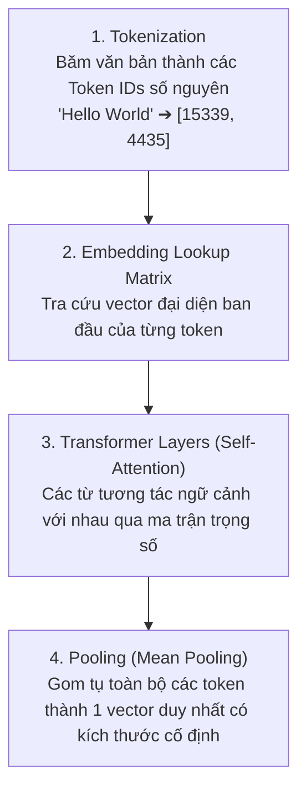

# 01. Vector Embeddings & Không Gian Ngữ Nghĩa (Semantic Space)

> **Mục tiêu**: Hiểu bản chất của Vector Embeddings, cơ chế biến một chuỗi văn bản thành tọa độ hình học trong không gian đa chiều, và tại sao số chiều luôn cố định.

---

## 1. Vector Embedding Là Gì?

- **Vector Embedding** là một mảng gồm các số thực dấu phẩy động (floating-point numbers), nén toàn bộ ý nghĩa ngữ nghĩa (semantics) của một đoạn văn bản vào một tọa độ trong không gian toán học đa chiều.
- Ví dụ một vector 768 chiều sinh bởi model Google `gemini-embedding-2` hoặc `text-embedding-004`:
  ```sql
  [-0.024518, 0.045182, -0.012891, 0.089123, -0.034112, 0.007812, ..., 0.051289]
  ```

---

## 2. Khái Niệm Không Gian Ngữ Nghĩa (Semantic Space)

Trong không gian này, **khoảng cách hình học phản ánh mức độ tương đồng về mặt ý nghĩa**:
- *"Bệnh nhân bị viêm phổi cấp"* và *"Người bệnh nhiễm khuẩn đường hô hấp dưới"* dùng hai bộ từ vựng khác hẳn nhau, nhưng vì cùng nói về một bệnh lý đường thở nên tọa độ vector của chúng **nằm sát cạnh nhau**.
- Ngược lại, *"Bệnh nhân bị viêm phổi"* và *"Thời tiết hôm nay rất đẹp"* sẽ nằm ở hai góc không gian hoàn toàn xa nhau.


---

## 3. Cơ Chế Biến Một Câu Thành Tọa Độ Hình Học

Không có bất kỳ công thức toán tĩnh nào (như mã ASCII hay hàm băm MD5/SHA256) làm được điều này. Quá trình biến một câu chữ thành tọa độ được thực hiện bởi **Mạng nơ-ron Transformer (Deep Learning)** qua 4 bước:



1. **Tokenization**: Chia nhỏ câu văn thành các đơn vị từ vựng (tokens). Mỗi token được gán một số định danh nguyên (Token ID).
2. **Embedding Matrix**: Mỗi token ban đầu được gán một vector nguyên mẫu từ từ điển học sẵn.
3. **Self-Attention Layers**: Đây là "bộ não" của Transformer. Nó tính toán mối quan hệ ngữ cảnh giữa các từ trong câu. Ví dụ: từ *"đường"* trong *"đái tháo đường"* sẽ được mô hình hiểu khác hoàn toàn với từ *"đường"* trong *"con đường đi học"*.
4. **Pooling**: Gom các vector của từng token trong câu lại (thường lấy giá trị trung bình - Mean Pooling) để tạo ra **duy nhất 1 vector cố định đại diện cho toàn bộ câu/đoạn văn**.

---

## 4. Câu Hỏi Kinh Điển: Số Chiều Của "Hello World" Là Bao Nhiêu?

> **CÂU TRẢ LỜI CỐT LÕI: Số chiều LUÔN LUÔN CỐ ĐỊNH, bất kể câu ngắn 1 chữ hay dài 500 chữ!**

| Đầu vào | Số từ | Model sử dụng | Số chiều Vector xuất ra |
|---|---|---|---|
| `"Thuốc"` | 1 từ | Google `gemini-embedding-2` | **768 số thực** |
| `"Hello World"` | 2 từ | Google `gemini-embedding-2` | **768 số thực** |
| Phác đồ viêm phổi (500 chữ) | ~700 tokens | Google `gemini-embedding-2` | **768 số thực** |
| `"Hello World"` | 2 từ | BAAI `bge-m3` | **1024 số thực** |
| `"Hello World"` | 2 từ | OpenAI `text-embedding-3-small` | **1536 số thực** |

### Tại sao số chiều bắt buộc phải cố định?
Trong toán học giải tích đa chiều, để tính được khoảng cách hay góc giữa hai vector $\vec{A}$ và $\vec{B}$, cả hai vector bắt buộc phải có **cùng số chiều $N$**:
$$\cos(\theta) = \frac{\vec{A} \cdot \vec{B}}{\|\vec{A}\| \|\vec{B}\|} = \frac{\sum_{i=1}^{N} A_i B_i}{\sqrt{\sum_{i=1}^{N} A_i^2} \sqrt{\sum_{i=1}^{N} B_i^2}}$$
Nếu vector $\vec{A}$ có 2 chiều mà vector $\vec{B}$ có 768 chiều, phép toán tích vô hướng hoàn toàn không thể thực hiện được.
