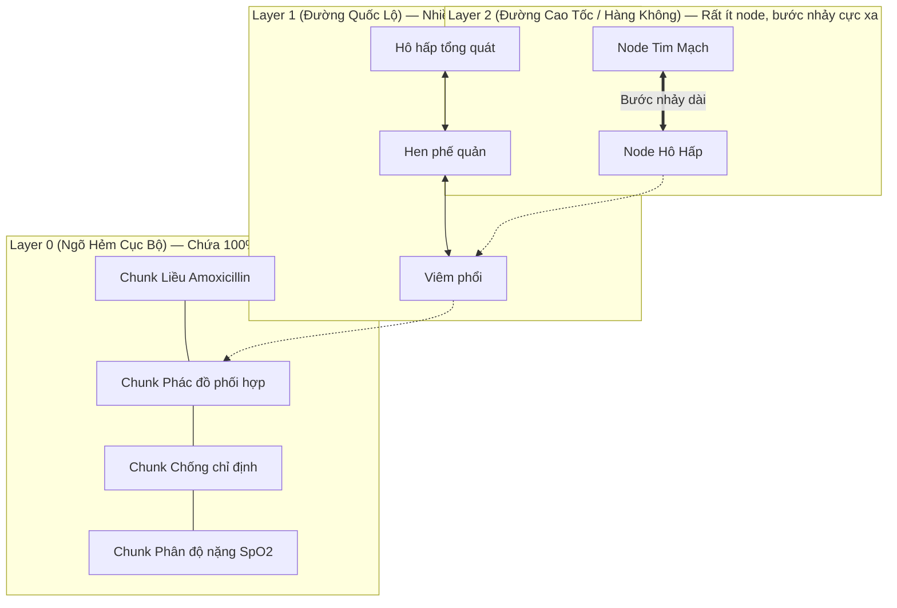

# 03. Thuật Toán HNSW (Hierarchical Navigable Small World) & Cơ Chế Chỉ Mục Vector

> **Mục tiêu**: Hiểu cấu trúc đồ thị đa tầng HNSW, tại sao B-Tree bất lực trước dữ liệu Vector, và ý nghĩa của các tham số cấu hình trong PostgreSQL.

---

## 1. Tại Sao B-Tree Bất Lực Trước Vector Đa Chiều?

* **B-Tree**: Hoạt động dựa trên thứ tự 1 chiều (Scalar Data) có thể so sánh lớn hơn / nhỏ hơn ($A < B < C$).
* **Vector**: Nằm trong không gian 768 chiều. Không tồn tại khái niệm "vector A lớn hơn vector B", chỉ có khái niệm **"vector A gần vector B hơn vector C"**. Do đó cấu trúc cây B-Tree hoàn toàn không thể áp dụng cho tìm kiếm vector tương đồng.

---

## 2. Cấu Trúc Đồ Thị Đa Tầng Của HNSW (Mô Hình Giao Thông 3 Tầng)

HNSW lấy cảm hứng từ cấu trúc dữ liệu **Skip-List** kết hợp với **Đồ thị thế giới nhỏ (Navigable Small World Graph)**:



### Quy trình tìm kiếm diễn ra khi Bác sĩ hỏi:
1. **Khởi đầu ở tầng cao nhất (Layer 2)**: Thuật toán xuất phát từ một node ngẫu nhiên, so sánh khoảng cách và "nhảy bước dài" sang cụm chủ đề gần nhất (nhảy thẳng từ *Tim mạch* sang *Hô hấp*).
2. **Rơi xuống tầng trung gian (Layer 1)**: Dò tìm quanh cụm Hô hấp và nhận ra câu hỏi liên quan đến *Viêm phổi*.
3. **Rơi xuống tầng đáy (Layer 0)**: Đi bộ qua các liên kết ngõ hẻm lân cận để lấy ra đúng **Top 5 Chunks** có độ tương đồng cao nhất ($>90\%$).
4. **Thời gian thực thi**: Toàn bộ quá trình chỉ mất **$< 15\text{ms}$** thay vì phải so sánh lần lượt toàn bộ 100.000 chunks (Exact Scan $O(N)$ mất hàng giây).

---

## 3. Các Tham Số Cấu Hình Quan Trọng Trong PostgreSQL

```sql
CREATE INDEX idx_clinical_chunks_hnsw 
ON clinical_guideline_chunks USING hnsw (embedding vector_cosine_ops)
WITH (m = 16, ef_construction = 64);
```

| Tham số | Giá trị chuẩn | Ý nghĩa kỹ thuật | Trade-off (Được & Mất) |
|---|:---:|---|---|
| **`m`** | `16` | Số lượng liên kết tối đa của mỗi node với các hàng xóm gần nhất ở mỗi tầng. | $m$ càng lớn thì tìm kiếm càng chính xác, nhưng tiêu tốn thêm RAM và tăng thời gian build index. $m=16$ là điểm cân bằng vàng. |
| **`ef_construction`** | `64` | Kích thước danh sách ứng viên được đánh giá trong quá trình xây dựng đồ thị ban đầu. | Số càng cao thì cấu trúc đồ thị càng tối ưu, chất lượng recall cao, nhưng làm chậm quá trình INSERT ban đầu. |
| **`ef_search`** | `40` (mặc định) | Số lượng ứng viên được giữ lại trong bộ nhớ khi thực hiện truy vấn SELECT realtime. | Có thể tăng lên trong session: `SET hnsw.ef_search = 100;` để tăng độ chính xác lên $99\%$ khi cần tra cứu lâm sàng đặc biệt. |

---

## 4. Bảng So Sánh Tổng Kết 3 Loại Index: B-Tree vs GIN vs HNSW

| Tiêu Chí | B-Tree Index | GIN (Generalized Inverted Index) | HNSW (Vector Graph Index) |
|---|---|---|---|
| **Kiểu dữ liệu phù hợp** | Dữ liệu 1 chiều: `UUID`, `INT`, `VARCHAR`, `TIMESTAMP` | Văn bản tìm kiếm `TSVECTOR`, Bán cấu trúc `JSONB`, Mảng `ARRAY` | Mảng số thực đa chiều `VECTOR(768)`, `VECTOR(1024)` |
| **Cơ chế hoạt động** | Cây cân bằng tự duy trì, duyệt theo thứ tự so sánh lớn/nhỏ | Bảng mục lục đảo ngược, tách từng từ khóa/khóa JSON thành index key | Mạng lưới đồ thị thế giới nhỏ phân tầng (Multi-layer Skip Graph) |
| **Phép toán tối ưu** | `=`, `<`, `>`, `BETWEEN`, `ORDER BY` | Chứa từ khóa (`@@`), Chứa JSON (`@>`), Chứa phần tử (`&&`) | Khoảng cách Cosine (`<=>`), L2 (`<->`), Inner Product (`<#>`) |
| **Độ phức tạp tìm kiếm** | $O(\log N)$ | Rất nhanh theo danh sách băm (Inverted List) | $O(\log N)$ theo bước nhảy đồ thị |
| **Độ trễ trung bình** | $< 1\text{ms}$ | $< 5\text{ms}$ | $< 15\text{ms}$ |
| **Điểm yếu** | Bất lực trước dữ liệu đa chiều (Vector) và Full-text | Chậm khi ghi dữ liệu (INSERT/UPDATE vì phải băm nhiều token) | Tốn nhiều RAM để duy trì đồ thị liên kết đa tầng |
| **Ứng dụng trong CareFlow** | Khóa chính `id`, mã `code`, chuyên khoa `specialty`, ca khám `consultation_id` | Tìm tên thuốc chính xác trong `tsv_content`, lọc `metadata` JSONB | Tìm kiếm tương đồng phác đồ ngữ nghĩa trong cột `embedding` |
