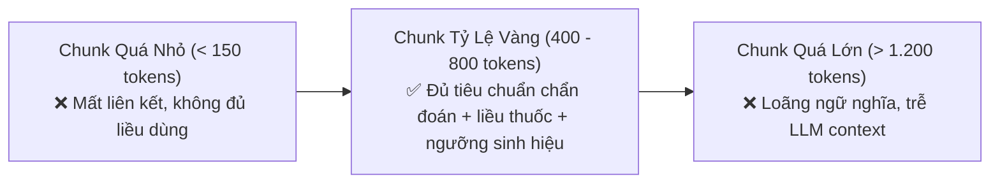

# 04. Phân Biệt Cốt Lõi: Token vs. Word (Từ Vựng) & Quy Tắc Đo Đoạn Y Tế

> **Mục tiêu**: Hiểu bản chất tokenization trong mô hình AI, quy tắc ước lượng token trong tiếng Việt & dược học, và tại sao ngưỡng 400 – 800 tokens là "tỷ lệ vàng" cho RAG lâm sàng.

---

## 1. Token Là Gì?

- **Token** là đơn vị xử lý văn bản cơ bản nhất của mô hình ngôn ngữ lớn (LLM) và mô hình Embedding. Mô hình không đọc câu văn theo từng chữ cái hay từng từ hoàn chỉnh, mà chia nhỏ văn bản thành các **mảnh từ vựng (Sub-words)** dựa trên thuật toán BPE (Byte Pair Encoding) hoặc WordPiece.
  - Một từ tiếng Anh ngắn phổ biến: `"hospital"` $\rightarrow$ **1 token**.
  - Một từ dài hoặc ghép: `"unbelievable"` $\rightarrow$ **3 tokens**: `["un", "believ", "able"]`.
  - Các ký tự đặc biệt, dấu câu, khoảng trắng: `","`, `"."`, `"\n"`, `"{"` $\rightarrow$ mỗi ký tự đều tính là **1 token**.

---

## 2. Quy Tắc Ước Lượng Token Trong Tiếng Việt & Dược Học

* **Tiếng Anh**: Trung bình **$1 \text{ từ} \approx 1.33 \text{ tokens}$** (hoặc $1000 \text{ tokens} \approx 750 \text{ từ}$).
* **Tiếng Việt & Thuật ngữ Y Dược**: Do tiếng Việt có hệ thống thanh điệu phức tạp và nhiều tên thuốc chuyên ngành latin dài, số lượng tokens thường **nhiều hơn đáng kể so với số từ**:
  - Từ tiếng Việt thông thường: **$1 \text{ từ} \approx 1.2 - 1.5 \text{ tokens}$** (vd: *"Kháng sinh"* $\approx$ 2 tokens).
  - Tên hoạt chất thuốc: *"Clarithromycin"* bị băm thành **3 tokens**: `["Clari", "thro", "mycin"]`.
  - Mã chẩn đoán: `"J18.9"` $\rightarrow$ **3 tokens**: `["J", "18", ".9"]`.

### Ví dụ trực quan so sánh Từ vs Token:
Xét một câu văn bệnh án thực tế:
> *"Bệnh nhân sốt cao 39.5 độ C, khó thở, SpO2 91%."*

* **Đếm theo Từ (Word count)**: **10 từ**.
* **Đếm theo Token (Token count)**: **17 tokens**!
  `["Bệnh", " nhân", " sốt", " cao", " 39", ".", "5", " độ", " C", ",", " khó", " thở", ",", " Sp", "O", "2", " 91", "%", "."]`

---

## 3. Tại Sao Khoảng 400 – 800 Tokens Là "Tỷ Lệ Vàng" Cho Chunk Y Khoa?

Trong thiết kế RAG cho bệnh viện, kích thước phân đoạn (Chunk Size) là yếu tố quyết định chất lượng:

1. **Nếu Chunk Quá Nhỏ (< 150 tokens)**:
   - Dễ gặp hiện tượng *"Thin Chunks"*: Một câu chỉ ghi liều dùng mà không có tên thuốc hoặc không có tiêu chuẩn phân độ nặng. Bác sĩ đọc không thể ứng dụng được.
2. **Nếu Chunk Quá Lớn (> 1.200 tokens)**:
   - Gây hiện tượng **Information Dilution (Loãng thông tin)**: Khi nén 1.200 tokens vào 1 vector 768 chiều, các tiểu tiết quan trọng (như liều lượng cho bệnh nhân suy thận) bị làm mờ bởi các đoạn văn chung chung khác.
3. **Chunk 400 – 800 tokens ($\approx$ 300 – 550 từ tiếng Việt)**:
   - Vừa khít một đề mục lâm sàng hoàn chỉnh: Bao gồm tiêu đề phân cấp, điều kiện chỉ định, bảng thuốc kháng sinh phối hợp và các lưu ý chống chỉ định đi kèm.
