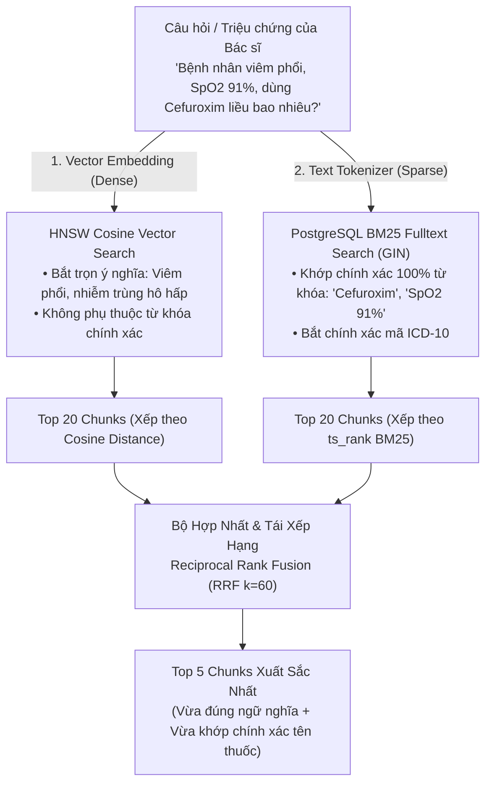

# 05. Thuật Toán Tìm Kiếm Lai Hybrid Search & Reciprocal Rank Fusion (RRF)

> **Mục tiêu**: Hiểu cặn kẽ tại sao tìm kiếm vector thuần tuý (Dense-only) sẽ thất bại trong y tế, cơ chế phối hợp giữa Dense Vector và Sparse BM25, công thức Reciprocal Rank Fusion ($k=60$) và ví dụ tính toán từng bước.

---

## 1. Điểm Yếu Chết Người Của Dense Vector Search Trong Y Tế

Mặc dù Vector Embeddings rất giỏi nắm bắt **ngữ nghĩa chung (Semantics)**, nhưng chúng lại bộc lộ 2 điểm mù tai hại trong môi trường lâm sàng:

| Tình huống lâm sàng | Hành vi của Vector Embeddings (Dense Search) | Hậu quả lâm sàng |
|---|---|---|
| **Mã bệnh ICD-10** | Câu hỏi có mã `"J18.0"` (Viêm phế quản phổi) và `"J18.1"` (Viêm phổi thùy). Vector của 2 mã này nằm sát sàn sạt nhau trong không gian đa chiều. | Trả nhầm tài liệu phác đồ của mã bệnh kế cận. |
| **Tên hoạt chất thuốc cụ thể** | Bác sĩ gõ `"Cefuroxim"`. Vector của `"Cefuroxim"`, `"Cefixim"`, `"Ceftriaxon"` đều thuộc họ Cephalosporin nên rất gần nhau. | Mô hình có thể lấy nhầm chunk hướng dẫn dùng Ceftriaxon (tiêm) thay vì Cefuroxim (uống). |
| **Liều dùng & Số liệu sinh hiệu** | Không phân biệt được độ chênh lệch giữa `"SpO2 < 90%"` và `"SpO2 < 95%"`. | Bỏ sót các ngưỡng chỉ định cấp cứu. |

---

## 2. Giải Pháp: Tìm Kiếm Lai (Hybrid Search = Dense + Sparse)

Để giải quyết triệt để, CareFlow kết hợp hai thế giới tìm kiếm bổ trợ cho nhau:

---

## 3. Thuật Toán Reciprocal Rank Fusion (RRF) Hoạt Động Ra Sao?

### 3.1. Vấn Đề Chuẩn Hóa Điểm Số (Score Calibration Problem)
- **Điểm Vector Cosine Similarity**: Nằm trong khoảng $[0.0, 1.0]$.
- **Điểm BM25 `ts_rank_cd`**: Là một số thực tự do không bị chặn trên, ví dụ $0.05, 0.42, 1.89...$ phụ thuộc vào tần suất xuất hiện từ trong tài liệu.
- 👉 **Không thể cộng trực tiếp 2 điểm này** vì thang đo hoàn toàn khác nhau!

### 3.2. Công Thức RRF (Cộng Hưởng Thứ Hạng Nghịch Đảo)
Thay vì dùng điểm số thô, RRF **chỉ quan tâm đến THỨ HẠNG (Rank position)** của tài liệu trong từng danh sách kết quả:

$$\mathbf{RRF\_Score}(d) = \sum_{m \in M} \frac{1}{k + \text{rank}_m(d)}$$

Trong đó:
- $M$: Tập hợp các thuật toán tìm kiếm (ở đây là $M = \{\text{Dense Vector}, \text{Sparse BM25}\}$).
- $\text{rank}_m(d)$: Vị trí thứ hạng của tài liệu $d$ trong thuật toán $m$ (bắt đầu từ $1, 2, 3...$).
- $k$: Hằng số làm mượt (Smoothing Constant). **Chuẩn quốc tế là $k = 60$** (được kiểm chứng qua nghiên cứu Cormack et al. để tránh trường hợp tài liệu xếp hạng 1 lấn át hoàn toàn các tài liệu xếp hạng 2, 3).

---

## 4. Ví Dụ Tính Toán Từng Bước Cực Kỳ Trực Quan

Giả sử bác sĩ tra cứu: *"Liều Cefuroxim cho viêm phổi cộng đồng"*. Hệ thống nhận về hai danh sách top 3:

* **Danh sách Dense (Vector Search)**:
  - Hạng 1: Chunk $A$ (Phác đồ Viêm phổi cộng đồng người lớn)
  - Hạng 2: Chunk $B$ (Điều trị kháng sinh hô hấp ban đầu)
  - Hạng 3: Chunk $C$ (Hen phế quản bội nhiễm)
* **Danh sách Sparse (BM25 Fulltext Search)**:
  - Hạng 1: Chunk $D$ (Bảng danh mục thuốc Cefuroxim 500mg)
  - Hạng 2: Chunk $A$ (Phác đồ Viêm phổi cộng đồng người lớn - vì trong bài có nhắc chữ Cefuroxim)
  - Hạng 3: Chunk $E$ (Dị ứng kháng sinh nhóm Cephalosporin)

### Bảng Tính Điểm RRF ($k=60$):

| Tài liệu (Chunk) | Rank Vector | Điểm RRF từ Vector $\frac{1}{60 + \text{rank}}$ | Rank BM25 | Điểm RRF từ BM25 $\frac{1}{60 + \text{rank}}$ | Tổng Điểm RRF Cuối Cùng | Thứ Hạng Chung Cuộc |
|---|:---:|:---:|:---:|:---:|:---:|:---:|
| **Chunk $A$** | **1** | $\frac{1}{60+1} \approx 0.01639$ | **2** | $\frac{1}{60+2} \approx 0.01613$ | $\mathbf{0.03252}$ | 🥇 **HẠNG 1** (Cộng hưởng cả 2 bên) |
| **Chunk $D$** | Không có ($>20$) | $0.00000$ | **1** | $\frac{1}{60+1} \approx 0.01639$ | $\mathbf{0.01639}$ | 🥈 **HẠNG 2** |
| **Chunk $B$** | **2** | $\frac{1}{60+2} \approx 0.01613$ | Không có ($>20$) | $0.00000$ | $\mathbf{0.01613}$ | 🥉 **HẠNG 3** |
| **Chunk $C$** | **3** | $\frac{1}{60+3} \approx 0.01587$ | Không có ($>20$) | $0.00000$ | $\mathbf{0.01587}$ | **Hạng 4** |
| **Chunk $E$** | Không có ($>20$) | $0.00000$ | **3** | $\frac{1}{60+3} \approx 0.01587$ | $\mathbf{0.01587}$ | **Hạng 5** |

### Nhận Xét Sâu Sắc:
- **Chunk $A$ vươn lên vị trí quán quân (Hạng 1)** vì nó xuất hiện ở cả hai danh sách tìm kiếm: vừa khớp ngữ nghĩa tổng thể về bệnh (Vector rank 1), vừa chứa đích danh từ khóa thuốc (BM25 rank 2).
- Đây chính là sự kỳ diệu của RRF: Tự động tôn vinh các tài liệu **vừa đúng bối cảnh vừa đúng tiểu tiết**.
