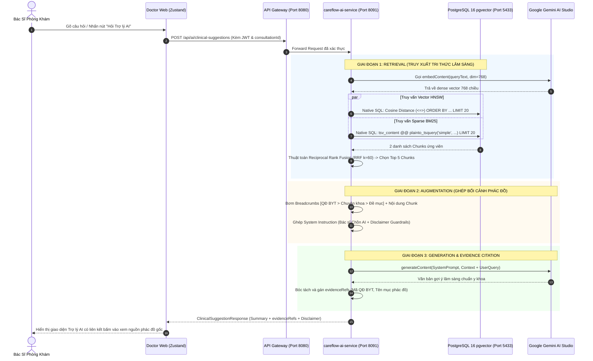

# 06. Kiến Trúc Hoàn Chỉnh Của Clinical RAG Pipeline (End-to-End)

> **Mục tiêu**: Nắm vững luồng xử lý toàn diện từ lúc Bác sĩ gõ câu hỏi / nói vào mic, qua bộ lọc bảo vệ dữ liệu y tế, RRF retrieval, tiêm ngữ cảnh phác đồ BYT, tới khi Gemini sinh câu trả lời kèm trích dẫn bằng chứng y khoa (`evidenceRefs`).

---

## 1. Sơ Đồ Kiến Trúc Luồng Lâm Sàng (End-to-End Execution Flow)



---

## 2. Ba Thành Phần Bắt Buộc Trong Prompt Augmentation (RAG)

Khi đưa context vào cho LLM (Gemini 2.5 Flash), prompt **BẮT BUỘC** tuân thủ cấu trúc 3 phần chặt chẽ:

```text
======================= PHẦN 1: SYSTEM INSTRUCTION & GUARDRAILS =======================
Bạn là Bác sĩ Chồn AI 🐾 (CareFlow Clinical Assistant) hỗ trợ Bác sĩ tại phòng khám.
QUY TẮC AN TOÀN TUYỆT ĐỐI (CLINICAL GUARDRAILS):
1. MỌI gợi ý điều trị, phác đồ dùng thuốc BẮT BUỘC phải dựa trên tài liệu Bộ Y Tế được cung cấp ở phần RAG Context dưới đây.
2. KHÔNG TỰ BỊA ĐẶT liều dùng hoặc thuốc không có trong tài liệu.
3. Nếu tài liệu không đủ dữ liệu để trả lời, phải thông báo rõ vào danh sách missingInformation.
4. Mọi phản hồi phải kết thúc bằng tuyên bố miễn trừ trách nhiệm y khoa.

======================= PHẦN 2: RAG CONTEXT (BỘ Y TẾ VIỆT NAM) =======================
[TÀI LIỆU THAM KHẢO CHÍNH THỨC TỪ BỘ Y TẾ]:
--- NGUỒN 1: [BYT-QD-4800-HOHAP] Hướng dẫn chẩn đoán và điều trị viêm phổi cộng đồng người lớn ---
[Mục: Điều trị ngoại trú > Phác đồ kháng sinh đầu tay]
Nội dung: Bệnh nhân không có bệnh lý đồng mắc: Amoxicillin/clavulanic acid 1g x 3 lần/ngày uống...

--- NGUỒN 2: [BYT-QD-5948-DDI] Dược thư Quốc gia Việt Nam & Chống chỉ định tương tác thuốc ---
[Mục: Cảnh báo tương tác nhóm Clopidogrel]
Nội dung: Tránh phối hợp Clopidogrel với Omeprazole do ức chế enzyme CYP2C19...

======================= PHẦN 3: THÔNG TIN CA KHÁM HIỆN TẠI =======================
- Mã ca khám (ConsultationId): 35df361e-f4b3-4113-ad0d-0ed853fe61fc
- Triệu chứng: Sốt 39 độ C, ho khạc đờm vàng, SpO2 93%, có tiền sử viêm loét dạ dày.
- Yêu cầu của Bác sĩ: Gợi ý phác đồ kháng sinh ban đầu và kiểm tra an toàn dùng thuốc.
```

---

## 3. Cấu Trúc Bằng Chứng Y Khoa (`evidenceRefs`)

Theo hợp đồng dịch vụ **CF-SVC-12**, mọi câu trả lời của AI **không được là hộp đen (Black-box)** mà phải chỉ rõ nguồn gốc cho bác sĩ kiểm chứng:

```json
{
  "interactionId": "17df5248-fe50-499f-b12a-015f38de8df7",
  "mode": "LLM_PROVIDER",
  "summary": "Dựa trên phác đồ QĐ 4800/QĐ-BYT, bệnh nhân có dấu hiệu viêm phổi mắc phải cộng đồng mức độ nhẹ-trung bình...",
  "suggestions": [
    {
      "type": "DIFFERENTIAL_DIAGNOSIS",
      "text": "Viêm phổi mắc phải cộng đồng (J18.9) theo tiêu chuẩn QĐ 4800",
      "evidenceRefs": [
        {
          "sourceType": "CLINICAL_GUIDELINE",
          "sourceId": "BYT-QD-4800-HOHAP",
          "field": "Tiêu chuẩn chẩn đoán lâm sàng & X-quang"
        }
      ]
    }
  ],
  "warnings": [
    "CHỐNG CHỈ ĐỊNH: Không dùng Omeprazole nếu bệnh nhân đang điều trị Clopidogrel (theo QĐ 5948/QĐ-BYT)"
  ],
  "disclaimer": "Gợi ý hỗ trợ lâm sàng từ CareFlow AI. Bác sĩ chịu trách nhiệm hoàn toàn đối với quyết định chẩn đoán và chỉ định điều trị."
}
```

Nhờ đó, Bác sĩ phòng khám hoàn toàn tự tin ra quyết định vì biết chắc chắn gợi ý này được trích xuất từ văn bản pháp lý y tế của Bộ Y Tế.
