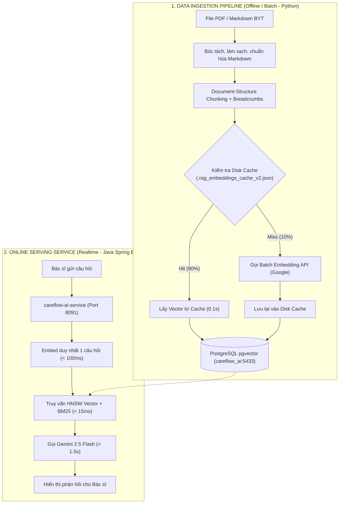

# 07. Kiến Trúc Ingestion Pipeline: Offline Pipeline vs. Online Serving

> **Mục tiêu**: Hiểu tại sao việc nạp dữ liệu tri thức (Ingestion) phải tách biệt khỏi Backend Spring Boot (Online Serving), cơ chế Disk Caching và tính Idempotent khi xử lý dữ liệu lớn.

---

## 1. Kiến Trúc Tách Biệt: Batch Ingestion vs. Online Serving

Trong hệ thống AI sản xuất (Production AI Systems), **vi phạm nghiêm trọng nhất** là nhồi việc đọc file PDF, băm chunk và batch embedding vào bên trong Web Server của ứng dụng chính. 

CareFlow tuân thủ tiêu chuẩn công nghiệp:



---

## 2. Tại Sao Nhồi Chunking/PDF Parsing Vào Spring Boot Lại Là Anti-Pattern?

1. **Tranh chấp tài nguyên (Resource Contention)**:
   - Quá trình đọc PDF lớn, bóc tách chuỗi và gọi hàng ngàn API embedding tiêu tốn rất nhiều CPU/RAM. Nếu nhồi vào Spring Boot, nó sẽ làm nghẽn Thread Pool và gây dừng máy ảo (Stop-the-world Garbage Collection), làm đơ các request khám bệnh khác.
2. **Bán kính rủi ro (Failure Blast Radius)**:
   - Nếu 1 file PDF bị lỗi font, tràn bộ nhớ hoặc ngắt kết nối mạng giữa chừng: Script Python chết thì chỉ việc chạy lại, nhưng Spring Boot chết sẽ làm sập microservice khám bệnh của toàn viện.
3. **Right Tool for the Right Job**:
   - **Java / Spring Boot**: Xuất sắc cho Transaction ACID, Bảo mật phân quyền, High-throughput REST API.
   - **Python**: Là "ông vua" tuyệt đối về NLP, Regex, PDF parsing, Data Wrangling và AI Tokenization.

---

## 3. Ba Đặc Tính Kỹ Thuật Của Script Ingestion (`scripts/ingest_clinical_rag.py`)

### 3.1. Tính Bất Biến (Idempotency)
- Sử dụng cú pháp `ON CONFLICT (code) DO UPDATE` cho bảng tài liệu cha và xóa sạch chunks cũ trước khi nạp mới:
  ```sql
  DELETE FROM clinical_guideline_chunks WHERE document_id = :doc_id;
  ```
- Đảm bảo kỹ sư chạy lại script 10 lần thì CSDL vẫn chỉ có đúng 1.095 chunks sạch, không bao giờ sinh dữ liệu rác trùng lặp.

### 3.2. Cơ Chế Bộ Nhớ Đệm Đĩa An Toàn (Disk Cache Hit)
- Mỗi đoạn chunk được băm (hash) SHA-256 nội dung. Vector tương ứng được lưu trong file `.rag_embeddings_cache_v2.json`.
- Khi nạp lại DB hoặc chạy trên máy chủ mới: **1.095 chunks được nạp vào DB trong chưa đầy 1 giây** mà không tốn thêm 1 request nào tới Google Embedding API.

### 3.3. Xử Lý Giới Hạn Tần Suất (Rate-limit & Exponential Backoff)
- Tự động chia nhỏ theo từng batch (20 chunks/batch) và ngủ chờ (`sleep`) giữa các đợt gọi.
- Khi gặp lỗi `HTTP 429 Too Many Requests`, script tự động áp dụng thuật toán lũy thừa giảm tải (**Exponential Backoff**) chờ $2^n$ giây rồi thử lại, không làm gián đoạn pipeline.
