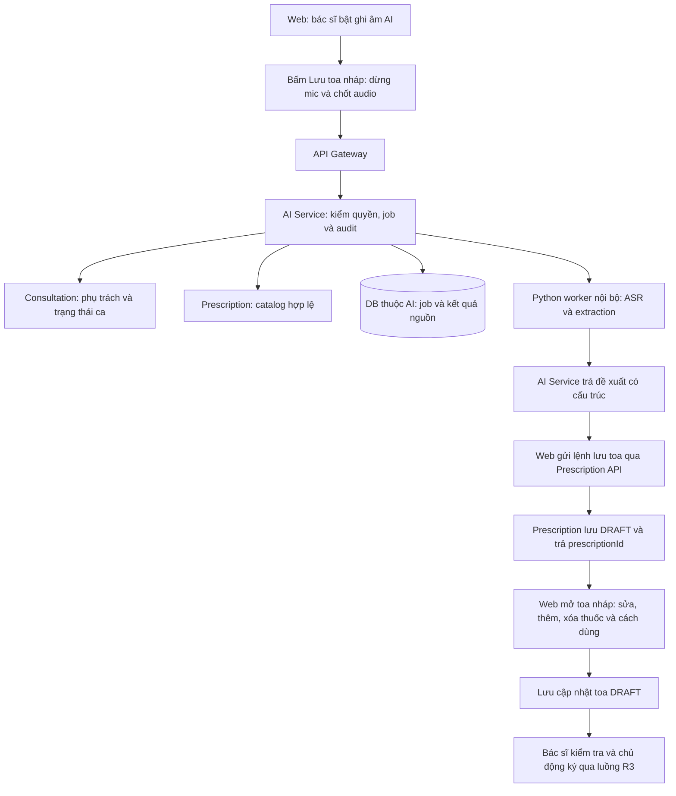

# Kế hoạch bàn giao Voice Prescription vào AI Service

**Cập nhật CURRENT21/10/2026:** đã triển khai tích hợp kỹ thuật R6 trên nhánh AI riêng. [Biên bản và giới hạn nghiệm thu](r6-acceptance-2026-10-21.md) thay thế trạng thái chưa tích hợp bên dưới; phần kế hoạch gốc giữ làm lịch sử thiết kế. Chưa nghiệm thu chất lượng lâm sàng/giọng bác sĩ độc lập.


Ngày20/10/2026. Trạng thái: **đề xuất tích hợp, chưa triển khai**. Phạm vi đã chốt theo yêu cầu: bác sĩ bật ghi âm AI trên web → bấm **Lưu toa nháp** → hệ thống dừng ghi âm, xử lý AI và lưu toa **DRAFT** → bác sĩ chỉnh sửa/thêm/xóa thành phần ngay trong toa nháp → lưu cập nhật → chủ động ký khi đã kiểm tra đầy đủ. Không có bước duyệt AI riêng bắt buộc trước khi lưu nháp. Đây là một năng lực của AI Clinical Assistant, không thay thế chatbot gợi ý phác đồ R6.

## 1. Hiện trạng đã đọc và giới hạn

Nguồn prototype trên máy: `/Users/dangkhoii/careflow-voice-prescription`. Tại lúc kiểm tra thư mục chưa có Git repository; không thể yêu cầu cherry-pick một commit chưa tồn tại. Bên bàn giao cần cung cấp bản export sạch hoặc đưa package đã tách vào nhánh feature của repo nhóm có thẩm quyền. Tài liệu này không khởi tạo repo, commit, push, tải model hoặc chuyển dữ liệu.

Nguồn CareFlow dùng đối chiếu: worktree `security-integration`, HEAD5a8c6e5 cộng thay đổi chưa commit R1–R3. Phải nhận cả baseline tích hợp được nhóm chốt; chỉ clone HEAD có thể thiếu API/quyền R3. Không sửa/đẩy main. Trước coding trên nhánh cá nhân cần cập nhật main, phân tích impact GitNexus, và kiểm tra phần tích hợp đang chưa commit để tránh ghi đè.

Các kết luận dựa trên source/tài liệu cục bộ đã đọc, chưa chạy lại model hoặc toàn bộ benchmark trong lần lập kế hoạch này:

- Prototype có `MLXASR`, rules/MLX extraction, bằng chứng trích đoạn, chuẩn hóa, matching catalog, sửa/hủy bằng xử lý lại toàn transcript, SQLite nháp/version/audit và UI localhost.
- Audio hiện xử lý sau khi dừng ghi, tối đa20MiB/180giây; chưa streaming/VAD/phân vai người nói. Source dùng ffmpeg chuẩn hóa mono16kHz. Không thiết kế lại thành nghe liên tục toàn cuộc khám ở lần tích hợp đầu.
- `Service.__init__` kéo theo `Store`, `TrainingLab`, tự chọn adapter qua `runtime/active-asr.json`; loader adapter trong `asr_lora.py` còn import digest từ `audio_factory`. Vì vậy không copy nguyên `service.py` hoặc cả thư mục để chạy production.
- UI prototype xác nhận bằng tên người duyệt tự nhập; ID nháp/host localhost không phải quyền bệnh án. Không mang cơ chế này thành API bệnh viện.
- AI Service Java hiện có `AiVoiceController`/`AiVoiceProcessingService` gọi ElevenLabs→Gemini, trả sinh hiệu/chẩn đoán, chưa có items thuốc. `AiAvailabilityFilter` chặn AI trong secure/prod cho tới khi có contract quyền. Không chỉ bật cờ demo hoặc bỏ filter để mở dùng dữ liệu thật. Log transcript hiện có trong đường voice cũ phải bỏ khỏi nhánh được phát hành.
- Catalog prototype là DAV snapshot; catalog kê toa của CareFlow là `drugs_dictionary` của Prescription. ID và tình trạng dữ liệu hai bên khác nhau; không tự nhập55005hồ sơ DAV thành thuốc active.
- `pipeline-metrics.json` tại `outputs/training/asr-round1-20261019-local/` ghi339mẫu TTS,313mẫu có thuốc. `positive_full_draft_exact=0/313` ở cả gold-transcript/rules, baseline-audio/rules và adapted-audio/rules. 26đơn rỗng khớp không chứng minh kê thuốc đạt. Đây là giới hạn của đúng bộ thử/schema/catalog này, không phải kết luận cho mọi trường hợp hoặc bằng chứng model an toàn.
- ASR fine-tune đã được thử trên dev tổng hợp; tài liệu ghi chưa có test giọng bác sĩ độc lập. Cải thiện WER không thay nghiệm thu đúng tên/hàm lượng/liều/số lượng/toàn đơn.

## 2. Kiến trúc đề xuất



### Luồng nghiệp vụ mục tiêu đã chốt

Đây là đặc tả cho chức năng sẽ triển khai, chưa phải hướng dẫn runtime đã phát hành.

1. Bác sĩ mở ca khám đủ quyền rồi bật **Ghi âm AI**. Web chỉ thu sau thao tác này và hiển thị trạng thái đang ghi.
2. Bấm **Lưu toa nháp** sẽ tự dừng mic, chốt audio và xử lý nhận dạng/trích xuất. Không buộc bác sĩ bấm Dừng rồi Duyệt AI/Đưa vào form ở các màn riêng trước khi lưu. Có thể giữ nút Dừng/Hủy để bác sĩ chủ động kết thúc hoặc bỏ lượt ghi.
3. Trong lúc xử lý, nút hiện **Đang xử lý và lưu nháp…** và chặn gửi lặp. Sau khi có dữ liệu đạt điều kiện lưu nháp, web gọi Prescription để tạo DRAFT, sau đó hiển thị toa đã lưu theo prescriptionId. Chỉ báo **Đã lưu toa nháp** khi Prescription xác nhận; job AI SUCCEEDED chưa đồng nghĩa toa đã lưu.
4. Toa DRAFT vẫn sửa được tên/mã thuốc qua catalog, thêm/xóa dòng, liều dùng, tần suất, thời điểm, số ngày, số lượng và lời dặn. Có thể chỉnh trước lần lưu đầu nếu cần khắc phục dữ liệu không hợp lệ, nhưng không bắt duyệt AI riêng với dữ liệu lưu được.
5. Bấm **Lưu cập nhật nháp** cập nhật đúng toa hiện có; tải lại vẫn giữ nội dung bác sĩ đã sửa. Không chạy lại AI hoặc tạo toa thứ hai chỉ vì lưu chỉnh sửa. Đọc thêm bằng giọng nói sau khi có nháp là phạm vi mở rộng; không tự thay toàn bộ toa đã chỉnh.
6. Các trường chưa nghe rõ giữ trống/cảnh báo trong editor theo contract DRAFT; không tự bù liều/số lượng. Nếu chưa có thuốc hợp lệ, tên thuốc mơ hồ hoặc dữ liệu vi phạm điều kiện lưu hiện có, giữ nội dung ở editor, chỉ rõ phần cần sửa và không báo đã lưu. Không tạo thuốc giả, tự chọn top1 hoặc lưu toa rỗng để làm luồng trông thành công.
7. Bác sĩ kiểm tra và sửa xong mới bấm **Ký & xác nhận đơn**. Kiểm tra đầy đủ theo điều kiện phát hành diễn ra tại bước này. Sau ký, giữ cơ chế khóa sửa/thay thế và audit của R3.

**Hai mốc khác nhau:** lưu DRAFT là thao tác lưu công việc còn chỉnh sửa; ký/phát hành mới chốt toa cho quy trình tiếp theo. DRAFT chưa được cấp phát hoặc hiển thị như toa đã phát hành cho bệnh nhân.


- **AI Service** là cửa vào nghiệp vụ suy luận duy nhất. Worker Python là thành phần triển khai nội bộ của cùng năng lực AI, không tạo service nghiệp vụ thứ13 hoặc gọi Prescription để ký. Worker không đọc DB bệnh án, không có token người dùng, không dùng chung SQLite prototype.
- Giữ Python cho model runtime; không viết lại MLX bằng Java hoặc chạy shell tạo process mới cho mỗi lượt. Worker thường trú, nạp model theo manifest cấu hình, có hàng chờ hữu hạn và giới hạn đồng thời. Serving adapter tách khỏi trainer/audio-factory.
- Giai đoạn đầu chạy worker MLX trên Mac Apple Silicon đã dùng thử. Artifact MLX này không được hứa chạy nguyên trạng trong image Linux/Eureka hiện tại. Nếu môi trường triển khai đòi Linux/CUDA, bên model phải cung cấp backend và benchmark riêng qua cùng contract trước bàn giao khả năng đó.
- Giữ chức năng chatbot/gợi ý phác đồ tách với nhập toa bằng giọng nói. Thêm feature flag riêng, mặc định tắt. Chỉ mở route voice đã có quyền/contract; các route AI cũ chưa đạt vẫn đóng.

## 3. Gói bên prototype cần bàn giao

Tên thư mục/package dưới đây là đích đề xuất. Không yêu cầu bên bàn giao copy cache/training vào repo CareFlow.

| Gói | Nguồn hiện tại | Phải chuẩn bị trước khi gửi |
|---|---|---|
| Core trích xuất | `models.py`, `text.py`, `extraction.py` | Module import độc lập, không mở DB/server/model khi import; field thiếu giữ null, có warnings/conflicts và evidence; test phủ định/tiền sử/sửa/hủy/mơ hồ. |
| Nhận dạng và provider | `providers.py`; phần serving trong `asr_lora.py` | Tách `MLXASR`, extractor và adapter loader khỏi training; digest dùng helper độc lập. Audio normalization/validate tách từ `Service.transcribe`; không phụ thuộc `TrainingLab`/`audio_factory`. |
| Matching | `catalog.py`, `aliases.py`, `phonetics.py` | Adapter nhận catalog/snapshot do CareFlow cấp; schema dữ liệu/alias có version/nguồn. Giữ spoken name, ứng viên và lý do; không đoán thuốc top1 khi mơ hồ. Mapping chính xác duy nhất đã được kiểm chứng có thể dùng để tạo DRAFT, không yêu cầu chọn lại từng thuốc trước lần lưu đầu. |
| Worker API | Contract mới trên core đã tách | API nội bộ có service auth, giới hạn input/time/queue, readiness thực sự, lỗi chuẩn, không public UI/CORS mở. Không bê gateway localhost và route training/dataset sang. |
| Model release | Base model, tokenizer và ASR adapter nếu chọn | Manifest modelID/revision, adapter/base compatibility, checksum, schema, dependency lock, license/điều kiện phân phối cần xác minh, cấu hình decode/context, máy thử và số liệu. File model dùng kho artifact/private volume, không Git thường. |
| Contract và SDK fixture | OpenAPI/JSON Schema + ví dụ JSON | Audio/text request, result, error, revision, evidence Unicode, field nullable. Fixture tổng hợp có expected output, không có tên/giọng/bệnh án người thật. |
| Test/benchmark | Tests core/audio/extraction/phonetic/conversation + runner đánh giá | Lệnh chạy tái lập; tách ASR, extraction, matching, end-to-end; giữ cả kết quả không đạt và phạm vi model/rules. Test giữ riêng không dùng làm prompt/context/huấn luyện. |
| Hướng dẫn bàn giao kỹ thuật | Manifest và contract | Danh sách file/dependency/runtime, cách build artifact, model acquisition/offline provisioning, cấu hình mẫu không secret, giới hạn hỗ trợ và migration adapter. Hướng dẫn thao tác bác sĩ sau tích hợp đặt duy nhất ở `huong-dan-su-dung/`. |

**Không đẩy nguyên:** `.venv/`, `.cache/`, `runtime/`, SQLite/log/PID, dataset private, thu âm người thật, model weights/cache lớn, toàn bộ `outputs/`, audio-factory/TTS/crawler/trainer/test-lab UI. Báo cáo cần thiết chỉ lấy bản đã lọc; fixture test/catalog nhỏ có nguồn rõ. Edge-TTS và việc sinh dataset ở lại môi trường nghiên cứu; serving không tự gửi audio/transcript đi TTS/ElevenLabs/Gemini hoặc provider ngoài khi local lỗi.

Package tối thiểu dự kiến:

```text
careflow-ai-service/
  src/...                           # Java: auth, API/job/result và clients
  inference/voice-prescription/
    pyproject.toml
    dependency lock
    src/careflow_voice_core/         # extraction, normalization, providers, matching
    src/careflow_voice_worker/       # serving nội bộ
    contracts/                      # schema và fixture tổng hợp
    tests/
    model-manifest.example.json     # không chứa đường dẫn cá nhân/secret
.planning/ai-service/
  voice-prescription-contract.md
  voice-prescription-evaluation.md
  ai-db.dbml                       # bổ sung cùng migration khi triển khai DB
```

Repo model có thể giữ riêng; chỉ đưa bản runtime được version hóa vào cấu trúc trên. Tránh tên package Python chung `careflow` gây đụng namespace khi cài vào môi trường khác. Phải kiểm tra cấu trúc sau tách bằng install từ artifact sạch, không dựa vào file còn sót trên máy tác giả.

## 4. Contract tích hợp cần chốt trước coding

### API public thuộc AI Service — đề xuất mới, chưa có sẵn

| Method/path | Chức năng và điều kiện |
|---|---|
| `POST /api/ai/voice-prescription/jobs` | Multipart `consultationId` + audio hoặc một kiểu JSON transcript được đặc tả riêng; `Idempotency-Key`; chỉ DOCTOR phụ trách ca đang cho phép kê toa. Trả202/jobId thay vì giữ browser chờ model180giây. |
| `GET /api/ai/voice-prescription/jobs/{id}` | Trạng thái QUEUED/RUNNING/SUCCEEDED/FAILED/CANCELLED/EXPIRED; khi xong trả transcript và draft có evidence/model/schema/catalog version. Kiểm quyền ở mỗi lần đọc, không chỉ lúc tạo. |
| `POST /api/ai/voice-prescription/jobs/{id}/revisions` | Sửa/đọc nối tiếp transcript với `expectedVersion`; xử lý lại toàn transcript trước khi lưu toa. Sau khi đã có DRAFT, sửa thành phần bằng Prescription API trên cùng toa; không tự tái áp dụng transcript vào toa đã chỉnh. Sửa toa đã ký vẫn theo quy trình toa hiện có. |
| `DELETE /api/ai/voice-prescription/jobs/{id}` | Hủy/dọn dữ liệu nháp theo retention. Không đồng nghĩa xóa toa đã lưu hoặc xóa audit được policy yêu cầu; phải đặc tả rõ. |

MVP nhận audio được chốt khi bấm **Lưu toa nháp**, hoặc sau khi bác sĩ chủ động dừng trước đó. Job trả kết quả có cấu trúc để tiếp tục lệnh lưu Prescription trong cùng thao tác UI, không yêu cầu review AI riêng. Có thể chỉnh transcript khi cần khắc phục nhận dạng trước khi lưu thành công. Không cung cấp URL tải audio bất kỳ cho worker để tránh lấy tài nguyên ngoài ý muốn. Audio/transcript là hai input rõ ràng, không nhập cả hai rồi âm thầm chọn. Upload lỗi không tạo nháp thành công giả.

Worker API nội bộ đề xuất `POST /internal/v1/voice/infer`, input binary/text cùng catalog snapshot/version đã được AI Service chuẩn bị. Worker trả kết quả suy luận, không trả quyền truy cập bệnh án. Các endpoint liveness/readiness tách riêng; readiness chỉ đạt khi model/artifact/ffmpeg và cấu hình cần thiết dùng được. Không đưa local filesystem path vào response public.

### Kết quả tối thiểu

`jobId`, `consultationId`, `version`, `schemaVersion`, `transcript`, `transcriptRevision`, `transcriptHash`, `items`, `warnings`, `modelInfo`, `catalogVersion`, thời gian xử lý/trạng thái.

Mỗi item giữ `spokenName`, `normalizedName` nếu có, `strength`, `dosageForm`, `quantity`, `quantityUnit`, `dose`, `frequency`, `route`, `duration`, `timing`, `minInterval`, `maxDailyDose`, candidate medicine codes, missing fields/conflicts và evidence riêng từng trường. Không giả lập xác suất đúng/confidence nếu model không cung cấp chỉ số đã hiệu chuẩn.

Evidence thống nhất **transcript NFC, offset Unicode code point, start inclusive/end exclusive**, kèm revision/hash. Python index và Java/JavaScript UTF-16 khác nhau: contract tests có ký tự ngoài BMP, web cắt bằng code point hoặc adapter đã kiểm chứng. Trích đoạn phải đúng nguyên văn của revision nguồn được áp dụng; sửa transcript làm evidence cũ vô hiệu. Bác sĩ sửa thành phần trong DRAFT phải được đánh dấu chỉnh tay, không gán evidence AI cũ thành bằng chứng của giá trị mới.

### Catalog và ánh xạ Prescription — chặn tích hợp sai dữ liệu

- AI chỉ gợi ý mã từ catalog kê toa thực tế của Prescription. DAV dùng tham chiếu/chuẩn hóa khi có mapping đã duyệt; `catalog_id` của prototype không tự trở thành `medicineCode`.
- Form dùng combobox tìm/chọn mã có thật. Khi lưu nháp/cập nhật/ký phải xác minh thuốc còn hợp lệ, không tin name/unit/id do model hoặc client tự khai. Không có mapping thì yêu cầu bác sĩ chọn hoặc dừng nhập dòng đó; không free-text tạo thuốc mới.
- Drug hiện có `code/name/unit/description/active`, chưa có strength/ingredient/dosageForm chuẩn riêng. Bên Prescription quyết định mở rộng master/schema hoặc phạm vi catalog được kiểm chứng; AI không tự suy từ description rồi gán thành dữ liệu chuẩn. Nếu thêm cột, migration/DBML thuộc Prescription trong PR riêng.
- `dose → dosage`, `frequency → frequency`, `timing → timing`; name/code/unit lấy từ catalog hợp lệ; trường hợp mơ hồ cần bác sĩ chọn trong editor. Không coi mapping kỹ thuật là xác nhận lâm sàng của bác sĩ. `duration` và `quantity` hiện nhận Integer, trong prototype duration là chuỗi và quantity có thể thập phân. Không ép kiểu/round: số ngày/số lượng chưa chuyển được chính xác phải yêu cầu bác sĩ nhập hợp lệ.
- `route`, `minInterval`, `maxDailyDose`, strength/dạng bào chế chưa có field tương ứng đầy đủ trong DTO toa. Giữ evidence và hiển thị để bác sĩ duyệt; chốt mapping/notes hoặc mở rộng contract trước triển khai, không lặng lẽ bỏ trường/nhét sai chỗ. Không tự tính liều tối đa hoặc suy thời gian điều trị từ số lượng.
- Lấy doctor/patient/consultation từ ca đã xác thực trên server; không từ transcript. Nút **Lưu toa nháp** điều phối dừng ghi âm → job AI → tạo DRAFT bằng Prescription API → mở editor của toa đã lưu. Không có bước bắt buộc **Đưa vào đơn nháp/Duyệt AI** trước đó. Lần lưu sau cập nhật đúng prescriptionId; ký là thao tác riêng. Lỗi AI không sửa/hủy/ghi đè toa có sẵn; không tự thay các thành phần bác sĩ đã chỉnh.

### Lưu nháp và cập nhật không tạo trùng

Chốt contract nguồn `sourceAiJobId/sourceAiRevision` hoặc cơ chế tương đương cùng Prescription để liên kết lần tạo và audit. Một kết quả job/revision chỉ tạo một DRAFT qua idempotency bền vững; mất phản hồi thì đối soát/toa đã tạo thay vì POST mới. Metadata nguồn do server kiểm chứng cùng ca/bác sĩ, không tin ID client tự khai. Đây là thay đổi cần bàn giao trong PR Prescription, không ghi xuyên DB từ AI.

Phân biệt điều kiện **lưu DRAFT** và **ký/phát hành**. Đặc tả rõ trường nào được để trống trong nháp, trường nào bắt buộc/hợp lệ ngay cả khi lưu nháp và cách highlight phần cần hoàn thiện. Không nới validation phát hành để phục vụ AI; cũng không ép hoàn chỉnh mọi trường điều trị trước khi bác sĩ có thể lưu nháp. Chỉnh sửa dùng prescriptionId/version hiện tại, bảo vệ khỏi ghi đè tab khác; nguồn AI không ghi đè giá trị thủ công sau refresh/retry.

## 5. Quyền, dữ liệu và vận hành cần có trong PR tích hợp

1. DOCTOR có phiên hợp lệ, đúng bác sĩ đang phụ trách và trạng thái ca cho phép kê toa. Quyền/check trạng thái kiểm lại lúc tạo/đọc/sửa job và khi lưu nháp, cập nhật hoặc ký toa. Chính sách MVP: job chỉ người tạo còn phụ trách được dùng; khi bàn giao, người cũ bị chặn, người mới tạo job riêng. Không ngầm chia sẻ audio/AI draft khi bàn giao; toa đã lưu vẫn theo quyền R3. USER-ID/role từ gateway/caller hợp lệ, không header tự khai.
2. Worker xác thực service caller, mạng nội bộ, không browser gọi trực tiếp; chỉ scope inference/health cần thiết. Không chuyển bearer người dùng, thông tin hồ sơ hoặc EMR đầy đủ nếu chỉ cần transcript và tên thuốc catalog.
3. AI Service giữ job/result version/audit bền vững bằng DB thuộc mình (hiện chưa có persistence kiểu này): tối thiểu `voice_prescription_jobs` và `voice_prescription_audit`, migration và DBML. Lưu actor từ phiên, timestamp, model/schema/catalog revision và request correlation; không dùng reviewer người dùng tự nhập. Chỉnh sửa toa sau lưu do Prescription giữ audit, phân biệt giá trị nguồn AI với giá trị bác sĩ đã sửa. Không log transcript/audio hoặc credential. Quyền đọc audit tách với quyền quản trị tài khoản thông thường.
4. Job bounded, một inference/model worker theo khả năng phần cứng đã đo, giới hạn theo bác sĩ/toàn hệ thống, TTL/deadline và429 khi quá tải. Có lease/idempotency/recovery để job không kẹt RUNNING sau restart; retry có giới hạn và không tự áp dụng kết quả hai lần. Đo p50/p95/RAM thực tế trước chốt timeout/concurrency; không hứa realtime.
5. Chốt retention trước nhận dữ liệu thật: audio private tạm trong thời gian job cần xử lý, xóa khi kết thúc/hủy/hết hạn và dọn rác sau crash. Transcript/result/audit có TTL và quyền riêng; hết hạn không trả dữ liệu. Không tự dùng lượt ghi âm cho train. Dữ liệu thật muốn làm dataset cần quy trình đồng ý riêng, không chỉ checkbox bắt đầu ghi âm.
6. Limit thống nhất gateway/Java/worker: không quá20MiB/180giây (có thể giảm sau đo), decode/format allowlist, ffmpeg deadline/resource limits, không URL/path người dùng. Model thiếu/checksum sai/OOM/quá tải phải có lỗi rõ503/429, không fallback mẫu hoặc provider ngoài.
7. Microphone web cần origin bảo mật trên máy bác sĩ; ghi âm phải có bắt đầu/dừng/hủy rõ và chỉ báo đang thu. Test codec thực trên trình duyệt dự kiến dùng, không giả mọi browser đều tạo WAV/webm. Không xin mic khi chưa thao tác, dừng track sau stop/unmount/logout/chuyển ca.

## 6. Thứ tự bàn giao và trách nhiệm

| Đợt/PR | Bên thực hiện | Đầu ra để bên tiếp theo nhận | Điều kiện đạt |
|---|---|---|---|
| VP0 — chốt contract và baseline | Bên model + AI + Prescription/Web | Schema request/result/error, mapping catalog/DTO, danh sách file/model và quality gaps; commit/artifact nguồn xác định | Hai bên dùng cùng fixture, chốt field không hỗ trợ và scope local; không gắn nhãn model sẵn sàng lâm sàng. |
| VP1 — tách runtime và sửa core | Bên đang làm voice prototype | Package core/worker độc lập, dependency lock, model manifest, fixture/test/evaluation report; clean export/PR riêng | Install từ artifact sạch, không TrainingLab/SQLite/TTS, chạy transcript/audio thật, không đoán sản phẩm mơ hồ/fill thiếu; cải thiện lỗi extraction được đo trên tập chốt. |
| VP2 — nối AI Service có quyền | Bên CareFlow AI/backend | Java jobs/result/audit, worker client/service auth, migrations/DBML, cấu hình local private, route feature flag riêng | Sai quyền/bàn giao/replay/restart/quá tải bị xử lý đúng; API hoạt động trong môi trường kiểm thử secure sau khi contract quyền đạt; route AI cũ vẫn giữ policy riêng. |
| VP3 — ghép web bác sĩ | Bên doctor-web + Prescription | Mic và nút Lưu toa nháp điều phối AI→Prescription; editor DRAFT sửa/thêm/xóa và lưu cập nhật cùng toa; ký riêng | Bấm lưu khi đang ghi tự dừng mic và tạo DRAFT khi dữ liệu hợp lệ; không bắt duyệt AI riêng. Chỉnh và reload giữ đúng toa; không tự ký/ghi đè; đổi ca/logout/handover không lộ/áp dụng kết quả cũ. |
| VP4 — nghiệm thu có giám sát | QA + bên model + người phụ trách chuyên môn | Báo cáo máy/browser/model/schema/catalog, test người thật độc lập có đồng ý và tiêu chí được chốt | Đánh giá riêng ASR/extraction/matching/toàn đơn và thời gian sửa; chỉ mở phạm vi dùng đã đạt. Nếu chưa đạt, giữ beta/transcript-edit hoặc tắt extraction; không coi có UI là đạt sản phẩm. |

Không cần chờ train lớn mới chốt VP0/API/UI khung; dùng fixture tổng hợp minh bạch cho contract tests. Model/extraction chưa qua gate thì chỉ nghiệm thu plumbing trên dữ liệu test. Chưa tự mở cho bệnh án thật. VP là nhánh năng lực voice bổ sung trong R6, không đánh dấu xong toàn bộ R6 hoặc trì hoãn R4/R5 đang độc lập.

Các PR backend AI, worker core và web tách rõ để review/cherry-pick. Cập nhật main trước coding trên nhánh service cá nhân, không push main. Những phần Prescription/Consultation chỉ sửa bằng PR đúng service, không chuyển ownership sang AI. Người thực hiện chạy impact trước sửa symbol và detect-changes trước commit theo quy tắc repo; không tự commit/push từ kế hoạch này.

## 7. Bộ nghiệm thu bắt buộc

- Bật ghi âm rồi bấm **Lưu toa nháp** khi mic còn chạy: mic dừng, tiến trình rõ, tạo một DRAFT và mở editor; không có màn duyệt AI bắt buộc. Sửa/thêm/xóa thuốc, liều/số lượng/lời dặn → lưu cập nhật → reload giữ cùng prescriptionId và đúng nội dung; chỉ ký sau thao tác riêng của bác sĩ.

- Đọc một thuốc/nhiều thuốc; số Việt/số thập phân; tên gần âm, sai hàm lượng, phối hợp hoạt chất và ngoài catalog. Không suy sản phẩm từ một thành phần.
- “Không kê”, tiền sử/tự thuật/giả định; sửa số lượng, hủy/đổi thuốc; lệnh không rõ mục tiêu khi nhiều dòng; câu đọc nối tiếp. Đổi thuốc không giữ liều cũ theo quán tính.
- Trường không nói giữ trống; xung đột hiển thị, evidence đúng substring/revision, không thực thi chỉ dẫn nhúng trong transcript. Không tự tính số ngày/liều từ dữ liệu khác.
- Người sai quyền, patientId giả, ID job tài khoản khác; ca hoàn tất/bàn giao trong lúc inference; revision cũ409; bấm lưu/retry hai lần; model lỗi/worker chết/job hết hạn/quá tải; restart còn xử lý được pending hoặc thất bại rõ.
- Web bật/tắt/hủy mic, deny permission, codec lỗi, audio trống/im lặng/dài/quá dung lượng, chuyển ca hoặc đăng xuất khi đang thu/chờ. Không tự ghi âm lại khi retry; không áp dụng kết quả muộn sang ca khác.
- Toa thật vẫn phải qua chọn mã, validation, DRAFT → bác sĩ ký theo R3, đúng tác giả/quyền và giữ lịch sử. Lưu DRAFT không đồng nghĩa xác nhận thuốc an toàn, ký/phát hành hoặc cấp phát.
- Báo cáo tên thuốc/hàm lượng/liều/số lượng/phủ định/sửa-hủy và full-draft match riêng, tách mẫu có thuốc với mẫu rỗng; công bố tử số/mẫu số và thời gian bác sĩ sửa. Ngưỡng phát hành do người phụ trách chuyên môn chốt trước dùng test cuối; không lấy WER hoặc test TTS làm ngưỡng lâm sàng thay thế.

## 8. Tin nhắn có thể chuyển nguyên cho bên voice

> Hãy chuẩn bị bàn giao lõi `careflow-voice-prescription` để tích hợp thành tính năng “Nhập đơn thuốc bằng giọng nói” trong `careflow-ai-service`. Trước mắt bàn giao package runtime/contract/test/model manifest; worker chỉ trả kết quả, việc tạo DRAFT do CareFlow thực hiện khi bác sĩ bấm Lưu toa nháp, và không tự ký/phát hành.
>
> Tách ASR, extraction, chuẩn hóa/evidence và matching khỏi SQLite, TrainingLab, UI localhost, trainer/TTS/crawler. Adapter loader không được phụ thuộc audio_factory. Cung cấp API inference nội bộ theo contract đã thống nhất; ghi rõ giới hạn20MiB/180giây, dependency lock, model/revision/checksum/điều kiện license, codec và máy chạy được. Không đưa dataset private, audio người thật, cache, runtime DB/log hoặc weights lớn vào Git.
>
> Catalog phải nhận bản do Prescription cung cấp và trả candidates với medicineCode hợp lệ; ID DAV không tự thành mã thuốc bệnh viện. Giữ trường thiếu/xung đột/evidence, không tự chọn top1 hoặc tính liều. Chốt mapping quantity/duration và các field CareFlow chưa hỗ trợ; không ép kiểu hoặc bỏ mất thông tin.
>
> Bàn giao kèm tests và đánh giá ba tầng ASR/extraction/matching cùng end-to-end. Giữ nguyên báo cáo hiện có, đặc biệt0/313mẫu có thuốc khớp toàn đơn ở bộ pipeline TTS hiện tại; đề xuất sửa extraction/catalog và tiêu chí đánh giá trước khi tuyên bố sẵn sàng. Không quảng bá điểm dev TTS thành độ chính xác với bác sĩ thật.
>
> Luồng UI đã chốt: bác sĩ bật ghi âm AI trên web → bấm Lưu toa nháp (tự dừng ghi âm, xử lý AI, lưu DRAFT qua Prescription) → sửa/thêm/xóa thuốc và cách dùng trong chính toa nháp → lưu cập nhật → ký riêng khi đã kiểm tra. Không yêu cầu duyệt AI/Đưa vào đơn nháp riêng trước lần lưu đầu; lưu sửa không chạy lại AI hoặc sinh toa mới. Job AI xong chưa được báo đã lưu nếu Prescription chưa xác nhận.
>
> Phần quyền ca khám, job/audit bền vững, Gateway và ghép form lưu/ký toa do bên CareFlow nhận tiếp. Làm trên nhánh feature đúng service, PR có file list/contract/test/giới hạn rõ; không push main. Trước coding đọc đầy đủ kế hoạch `.planning/ai-service/voice-prescription-integration-plan-2026-10-20.md`.
