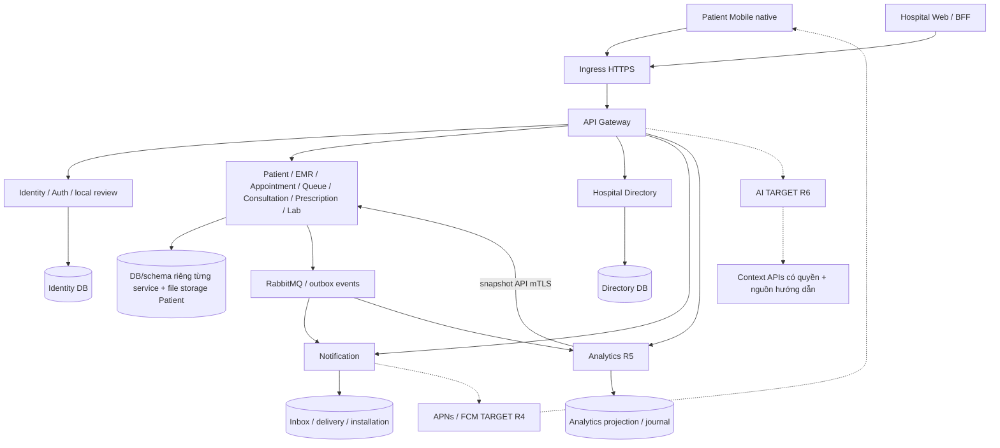

# Kiến trúc Microservices — R0-1.0

**CURRENT21/10/2026 — R7:** đủ12service yêu cầu cùng Directory hỗ trợ đã build/khởi động trên stack test; manifest ghi hash artifact, Gateway trả503 cho lỗi kết nối upstream. Eureka chỉ build, runtime Mac dùng discovery tĩnh. [Biên bản R7](../deployment/r7-acceptance-2026-10-21.md) phân biệt triển khai kỹ thuật với nghiệm thu đầy đủ còn OPEN.

**CURRENT21/10/2026 — R6:** AI đã có tra cứu nguồn local có duyệt, lịch sử mã hóa theo ca và luồng voice → Prescription DRAFT → chỉnh → ký riêng. Xem [biên bản R6](../ai-service/r6-acceptance-2026-10-21.md). Nội dung TARGET AI của baseline bên dưới không còn mô tả đầy đủ trạng thái kỹ thuật hiện tại; chuyên môn vẫn chưa nghiệm thu.

Cập nhật Analytics R5 ngày21/10/2026; các dòng chưa có cập nhật riêng giữ phạm vi baseline R0. Xem [biên bản R5](../analytics-service/r5-acceptance-2026-10-21.md).

## 1. Service và nguồn dữ liệu có thẩm quyền

| Service | Sở hữu | Gọi đồng bộ / sự kiện chính | Hiện trạng và đợt còn mở |
|---|---|---|---|
| API Gateway | Ingress/routing, xác thực boundary | Identity session/proof, downstream HTTPS | Có; deployment staging R7 |
| Identity & eKYC | User, credential/session/revocation, email challenge, đối chiếu giấy tờ | Email outbox/provider; API quyền/session | Có auth/đối chiếu thủ công; quản trị thật/nghiệm thu R1; chưa eKYC tự động |
| Patient | Hồ sơ, quan hệ chủ hồ sơ, tệp/health record, tiếp nhận | Kiểm tra phân công qua contract đã bảo vệ | Có; web đọc file và claim/đại diện R2–R3 |
| EMR | Master metadata và tổng hợp bệnh án có quyền | Patient/Consultation/Prescription/Lab queries | Có; tích hợp file upload R3; không sở hữu bản sao mọi dữ liệu nguồn |
| Appointment | Lịch hẹn/cancel/follow-up, giá/phân công snapshot; TARGET lịch/slot/capacity | Directory/Patient; AppointmentConfirmed/Cancelled/FollowUpScheduled | Có booking; lịch quản trị và phân nhiều phòng R2, follow-up R3 |
| Queue | Số/entry/check-in, policy, scheduler, chuyển trạng thái/audit | Appointment query/event; gọi/near-turn/start/complete/missed/requeue; Lab/Prescription events | Có; web walk-in/requeue và multiple-room config R2 |
| Analytics | Projection/journal/receipt/checkpoint và KPI riêng | Events là tín hiệu; API snapshot tối thiểu qua mTLS từ ba nguồn | R5 chạy/đối soát/API ADMIN/browser đạt trên Mac; chưa production/tải lớn |
| Doctor Consultation | Ca khám, triệu chứng/sinh hiệu/chẩn đoán, bàn giao | Queue/Directory/Appointment/Lab; sự kiện hoàn tất | Có; context walk-in và native E2E R2–R3 |
| Prescription | Toa/dòng thuốc, catalog thuốc, ký/sửa đổi/cấp phát | Patient/Consultation/Queue/Appointment; PrescriptionIssued | Có; tái khám từ toa R3 |
| Laboratory Order | Catalog CLS/order/result/finalize/review | Consultation/Queue; order-ready/results-available | Có nhánh CBC; nghiệm thu native/ngoại lệ R3 |
| Notification | Inbox/read state, installation/token, delivery/outbox/retry | Consume domain events; WebSocket/push | Có infrastructure; native realtime/push R4 |
| AI Clinical Assistant | TARGET tương tác/lưu vết/nguồn được quản lý | Context có quyền từ Consultation/EMR, model đã chọn | Có prototype/provider/mock fallback; R6 chưa nghiệm thu |
| Hospital Directory (bổ sung) | Khoa/phòng/bác sĩ, phân công, catalog/giá hiệu lực | API master cho booking/queue/quản trị | Có; không sở hữu appointment hoặc tự tạo ca khám |
| Eureka (hạ tầng) | Discovery nếu deployment bật | Đăng ký/tìm instance | Không bắt buộc cho runtime audit đang dùng URL riêng; không đếm vào12service |

Common là thư viện security/event/envelope. Mỗi service sở hữu DB/schema của mình; liên kết xuyên service là ID/contract, không tạo FK xuyên DB hoặc đọc trực tiếp bảng của service khác. Một PostgreSQL host có thể chứa nhiều DB; điều này không biến các service thành chủ sở hữu chung.

## 2. Sơ đồ logic

Nét đứt là phần mục tiêu chưa nghiệm thu hoặc luồng bổ sung. Mũi tên nhóm REST không có nghĩa mọi role được gọi mọi service.

Các REST dependency cụ thể tuân thủ bảng ownership và contract; không dùng sơ đồ nhóm để mở quyền truy cập chung. Broker áp dụng at-least-once; consumer phải chống trùng, không giả định exactly-once toàn hệ thống.

## 3. Trust boundary và phân quyền

- Native gọi ingress HTTPS bằng phiên và proof theo contract hiện hành; web dùng BFF/cookie bảo vệ session, không lưu token dài hạn vào localStorage.
- Gateway loại bỏ identity header giả, downstream vẫn kiểm tra token/session/caller scope và quyền tài nguyên. Header user không phải credential.
- Service-to-service dùng HTTPS/mTLS/caller credential có scope, chuyển tiếp actor qua contract được bảo vệ. Không tái sử dụng proof dành cho URL gốc ở URL downstream.
- Role là điều kiện cần; quyền theo chủ hồ sơ/phân công phòng/ca là điều kiện bổ sung. Quyền bị thu hồi phải có hiệu lực trong phiên, không chỉ ẩn nút.
- STAFF chỉ đọc demographic/operational view tối thiểu theo phân công; không mở toàn EMR để tìm bệnh nhân tiếp nhận. ADMIN quản trị không ký quyết định chuyên môn thay bác sĩ.
- Chỉ lưu/hiển thị dữ liệu cần cho mục đích; file có quyền không mở bằng URL chứa token. Analytics không lưu nội dung bệnh án trong projection/journal và không trả ra báo cáo; push không đưa chi tiết nhạy cảm ra màn khóa.
- OCR/QR local không xác thực chủ sở hữu bệnh án. Không có VNPT trong kiến trúc hiện hành; model/provider AI là quyết định R6, không ngầm gửi dữ liệu thật.

## 4. Deployment hiện hành và mục tiêu

| Thành phần | CURRENT audit Mac | TARGET staging/release |
|---|---|---|
| DB | Container riêng loopback15432; không dùng remote dùng chung trong R0 | Endpoint/network/role DB được quản lý; migration và backup/restore có kiểm chứng |
| Backend | JAR riêng với port18080–18092, HTTPS/mTLS; runtime lấy trong evidence | Artifact có version/digest, network riêng, readiness theo request nghiệp vụ |
| Mobile ingress | Bridge HTTPS18443 phụ thuộc Mac/mạng local và CA test | Domain HTTPS ổn định; chuỗi chứng chỉ và đường kết nối được nghiệm thu |
| Web | Dev server5173; build production kiểm tra riêng | Release web/BFF đồng bộ, cookie/origin/passkey RP hợp lệ |
| Push | App16 thiếu aps-environment; Firebase config chưa có | Provisioning/entitlement và config private hợp lệ; giao thông báo trên máy thật |
| Analytics/AI | Analytics R5 có module/runtime và kiểm chứng Mac; AI chưa nghiệm thu | Production/load R7 cho Analytics; AI R6 |

Không khởi động lại ứng dụng, sửa DNS, đổi secret hoặc áp migration production trong R0. Danh sách endpoint cụ thể và health được lưu dưới dạng metadata đã loại secret trong evidence.

## 5. Quyết định kiến trúc cho đợt sau

- Appointment sở hữu lịch/slot/capacity, Directory sở hữu master/phân công; API tham chiếu ID có kiểm tra tồn tại. Queue không tự phân phòng cho appointment đã xác nhận.
- Queue config hiện gắn unique department là giới hạn CURRENT; R2 chuyển đơn vị cấu hình/scheduler sang phòng/phiên khi hỗ trợ nhiều phòng. Không chỉ xóa kiểm tra một phòng mà giữ nguyên uniqueness cũ.
- Walk-in dùng queueEntryId làm ngữ cảnh khám, appointmentId nullable. Chi tiết tương thích nằm trong contract, không dùng UUID phiếu làm ID lịch hẹn giả.
- Tái khám là command riêng có idempotency/trạng thái retry; ký toa và tạo appointment ở hai DB không phải một transaction phân tán tự động.
- Analytics chỉ đọc projection; AI chỉ gợi ý. Các command lâm sàng vẫn do service sở hữu và bác sĩ xác nhận.
