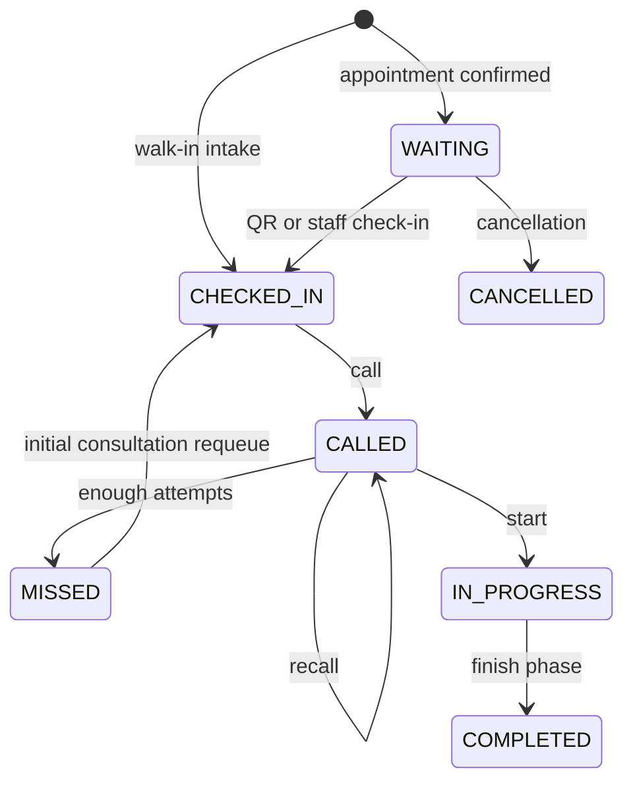
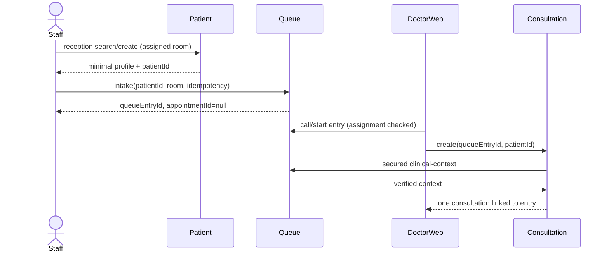

# Contract tích hợp và trạng thái — R0-1.0

**CURRENT** mô tả source baseline có hash trong evidence. **TARGET** là contract để triển khai ở R1–R6, chưa phải API hiện hành. Các ví dụ là dữ liệu tổng hợp, không dùng người thật. Không có migration hay endpoint mới được triển khai trong R0.

## 1. Định danh và tương thích

| Trường | Ý nghĩa và quy tắc |
|---|---|
| userId | Identity principal; không suy từ patientId hoặc doctorProfileId; lấy actor từ phiên đã xác thực |
| patientId | Hồ sơ Patient; có thể chưa liên kết user khi tiếp nhận walk-in |
| appointmentId | Lịch thật trong Appointment; TARGET nullable cho walk-in, không dùng UUID entry làm lịch giả |
| queueEntryId / ticketId | Queue entry cụ thể; phiếu ban đầu hiện là DTO dựng từ entry, không suy ra có bảng visit_tickets độc lập |
| consultationId | Ca lâm sàng; lượt RESULT_REVIEW giữ ca cũ; lần tái khám sau có ca mới |
| visit | Khái niệm hành trình, không phải một service/bảng mới được tự thêm trong R0; correlate bằng các ID trên và origin APPOINTMENT/WALK_IN |
| roomId / doctorUserId | Tham chiếu Directory; phân công do server xác minh; không tin nhãn/phòng/doctor do client tự khai |
| sourceConsultationId | Liên kết lịch tái khám với ca nguồn; không tự chuyển quyền của bác sĩ cũ sang ca mới |

CURRENT: ManualIntake tạo QueueEntry với appointmentId=null; CreateConsultationRequest lại bắt buộc appointmentId và requireStartedQueueContext truy ticket theo appointment trước khi tới nhánh catch appointment404. Vì vậy, nhánh catch này **không đủ chứng minh** walk-in đi đến khám được. R2 phải bổ sung context theo queueEntryId, kiểm tra lại phân quyền Patient/EMR cho ca không có lịch, rồi nghiệm thu. Không chỉ nối thêm nút web.

CURRENT QueueConfig unique department và consumer kiểm tra phòng theo config khoa. TARGET nhiều phòng cần chuyển config/lock/sequence/scheduler sang khóa phù hợp room/date/session, migration bảo toàn lịch sử và các command cũ. Không xóa validation một-phòng trước khi thay ràng buộc này.

## 2. Quy ước HTTP/quyền/idempotency

- Giữ envelope Common; create201, query/action200; validation400/422 theo contract từng API, chưa xác thực401, sai quyền403, không tồn tại404, conflict/state/capacity409, dependency chưa xác minh503. Không đổi toàn bộ mã cũ chỉ vì chuẩn hóa tài liệu.
- Mutating command có nguy cơ gửi lại nhận Idempotency-Key; phạm vi gồm actor + command + resource; fingerprint là trường nghiệp vụ chuẩn hóa. Cùng key/nội dung trả cùng kết quả, khác nội dung409; ghi record và nghiệp vụ trong transaction sở hữu.
- Nếu mất phản hồi, client đọc lại/retry cùng key. Correlation ID phục vụ truy vết, không thay key chống trùng hoặc credential.
- TARGET thêm version cho cấu hình lịch; cập nhật expectedVersion không khớp409. API không tin giá/số tiền/quyền do client gửi.
- Caller sai assignment phải bị chặn ở server. Lỗi Directory/Identity/assignment không mở quyền bằng fallback.

## 3. Lịch/slot và phân công — TARGET R2

Appointment sở hữu schedule; Directory chỉ cung cấp master/phân công đang hoạt động. Đề xuất API bổ sung, chưa có ở CURRENT:

| Method/path TARGET | Quyền | Contract |
|---|---|---|
| GET `/api/appointments/schedules/rooms/{roomId}` | ADMIN | Lịch có version, hiệu lực, ngày/ngoại lệ và windows/capacity |
| PUT `/api/appointments/schedules/rooms/{roomId}` | ADMIN | expectedVersion + cấu hình; kiểm tra phòng/bác sĩ hợp lệ, thời gian không chồng và capacity dương |
| GET `/api/appointments/time-slots/availability` | Quyền hiện hành của booking | Giữ contract cũ, bổ sung dữ liệu theo lịch/phòng khi cần; mobile không tính capacity riêng |

Ví dụ body cấu hình TARGET:

```json
{
  "expectedVersion": 0,
  "effectiveFrom": "2026-11-01",
  "timeZone": "Asia/Ho_Chi_Minh",
  "weekdays": [1, 2, 3, 4, 5],
  "windows": [{"start": "08:00", "end": "11:00", "slotMinutes": 30, "capacity": 5}],
  "exceptions": [{"date": "2026-11-02", "closed": true}]
}
```

Weekdays theo ISO1=Monday..7=Sunday. Nguồn bác sĩ là phân công Directory đã được xác minh; không tạo danh sách nhân sự tự do trong payload lịch. Nếu cần phân công thay đổi theo ngày, R2 mở contract Directory có version trước khi consumer dùng, không dựng lịch bác sĩ khác với nguồn đó.

Khoa có nhiều phòng: server lọc phòng hoạt động, có phân công và lịch hợp lệ, còn chỗ; dùng thứ tự ổn định theo số chỗ còn rồi roomId. Kiểm tra lại trong transaction/lock khi giữ chỗ, retry ứng viên còn chỗ nếu có race. Không cho client chọn phòng không tồn tại; không sửa snapshot của booking đã xác nhận khi Directory thay đổi.

Thay lịch có booking: không tự hủy/chuyển; trả conflict khi cấu hình làm mất tính hợp lệ, hoặc lưu thay đổi tương lai không tác động booking cũ. Quy trình chuyển lịch có chủ đích phải là command riêng và thông báo sau này. CURRENT vẫn dùng DEFAULT_TIME_SLOTS/capacity env và một phòng active/khoa; UI schedule chưa lưu thật.

## 4. Tiếp nhận/walk-in — CURRENT và TARGET R2

CURRENT có POST `/api/patients/reception` và POST `/api/queues/entries`. Intake nhận patientId, userId optional, departmentId, priorityLevel; STAFF chỉ WALK_IN, ADMIN theo quyền hiện hành. Server xác minh owner, active room và phân công.

TARGET bổ sung:

| API | Actor / phạm vi | Kết quả |
|---|---|---|
| GET `/api/patients/reception/search?roomId=&query=` | STAFF đúng phòng/ADMIN; query có giới hạn, rate limit/audit | Tối đa20 demographic tối thiểu; không trả toàn EMR/CCCD đầy đủ, không tìm rộng không điều kiện |
| POST `/api/queues/entries` (giữ endpoint) | Actor xác minh, master hợp lệ, Idempotency-Key | Entry với appointmentId=null; nếu thêm roomId thì server kiểm tra department/room/config cùng ngữ cảnh |
| GET `/api/queues/entries/{entryId}/clinical-context` | DOCTOR đúng ca/phòng và service caller đúng scope | entryId/patientId/appointmentId nullable/roomId/phase/status/owner reference tối thiểu |
| POST `/api/consultations` (mở rộng tương thích) | DOCTOR có quyền; TARGET bắt buộc queueEntryId | Tạo/tìm lại ca từ entry đã gọi; appointmentId bắt buộc chỉ khi origin APPOINTMENT |

Không thay request của caller hiện có trước khi provider context mới và validation tương thích được triển khai. Có appointmentId thì phải khớp entry và Appointment; không có thì dùng quyền từ Queue/Directory, không bỏ qua kiểm tra chỉ vì Appointment404. Phân quyền read Patient/EMR cho walk-in phải xác minh consultation/queue thực, không mở role DOCTOR toàn bộ hồ sơ.

Hồ sơ chưa có user vẫn được khám; không ép tạo tài khoản hoặc email giả. Thông báo mobile chỉ gửi khi có owner/installation hợp lệ, không đoán người nhận theo tên/CCCD. Liên kết hồ sơ vào tài khoản là use case xác minh riêng.

## 5. Recall/missed/requeue — contract wire hiện hành

Các route hiện có: POST `/api/queues/entries/{entryId}/recall`, `/miss`, `/requeue`. Body requeue đúng CURRENT:

```json
{"position": "BACK"}
```

FRONT/BACK áp dụng khi REQUIRE_MANUAL. REQUEUE_BACK/REQUEUE_FRONT do config quyết định; RESULT_REVIEW luôn về cuối lane. CURRENT client web gửi `{reason}`, không có caller UI; R2 sửa caller và body, không tự thêm trường reason vào DTO chưa có.

Chỉ CALLED và đủ MAX_CALL_ATTEMPTS theo source mới MISSED. Requeue chỉ nhận MISSED, reset calledAt/calledBy/callAttempts/near-turn flag. Initial consultation trở về CHECKED_IN, các chặng khác QUEUED. FRONT là đầu lane đủ điều kiện, không vượt mọi lane hoặc thay chính sách chuyên môn. Chính sách/actor/audit phải giữ khi hai client cạnh tranh.

API queue config CURRENT GET/PUT `/api/queues/configs/{departmentId}`; TARGET cấu hình theo phòng cần versioned endpoint mới hoặc adapter tương thích, không đổi ý nghĩa departmentId thành roomId trong cùng path mà không migration.

## 6. Tái khám — CURRENT và TARGET R3

CURRENT POST `/api/appointments/follow-ups` nhận patientId/consultationId/recommendedDate và tùy chọn department/timeSlot/note. Prescription AppointmentClient đang gửi khoa NOI_TONG_QUAT và09:00-09:30 cố định. R3 giữ endpoint, sửa nguồn context và UI chọn slot thật.

TARGET request giữ các trường này; serviceCode/priceVersion chỉ dùng khi contract báo giá yêu cầu, server lấy danh mục được phép cho ca/tái khám chứ không nhận số tiền từ client. Không mặc định khoa/slot nếu không tìm được ngữ cảnh. Bác sĩ hiện phụ trách phải được xác minh lại; ngày/slot/phòng/bác sĩ hoạt động và còn capacity.

Idempotency-Key gắn ca nguồn + yêu cầu tái khám, không chỉ tên bệnh nhân. Trả lịch đã tạo khi retry cùng yêu cầu,409 khi khác nội dung cùng key. Không mất trạng thái toa đã ký vì lỗi gọi Appointment: công việc tạo lịch phải có trạng thái bền vững PENDING/CREATED/FAILED_RETRYABLE theo contract sẽ triển khai R3, và UI hiển thị rõ từng kết quả. Các trạng thái này là TARGET cho tác vụ tái khám, không phải giá trị AppointmentStatus hiện hành.

## 7. Event contract cho Notification/Analytics

CURRENT EventEnvelope có eventId,eventType,eventVersion,aggregateId,aggregateVersion,occurredAt,producer,correlationId,payload. Không tự đổi schemaVersion hoặc field names vì tài liệu cũ dùng tên khác.

| Producer / event | Consumer | Lưu ý CURRENT → TARGET |
|---|---|---|
| AppointmentConfirmed / AppointmentCancelled | Queue, Notification; Analytics R5 | AppointmentEventService hiện ghi aggregateVersion=1 cho mọi event; không dùng nó như sequence đã bảo đảm |
| FollowUpScheduled | Notification; Analytics R5 | Payload lịch/consultation link; event tạo lịch khác reminder đến hạn |
| VisitTicketIssued / PatientCheckedIn / PatientCalled / QueueNearTurn | Notification; Analytics R5 | Queue payload có entryId/appointmentId nullable/patientId/recipientUserId/room và phase; không gửi cho user=null |
| QueueEntryMissed / QueueEntryRequeued / QueueEntryStarted / QueueEntryCompleted | Consumer tương ứng; Analytics R5 | Một lần missed/requeue không phải visit mới; giữ ID entry và lần chuyển trạng thái |
| LabOrderReadyForExecution / AllRequiredResultsAvailable | Queue/Consultation và Notification theo binding hiện hành | Giữ cùng consultation, dedup event/order; không suy mọi event tên trong tài liệu cũ đã có producer |
| PrescriptionIssued | Queue/Notification theo binding | Chỉ từ toa hợp lệ; không tạo hai lượt cấp phát do retry |

TARGET trước R5: inventory producer/binding thực, chuẩn hóa timestamp nghiệp vụ theo UTC, thêm businessDate/timeZone/phase/cycle khi KPI cần và chưa có; version payload khi thay meaning. Mỗi producer cung cấp monotonic aggregateVersion thật hoặc cơ chế phát lại snapshot/version được chứng minh. Consumer dedup theo producer+eventId; giữ event sớm hơn cho audit, không cho state cũ ghi đè projection mới; phát hiện gap và reconcile qua API/export có quyền. Không sort toàn hệ thống chỉ bằng occurredAt.

Outbox nằm cùng transaction nghiệp vụ tại nơi đã hỗ trợ; các producer còn publish trực tiếp phải được kiểm kê và sửa trước cam kết delivery bền vững. Retry/backoff/DLQ có giới hạn và replay có audit. Không khẳng định exactly-once hoặc coverage mọi producer chỉ vì Common có EventEnvelope.

Analytics R5 dùng [contract KPI R5_V1](../analytics-service/r5-contract-2026-10-21.md) thay phần công thức TARGET trước đây: cohort ngày lịch/INITIAL visit, `from/to` là LocalDate gồm hai đầu theo Việt Nam; mẫu chờ cuối cùng sau requeue, hoàn tất gộp theo lượt ban đầu; số lượt từng lỡ và tổng lần lỡ tách riêng. Không cung cấp no-show rate hoặc missed rate khi chưa có mẫu số được chốt. Snapshot tối thiểu do nguồn sở hữu; sự kiện chỉ kích hoạt đọc trạng thái mới nhất, dedup theo eventId hoặc messageId ổn định của Consultation outbox. Nội dung clinical trong event gốc không được sao chép vào Analytics journal. Queue bị xóa trước quan sát là giới hạn coverage rõ ràng. API CURRENT: `GET /api/analytics/report`, `POST /api/analytics/reconcile`, `POST /api/analytics/rebuild` chỉ ADMIN; export nội bộ yêu cầu certificate CN Analytics và key riêng.

## 8. State hiện hành và wire mapping



Đây là initial queue; DTO phiếu ánh xạ WAITING thành TICKET_ISSUED. TICKET_ISSUED không phải enum QueueStatus Java hiện hành; NO_SHOW cũng chưa có trong enum này. Với LAB_EXECUTION/RESULT_REVIEW/PHARMACY_DISPENSING, điểm chờ/requeue là QUEUED. Không tự thêm enum/SQL trong R0 để làm tài liệu cũ đúng.

ConsultationStatus CURRENT: IN_PROGRESS,AWAITING_CLS,AWAITING_REVIEW,READY_TO_COMPLETE,COMPLETED,CANCELLED,TRANSFERRED. Tài liệu cũ nói WAITING_FOR_REVIEW phải đọc theo mapping AWAITING_REVIEW; các command cụ thể vẫn phải kiểm tra source, không dùng enum liệt kê như bằng chứng mọi transition được mở.

AppointmentStatus CURRENT: PENDING,CONFIRMED,CHECKED_IN,IN_PROGRESS,COMPLETED,CANCELLED. Dữ liệu đã hoàn tất chỉ đọc theo quyền, không quay về nháp để chạy lại demo.

## 9. Sequence mục tiêu



```mermaid
sequenceDiagram
  actor Doctor
  participant Prescription
  participant FollowupTask
  participant Appointment
  participant Broker
  participant Notification
  actor Mobile
  Doctor->>Prescription: confirm prescription
  Prescription-->>Doctor: signed result
  Doctor->>FollowupTask: request valid date/slot, idempotency
  FollowupTask->>Appointment: create follow-up with verified context
  alt slot available
    Appointment->>Broker: FollowUpScheduled via outbox
    Appointment-->>FollowupTask: appointmentId
    FollowupTask-->>Doctor: CREATED
    Broker->>Notification: deduplicated event
    Notification-->>Mobile: inbox/push when configured
    Mobile->>Appointment: authorized GET
  else unavailable or full
    Appointment-->>FollowupTask: conflict/dependency error
    FollowupTask-->>Doctor: explicit pending/failure; preserve signed prescription
  end
```

FollowupTask là trách nhiệm application/outbox trong service được chọn ở R3, không mặc nhiên là microservice thứ13. Sequence thể hiện ranh giới kết quả/transaction, không yêu cầu dựng thêm tầng nếu implementation đơn giản vẫn giữ đủ bảo đảm.

## 10. Thứ tự migration và contract gate

Provider context mới + quyền → consumer tương thích → chuyển UI → theo dõi caller cũ → ngừng đường cũ có version. Room config cần backfill từ config khoa và bảo toàn sequence lịch sử trước mở nhiều phòng. Event mới phải được consumer chấp nhận trước producer chuyển version.

Mỗi đổi JPA/Flyway cập nhật DBML đúng service. Queue DBML hiện có mô hình thiết kế cũ visit_tickets/enum không khớp hoàn toàn entity; R0 ghi debt này, source/entity/migration là CURRENT. R2 phải đồng bộ DBML khi thực hiện migration, không coi sơ đồ DBML cũ là lệnh tạo bảng trên môi trường đang chạy.
