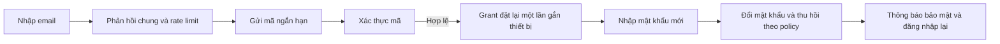

# CareFlow — Báo cáo đánh giá bảo mật và điều kiện đưa lên production

> Đây là mốc đánh giá trước sửa. Xem [kết quả khắc phục 19/10/2026](bao-cao-khac-phuc-bao-mat-2026-10-19.md) để biết trạng thái source mới và các phần còn chưa triển khai.

**Thời gian đánh giá:** 18–19/10/2026, Asia/Ho_Chi_Minh.  
**Phạm vi thay đổi của đợt này:** chỉ kiểm tra và lập báo cáo; không sửa chức năng, không nâng dependency, không commit/push, không gửi email thử hoặc khai thác phá hoại.  
**Đối tượng:** mobile Flutter chạy trên điện thoại thật, web nhân viên/bác sĩ, Identity, Gateway, Common, các service nghiệp vụ, AI và cấu hình vận hành.

## 1. Kết luận dành cho chủ sản phẩm

**Chưa nên mở hệ thống hiện tại cho người dùng thật và dữ liệu sức khỏe thật trên Internet.** Nền tảng xác thực đã có nhiều thành phần tốt: JWT bất đối xứng, ràng buộc thiết bị bằng DPoP, kiểm tra phiên tại backend, kiểm soát quyền ở nhiều luồng khám và luồng quên mật khẩu hai bước. Tuy nhiên, vẫn còn đường đăng nhập yếu hơn các cơ chế đó, quyền sửa hồ sơ quá rộng, dependency có advisory và pipeline chưa bảo đảm triển khai đúng cấu hình bảo mật.

Các việc phải xử lý trước tiên:

1. Bỏ đăng nhập bằng câu hỏi bí mật; yêu cầu xác thực mạnh cho nhân viên, bác sĩ và quản trị viên.
2. Khi khôi phục tài khoản, xử lý toàn bộ phương thức đăng nhập đã đăng ký, không chỉ mật khẩu và phiên hiện tại.
3. Sửa quyền cập nhật hồ sơ: STAFF phải có phân công hợp lệ và chỉ được sửa/nhận các trường cần cho tiếp nhận.
4. Vá dependency và chốt một quy trình build/deploy dùng cấu hình bảo mật đã kiểm thử.
5. Xoay API key Resend đã xuất hiện trong hội thoại; giữ AI và eKYC giả lập ngoài luồng production cho đến khi đủ điều kiện.

**Face ID/Touch ID vẫn nên giữ** vì thuận tiện. Đăng xuất phiên hiện tại và xóa quyền đăng nhập sinh trắc học của thiết bị là hai thao tác khác nhau. Cách tách chúng đang đi đúng hướng; cần bổ sung quản lý thiết bị, khôi phục tài khoản và kiểm thử trên thiết bị thật.

Đây là đánh giá mã nguồn, cấu hình, dependency và kiểm thử có giới hạn, **không phải chứng nhận an toàn, chứng nhận tuân thủ hay pentest đầy đủ hệ thống production**. Các vấn đề dưới đây chưa được sửa trong đợt kiểm tra này.

## 2. Phiên bản và cách đọc bằng chứng

Không coi toàn bộ thư mục hiện tại là một release đồng nhất. Các luồng mới nằm ở nhiều worktree và còn thay đổi chưa commit.

| Ký hiệu | Thư mục gốc bằng chứng | Nhánh / HEAD tại thời điểm kiểm tra | Phạm vi |
|---|---|---|---|
| R | `/Users/dangkhoii/careflow` | `develop`, `e5fc9c1` + thay đổi local | Repository gốc, web và tài liệu |
| I | `.worktrees/identity-email-recovery` dưới R | `feature/dangkhoii/identity-email-recovery`, `5a8c6e5` + thay đổi local | Identity/Common/Gateway đang phát triển |
| C | `.worktrees/security-integration` dưới R | `feature/dangkhoii/security-integration`, `5a8c6e5` + thay đổi local | Service nghiệp vụ, web, cấu hình triển khai |
| M | `.worktrees/patient-mobile-ios-login` dưới R | `feature/dangkhoii/patient-mobile-ios-login`, `e5fc9c1` + thay đổi local | Mobile native |

Đường dẫn dạng `I:careflow-identity-service/...` luôn tính từ worktree I, không phải bản cùng tên trên nhánh gốc. Số dòng là mốc của lần kiểm tra này; có thể thay đổi sau khi sửa mã.

- **Mã xác nhận:** đọc được điều kiện cho phép/từ chối trong source; chưa đồng nghĩa đã chạy khai thác E2E.
- **Kiểm thử xác nhận:** có kết quả chạy mới trong đợt đánh giá.
- **Có điều kiện:** chỉ thành rủi ro thực tế khi route/tính năng/cấu hình tương ứng được bật.
- **Chưa kiểm chứng:** thiếu quyền truy cập hoặc bằng chứng runtime; không tự coi là đã an toàn hay đã có lỗ hổng.
- **P0:** chặn phát hành production với phạm vi liên quan. **P1:** hoàn thành trước pilot với dữ liệu thật. **P2:** tăng cường sau khi baseline đã đạt. Mức ưu tiên này là quyết định đánh giá cho CareFlow, không phải điểm CVSS tự tính.

GitNexus được dùng để tìm luồng và đối chiếu quan hệ gọi; index Identity và clinical đã được làm mới. Ví dụ `PatientAccessPolicy` được gọi từ `PatientService`. Không sửa symbol trong đợt này; khi triển khai các đề xuất vẫn phải chạy impact analysis theo AGENTS.md trước từng thay đổi.

## 3. Những biện pháp đang làm tốt

| Thành phần | Bằng chứng / đánh giá |
|---|---|
| JWT và phiên | Identity dùng RSA/RS256, `kid`, issuer/audience, thời hạn, ID phiên và trạng thái tài khoản; backend kiểm tra phiên còn hiệu lực. Refresh token được băm và luân chuyển. |
| DPoP | Kiểm tra chữ ký ES256, JWK công khai, khóa gắn với token, method/URL, thời gian, `jti`, `ath`; có chống phát lại trong PostgreSQL. DPoP không tự thay thế chống XSS hoặc quyền theo hồ sơ. |
| Danh tính nội bộ | Gateway/Common xử lý danh tính đã xác thực; cấu hình secure có mTLS, secret theo caller/scope và từ chối khi không xác minh được phiên. |
| Quên mật khẩu | Mã ngẫu nhiên 6 chữ số được băm, hết hạn, giới hạn lần sai; xác thực mã rồi mới nhận quyền đặt mật khẩu mới. Grant được ràng buộc DPoP, dùng một lần; không tự đăng nhập sau reset. |
| Thu hồi phiên sau reset | Reset email thu hồi các phiên và đăng ký đăng nhập sinh trắc học; có giao dịch và khóa dữ liệu. Còn thiếu chính sách cho câu hỏi/passkey, xem F02. |
| Face ID trên mobile | Bí mật thiết bị nằm trong kho có xác thực sinh trắc học của hệ điều hành; backend lưu hash credential và ràng buộc khóa thiết bị. Không gửi mẫu khuôn mặt/vân tay lên server. |
| Phân quyền nghiệp vụ | Nhiều luồng Consultation, Lab, EMR, Prescription kiểm tra vai trò, chủ hồ sơ, phân công và trạng thái nghiệp vụ; đã có các regression test chống truy cập chéo. |
| Hồ sơ đính kèm | Có kiểm tra người truy cập và file thuộc bệnh nhân trước khi tải xuống; tên lưu file ngẫu nhiên. Còn thiếu kiểm tra nội dung và quota. |
| WebSocket | Xác thực phiên/proof khi kết nối, giới hạn subscription theo người dùng, chặn SEND từ client và kiểm tra lại hiệu lực phiên. |
| Cấu hình secure | Có TLS/mTLS, tắt Swagger, health tối giản, mạng nội bộ và cấu hình hạn chế port. Vấn đề là pipeline mặc định chưa bảo đảm sử dụng chúng. |

## 4. Danh mục phát hiện và hướng khắc phục

### F01 — Câu hỏi bí mật có thể cấp phiên đăng nhập đầy đủ

**Mức: High · P0 · Mã xác nhận.**

**Bằng chứng:** `I:careflow-identity-service/src/main/java/com/careflow/identity/service/LoginMethodsService.java:59` gọi `questionUser(...)` rồi `issue(...)`; phần kiểm tra câu trả lời ở dòng 70–83. Không có yêu cầu mật khẩu hoặc giới hạn chỉ PATIENT trên đường này. `LoginMethodsController` mở endpoint đăng nhập câu hỏi; `MfaController.java` trả 410 cho MFA cũ.

**Tác động:** người biết/đoán được câu trả lời có thể lấy phiên với quyền của tài khoản đã bật phương thức này. Băm BCrypt và giới hạn lần sai giúp bảo vệ lưu trữ/brute force nhưng không làm thông tin cá nhân trở thành yếu tố xác thực mạnh. DPoP chỉ ràng buộc phiên mới với khóa của người đang đăng nhập.

**Sửa:** ngừng cho câu hỏi bí mật cấp phiên hoặc phục hồi tài khoản. Chuyển người dùng sang mật khẩu mạnh, passkey hoặc sinh trắc học gắn thiết bị. Với DOCTOR/STAFF/LAB_TECHNICIAN/ADMIN, yêu cầu passkey có user verification hoặc MFA phù hợp; không để đường mật khẩu/câu hỏi yếu hơn bỏ qua chính sách. Có thể dùng TOTP nếu chưa triển khai passkey đầy đủ, không cần SMS.

**Nghiệm thu:** câu hỏi cũ không còn cấp token ở mọi vai trò; login bằng mật khẩu của tài khoản bắt buộc MFA chưa được phép truy cập API lâm sàng trước khi hoàn tất yếu tố bổ sung; kiểm tra cả endpoint cũ và client cũ. [OWASP Security Questions](https://cheatsheetseries.owasp.org/cheatsheets/Choosing_and_Using_Security_Questions_Cheat_Sheet.html) khuyến cáo không dùng câu hỏi bảo mật trong phần mềm cần bảo mật.

### F02 — Khôi phục bằng email chưa xử lý hết phương thức đăng nhập cũ

**Mức: High · P0 · Mã xác nhận; kịch bản chiếm giữ tài khoản chưa chạy E2E.**

**Bằng chứng:** `I:.../recovery/PasswordRecoveryService.java:96` thay mật khẩu, gọi `sessions.revokeAll`, hủy code và xóa `identity.login_challenges` ở dòng 114–116. Không xóa/khóa `identity.login_questions` hoặc `identity.passkeys`. `LoginMethodsService` vẫn chấp nhận chúng để tạo phiên mới.

**Tác động:** nếu người khác đã biết câu trả lời hoặc từng đăng ký phương thức của họ khi chiếm tài khoản, chủ tài khoản reset mật khẩu qua email chưa chắc đã giành lại toàn bộ quyền kiểm soát. Đăng xuất các phiên không vô hiệu hóa credential có thể cấp phiên mới.

**Sửa:** phân biệt đổi mật khẩu thông thường với khôi phục sau mất quyền kiểm soát. Với luồng khôi phục, vô hiệu hóa phương thức yếu, thực hiện chính sách khóa/kiểm tra lại các passkey và thiết bị đã đăng ký, thông báo thay đổi và cho chủ tài khoản quản lý từng credential. Không nhất thiết xóa tất cả passkey hợp lệ mỗi lần đổi mật khẩu thông thường. Với tài khoản nhân viên có MFA, không để chỉ email reset luôn cả yếu tố mạnh mà không có quy trình khôi phục được duyệt.

**Nghiệm thu:** tạo tài khoản test có nhiều phiên, câu hỏi, passkey và thiết bị; recovery phải vô hiệu hóa đúng mọi credential theo chính sách, cả khi chạy hai instance đồng thời. Credential bị thu hồi không được tạo phiên mới. [OWASP Forgot Password](https://cheatsheetseries.owasp.org/cheatsheets/Forgot_Password_Cheat_Sheet.html).

### F03 — STAFF được sửa hồ sơ có tài khoản mà không cần phân công

**Mức: High · P0 · Mã xác nhận.**

**Bằng chứng:** `C:careflow-patient-service/src/main/java/com/careflow/patient/service/PatientAccessPolicy.java:46` cho phép mọi STAFF trong `requireUpdate`. `PatientService.java:138` chỉ chặn STAFF khi hồ sơ không có `userId`; sau đó cho sửa thông tin định danh, `allergyNotes` và `medicalHistory` ở dòng 156–167, rồi trả `PatientMapper.toResponse` ở dòng 172.

**Tác động:** STAFF biết ID của hồ sơ có tài khoản có thể đi qua đường sửa mà không kiểm tra phân công. Response còn có thể làm lộ dữ liệu rộng hơn quyền đọc thông thường. Một request cập nhật rỗng đi tới mapper cũng là đường cần kiểm thử, không chỉ request đổi trường. Chưa gửi PUT vào hồ sơ đang dùng để tránh thay đổi dữ liệu.

**Sửa:** kiểm tra phân công/phạm vi tiếp nhận tại service; chia DTO hành chính và dữ liệu lâm sàng; allowlist trường theo vai trò; response chỉ trả trường được phép đọc. Phân biệt thông tin bệnh nhân tự khai với dữ liệu bác sĩ xác nhận, giữ lịch sử chỉnh sửa.

**Nghiệm thu:** STAFF không được phân công nhận 403 cho cả PUT rỗng và PUT có dữ liệu; STAFF được phân công chỉ sửa trường hành chính; không thể đổi tiền sử/dị ứng đã xác nhận; response không chứa trường ngoài quyền; DOCTOR cũng phải đúng ca và trạng thái.

### F04 — Quyền ADMIN trên dữ liệu lâm sàng chưa có chính sách thống nhất

**Mức: High theo phạm vi dữ liệu · P1 · Mã xác nhận, cần chốt yêu cầu nghiệp vụ.**

**Bằng chứng:** `PatientAccessPolicy.java:21,29,46` cho ADMIN đọc/sửa rộng. `C:careflow-prescription-service/.../service/PrescriptionService.java` phần hủy đơn cho DOCTOR hoặc ADMIN, nhưng kiểm tra bác sĩ được phân công chỉ áp dụng DOCTOR. Tài liệu `.planning/security/access-control-target.md` đang là đề xuất, không tự coi đã được phê duyệt.

**Sửa:** ADMIN quản trị tài khoản/hạ tầng không mặc nhiên có quyền lâm sàng. Nếu cần truy cập khẩn cấp, tạo quyền riêng, yêu cầu lý do, xác thực lại, thời hạn và audit. Tránh một vai trò ADMIN đồng thời sửa quyền và đọc toàn bộ bệnh án.

**Nghiệm thu:** ma trận vai trò × hành động × quan hệ bệnh nhân/ca khám × trạng thái có người chịu trách nhiệm duyệt; có test quyền âm cho từng tổ hợp nhạy cảm.

### F05 — AI thiếu kiểm tra quyền theo ca khám và chủ sở hữu tương tác

**Mức: High · P0 nếu bật AI · Mã xác nhận, phơi bày runtime có điều kiện.**

**Bằng chứng:** `C:careflow-ai-service/.../controller/AiClinicalController.java:22,30,38` nhận yêu cầu mà không kiểm tra actor/quan hệ ca khám ở nghiệp vụ. `AiClinicalAssistantService.java:38,185` lưu tương tác vào map chung và trả theo ID, không gắn chủ sở hữu/TTL. Luồng chat đưa `pageData` do client gửi vào prompt cho nhà cung cấp AI.

**Tác động:** khi route được bật, chỉ xác thực token chung không đủ ngăn người dùng gọi AI với ca không thuộc quyền, hoặc lấy tương tác khác khi biết ID. Dữ liệu sức khỏe có thể được gửi ra ngoài qua nội dung trang. Chưa chứng minh đọc chéo trên runtime hiện tại: manifest secure đã kiểm tra không khai báo AI; route AI tồn tại ở cấu hình Gateway mặc định.

**Sửa:** giữ tính năng tắt cho production đến khi có kiểm tra DOCTOR + phân công, dữ liệu lấy lại từ backend đúng quyền, tương tác gắn owner/consultation và hạn lưu; giới hạn kích thước/token/quota. Chốt loại dữ liệu được gửi, giảm định danh, điều khoản lưu trữ/sử dụng dữ liệu của nhà cung cấp; coi prompt đầu vào là không đáng tin. Không dùng kết quả mock làm kết luận lâm sàng thật.

**Nghiệm thu:** tài khoản khác, ca khác, sai vai trò đều bị từ chối; không lấy interaction bằng ID ngoài quyền; thử prompt injection và nội dung lớn trong staging; đối chiếu payload outbound đã giảm dữ liệu.

### F06 — eKYC đang giả lập nhưng trả trạng thái VERIFIED

**Mức: High · P0 nếu dùng làm căn cứ xác minh danh tính · Mã xác nhận.**

**Bằng chứng:** `I:careflow-identity-service/.../service/EkycService.java:21` kiểm tra ảnh rồi tạo kết quả mock với `VERIFIED`, confidence 0.98 và `mock=true`.

**Tác động:** trường `mock=true` không đủ bảo vệ nếu client/service khác chỉ tin `VERIFIED`. Chưa có bằng chứng kết quả này hiện mở quyền đọc hồ sơ cũ; không kết luận đã có truy cập chéo vì eKYC.

**Sửa/nghiệm thu:** production không cho provider mock khởi động hoặc trả trạng thái xác minh thành công; dùng PENDING/UNVERIFIED khi chưa tích hợp nhà cung cấp thật/quy trình duyệt. Mọi quyết định gắn danh tính phải kiểm tra nguồn xác minh và kết quả server-side.

### F07 — Đăng ký chưa xác minh quyền sở hữu email; đại diện hồ sơ cần chính sách rõ

**Mức: Medium, có thể High khi liên kết danh tính · P1 · Mã xác nhận.**

**Bằng chứng:** `I:.../service/AuthService.java:39` đăng ký PATIENT mà chưa có bước xác nhận email. `C:.../patient/service/PatientService.java:35` cho tạo hồ sơ và cho phép CCCD trùng giữa tài khoản khác nhau.

**Tác động:** định dạng email hợp lệ không chứng minh người đăng ký sở hữu email. Hồ sơ tự khai hoặc cùng CCCD không được dùng để tự động nhận quyền vào bệnh án hiện hữu. Việc trùng CCCD tự nó chưa chứng minh IDOR.

**Sửa:** có trạng thái email đã xác minh; tách tài khoản, hồ sơ tự khai và danh tính đã được xác minh; quy trình yêu cầu/thu hồi quyền người đại diện, trẻ em, người trưởng thành, hồ sơ chưa có tài khoản. Không tự merge hoặc chuyển quyền chỉ vì trùng thông tin.

**Nghiệm thu:** đăng ký bằng email của người khác không được coi đã xác minh; claim/merge hồ sơ cần bằng chứng đúng chính sách và audit; người đại diện bị thu hồi mất quyền ngay.

### F08 — Sai mật khẩu có thể làm mất đăng nhập sinh trắc học của nạn nhân

**Mức: Medium về tính sẵn sàng · P1 · Mã xác nhận.**

**Bằng chứng:** `I:.../service/AuthService.java:61` và `LoginMethodsService.java:178` khóa tài khoản sau 5 lần sai trong 15 phút, đồng thời gọi `revokeAll`; phương thức này hiện thu hồi cả đăng ký thiết bị sinh trắc học.

**Tác động:** người biết tên tài khoản có thể gây đăng xuất và buộc chủ tài khoản đăng ký lại Face ID. Hết thời gian khóa không tự khôi phục credential đã thu hồi. Đây là vấn đề logic chống lạm dụng, không phải bypass Face ID.

**Sửa:** rate limit đa chiều, backoff tăng dần; không xóa vĩnh viễn thiết bị đáng tin chỉ vì lỗi đăng nhập từ xa. Thu hồi mạnh khi có reset, mất thiết bị, chủ tài khoản yêu cầu hoặc tín hiệu chiếm quyền đủ tin cậy.

**Nghiệm thu:** sai mật khẩu từ nguồn lạ không vô hiệu hóa vĩnh viễn Face ID của thiết bị hợp lệ; vẫn ngăn brute force và kiểm soát khóa tài khoản.

### F09 — Giới hạn chống lạm dụng chưa đầy đủ theo IP/thiết bị/toàn hệ thống

**Mức: High về tính sẵn sàng và chi phí · P1 · Mã/cấu hình xác nhận trong phạm vi đã đọc; chưa kiểm thử tải.**

**Bằng chứng:** email recovery có giới hạn theo mailbox, nhưng `I:.../recovery/PasswordRecoveryService.java:41` vẫn tạo challenge/băm cho email chưa có tài khoản; thay email liên tục đi qua giới hạn theo một mailbox. Chưa thấy bộ rate limiter tổng thể ở Gateway đã kiểm tra. `DpopReplayStore` còn thao tác dọn/ghi DB theo proof.

**Tác động:** tài nguyên CPU/DB/email có thể bị tiêu hao; gửi lại cho cùng nạn nhân làm mất hiệu lực challenge trước, gây cản trở khôi phục. Đây là giả thuyết abuse dựa trên luồng mã, chưa thực hiện DoS.

**Sửa:** giới hạn ở edge trước thao tác BCrypt/DB, theo IP được xác minh qua trusted proxy, account fingerprint, thiết bị và ngân sách toàn hệ thống; quota gửi email và queue có giới hạn; giới hạn body, timeout, số kết nối. Không chỉ khóa theo tài khoản vì dễ gây DoS cho người dùng. Chuẩn hóa thông báo login và dùng dummy hash khi user không tồn tại để giảm enumeration/timing.

**Nghiệm thu:** kiểm thử tải có kiểm soát trên staging với nhiều instance, đổi IP/email, resend cạnh tranh; có 429/backoff và cảnh báo; không tăng chi phí vô hạn hoặc khóa diện rộng người dùng thật.

### F10 — Dependency web/backend có advisory cần xử lý trước phát hành

**Mức: Critical ở cấp package web, mức rủi ro runtime tùy đường sử dụng · P0/P1.**

**Kết quả mới:** `npm audit --omit=dev --package-lock-only --json` trên web ở C báo **6 package có cảnh báo: 1 Critical, 4 High, 1 Moderate**. Lockfile web R và C có cùng SHA-256 tại lần kiểm tra. Next đang ở **16.2.10**, sharp **0.34.5**. Bảng chi tiết ở phụ lục.

Advisory chính thức của Next **GHSA-2xp9-vwfh-vxw4** mô tả RCE khi xử lý tối ưu ảnh AVIF; phiên bản sửa cho nhánh 16 ở advisory này là 16.3.3. Chưa kiểm thử khả năng đưa AVIF vào optimizer của CareFlow, nên **không kết luận đã khai thác được RCE**. npm audit đề xuất Next 16.4.2 tại thời điểm quét để xử lý tập advisory rộng hơn; không chỉ nâng đến bản vá của một advisory. [Next.js security advisory](https://github.com/vercel/next.js/security/advisories/GHSA-2xp9-vwfh-vxw4).

OSV đối chiếu **193 tọa độ Maven** lấy được từ metadata trong artifact JAR: **28 tọa độ có advisory**. Đối chiếu **157 package Pub** trong lockfile mobile: không có advisory khớp. Kết quả Pub trống không chứng minh mobile an toàn; plugin native, CocoaPods, SDK và OS chưa được quét đầy đủ. Artifact có thể khác source chưa build; đây chưa phải SBOM của release cuối cùng.

Ví dụ backend: `spring-cloud-gateway-server:4.1.5` khớp **CVE-2025-41235** về forwarded header từ proxy không đáng tin. Bản sửa nhánh tương ứng cho riêng lỗi này là 4.1.8, kèm cấu hình trusted proxies. Không đồng nhất forwarded-header issue với việc đã giả mạo được `X-User-Role`: probe Gateway hiện tại vẫn trả 401. [Spring advisory](https://spring.io/security/cve-2025-41235/).

**Sửa:** tạo SBOM từ artifact/container sẽ phát hành; chọn BOM Spring Boot/Cloud tương thích và còn hỗ trợ, nâng Next cùng transitive deps, kiểm tra từng advisory theo điều kiện thực tế. Không dùng `audit fix --force` hoặc override từng JAR thiếu kiểm thử. Quét cả image base/JDK/Node/native plugin, ký artifact và dùng digest cố định.

**Nghiệm thu:** không còn Critical/High có khả năng tác động mà chưa có xử lý hoặc ngoại lệ có người duyệt/thời hạn; toàn bộ auth, DPoP, WebSocket, upload và nghiệp vụ chạy lại trên artifact mới.

### F11 — Pipeline mặc định chưa triển khai baseline bảo mật

**Mức: High · P0 · Mã/cấu hình xác nhận; không suy diễn hạ tầng production đang mở port.**

**Bằng chứng:** `C:.github/workflows/deploy-backend.yml:65` chạy `docker-compose up --build -d`, không chỉ định `docker-compose.security.yml`; Dockerfile Identity build với `-DskipTests`. Compose mặc định công bố nhiều port service/Eureka; compose hạ tầng công bố DB và RabbitMQ. Trong khi đó manifest secure đã có mạng và TLS tốt hơn. Các `DataInitializer` đã kiểm tra có `@Profile("!secure")`, không phải không có guard.

**Tác động:** một lần deploy theo đường mặc định có thể quay lại cấu hình demo, chạy seed hoặc bỏ qua hardening; source/test/runtime nằm ở nhiều worktree làm khó truy xuất phiên bản. Port loopback trên Mac đang kiểm tra không phải bằng chứng các port này đang mở ra Internet.

**Sửa:** một entry point production bắt buộc profile secure, cấu hình thiếu thì fail startup, chỉ công bố edge cần thiết. Seed chỉ bật bằng profile demo/test rõ ràng thay vì phủ định `!secure`. CI phải chạy test, SCA, secret scan, migration checks, build artifact bất biến, staging smoke, phê duyệt release và rollback. Kiểm tra cả pipeline web; quản lý runner và secrets theo quyền tối thiểu.

**Nghiệm thu:** deploy sạch từ commit/tag xác định lên staging không cần sửa tay; kiểm tra port từ ngoài, TLS, service isolation, Swagger/actuator, seed và rollback. Không sử dụng `main` để push trong quá trình sửa; theo nhánh service như AGENTS.md.

### F12 — Token web trong localStorage làm tăng tác động nếu có XSS

**Mức: High có điều kiện XSS · P1 · Mã xác nhận, chưa tìm được payload XSS thực thi.**

**Bằng chứng:** `C:frontend/doctor-web/src/lib/api.ts:16,84` và `src/contexts/AuthContext.tsx:69` lưu/đọc access/refresh token từ localStorage. DPoP key web là non-extractable trong IndexedDB, nhưng script cùng origin vẫn có thể sử dụng chức năng ký/gửi request. `next.config.ts` chưa thiết lập CSP; GET trang local ở 5173 trả 200 mà không có CSP/HSTS/X-Frame-Options/nosniff trong tập header đã kiểm tra. Chưa kiểm tra CDN/reverse proxy production; HSTS không dùng để đánh giá endpoint HTTP dev.

**Sửa:** ưu tiên BFF với cookie HttpOnly/Secure/SameSite và CSRF control phù hợp; token upstream giữ server-side. Nếu tiếp tục SPA, giảm persistence, access token trong memory, CSP nonce nghiêm, hạn chế script bên thứ ba, kiểm soát đầu ra. DPoP vẫn hữu ích nhưng không ngăn script độc hại thao tác trong origin.

**Nghiệm thu:** kiểm thử XSS trên dữ liệu bệnh nhân/chat/tên file/thông báo, cookie và CSRF, CSP trên bản production; không lưu token dài hạn trong vùng JS đọc được của thiết kế BFF. [OWASP HTML5 Security](https://cheatsheetseries.owasp.org/cheatsheets/HTML5_Security_Cheat_Sheet.html).

### F13 — Upload kiểm tra phần mở rộng, chưa kiểm tra nội dung/quarantine/quota

**Mức: Medium–High tùy loại file và người mở · P1 · Mã xác nhận.**

**Bằng chứng:** `C:careflow-patient-service/.../service/FileStorageService.java:31,44` giới hạn 10 MB và danh sách extension nhưng chưa kiểm tra magic bytes/AV. `HealthRecordService` lưu MIME từ client; `HealthRecordController.java:102` dùng MIME lưu trước đó khi tải. `load/delete` normalize đường dẫn nhưng chưa kiểm tra `startsWith(root)`.

**Tác động:** file đổi đuôi, nội dung độc hại hoặc tích lũy nhiều file có thể ảnh hưởng người mở và dung lượng. Đường dẫn hiện được tạo phía server bằng UUID, nên thiếu kiểm tra root ở đây là thiếu phòng thủ bổ sung, **chưa phải path traversal từ xa đã xác nhận**. Download có kiểm tra ownership và attachment disposition là điểm tốt.

**Sửa:** kiểm tra nội dung thực, quarantine + quét AV/CDR cho loại phù hợp, giới hạn số file/tổng dung lượng/tốc độ, lưu private object storage, MIME được xác định an toàn, dựng Content-Disposition bằng API đúng, `nosniff`, kiểm tra containment. Tách quyền upload/download và quản lý vòng đời file mồ côi.

**Nghiệm thu:** test file giả extension, MIME sai, file quá lớn/nhiều file, tên Unicode/ký tự header, file khác bệnh nhân, tải file đang quarantine; không lưu mẫu malware thật trong repo. [OWASP File Upload](https://cheatsheetseries.owasp.org/cheatsheets/File_Upload_Cheat_Sheet.html).

### F14 — Sinh trắc học cần tăng cường khóa thiết bị và quản lý vòng đời

**Mức: Medium, tăng khi thiết bị bị xâm nhập · P1/P2 · Mã xác nhận, phần cứng chưa kiểm chứng đầy đủ.**

**Bằng chứng:** `M:frontend/patient-mobile/lib/services/biometric_session_store.dart` dùng kho yêu cầu xác thực hệ điều hành. `services/api_service.dart` phần `_loadDeviceProof` lưu JWK riêng trong secure storage rồi tải vào Dart memory; chưa phải khóa ký non-exportable trong Secure Enclave/Android Keystore. Backend dùng credential thiết bị có thời hạn và hash, gắn DPoP.

**Tác động:** Face ID prompt hợp lệ không đồng nghĩa server nhận bằng chứng user-presence bằng khóa phần cứng mỗi lần. Nếu cả bí mật thiết bị và khóa phần mềm bị trích xuất trên máy đã xâm nhập, mức bảo vệ thấp hơn khóa hardware-backed. Không kết luận người dùng bình thường có thể bypass Face ID.

**Sửa:** dùng khóa không xuất được và challenge server-side hoặc passkey chuẩn có user verification; quản lý danh sách thiết bị, thu hồi từ xa, hết hạn và đăng ký lại. App Attest/Play Integrity chỉ là tín hiệu bổ sung. Kiểm tra Keychain accessibility, backup/restore, đổi bộ sinh trắc học, screen capture/app switcher, local cache và log.

**Nghiệm thu trên máy thật:** đăng xuất → Face ID; hủy; sai/khóa Face ID; không có sinh trắc học; đổi người dùng; thêm khuôn mặt/vân tay; mất mạng; reset mật khẩu ở máy khác; thu hồi thiết bị; restore sang máy khác; Android có vân tay/Face Unlock khác mức bảo mật. Không chỉ nghiệm thu bằng giả lập. Tham chiếu [OWASP MASVS](https://mas.owasp.org/MASVS/).

### F15 — Session và rotation khóa cần chính sách production

**Mức: Medium · P1 · Mã xác nhận.**

**Bằng chứng:** `I:.../service/RefreshTokenService.java` refresh có thời hạn mặc định 30 ngày và mỗi lần rotate cấp lại thời hạn; chưa thấy giới hạn tuyệt đối từ lần đăng nhập gốc. Reuse token đã thu hồi có thể thu hồi các phiên khác của user. `security/JwtSigningKeys.java:41` và `JwtService.parse` phục vụ/xác minh một khóa hiện tại, chưa có giai đoạn chồng khóa cũ–mới.

**Sửa:** đặt idle timeout và absolute lifetime theo vai trò; xác thực lại trước đổi email, quyền, thêm factor, ký hành động nhạy cảm. Quản lý refresh theo session family và xử lý retry đồng thời để tránh đăng xuất diện rộng không cần thiết. Rotation JWT phải hỗ trợ keyring current/retiring, `kid`, thời hạn và quy trình khóa bị lộ; private key chỉ ở Identity/secret manager.

**Nghiệm thu:** refresh không kéo dài phiên vô hạn vượt policy; nhiều tab/retry/mất response có hành vi xác định; thu hồi một máy không ảnh hưởng ngoài dự kiến; rolling deployment đổi khóa không vô tình chấp nhận khóa hết hiệu lực hoặc làm mất phiên toàn hệ thống.

### F16 — Gửi email recovery chưa có outbox bền vững

**Mức: Medium · P1 · Mã xác nhận.**

**Bằng chứng:** `I:.../recovery/RecoveryMailListener.java:19` xử lý `@Async` sau commit; provider lỗi được đánh dấu thất bại, nhưng event ở memory có thể mất nếu process chết sau DB commit. Thông báo đổi mật khẩu thất bại chỉ được log.

**Sửa:** transactional outbox có worker, retry có giới hạn/backoff, idempotency, dead-letter và metrics. Không lưu OTP plaintext lâu dài trong outbox/log; nếu cần payload gửi lại phải mã hóa và TTL rất ngắn, hoặc thiết kế cấp challenge mới an toàn. Theo dõi delivery/bounce và xác minh chữ ký webhook nếu tích hợp webhook Resend.

**Nghiệm thu:** kill process sau commit, provider timeout/429/5xx, duplicate delivery; trạng thái code và mail nhất quán, không gửi lại code hết hạn, không để bí mật vào log. Giữ sender `careflow@supersignal-resend.id.vn`, template nhận diện CareFlow, mã/thời hạn/cảnh báo không chia sẻ; tránh nội dung sức khỏe và ảnh CID đính kèm không cần thiết. Domain Verified do người dùng cung cấp chưa thay thế kiểm tra SPF/DKIM/DMARC và deliverability production.

### F17 — API key đã xuất hiện trong hội thoại cần được xoay

**Mức: High nếu key vẫn còn hiệu lực · P0 trước vận hành thật · Việc chia sẻ đã xác nhận, chưa có bằng chứng bị sử dụng trái phép.**

Không chép lại key trong báo cáo. Chưa tự thu hồi key vì có thể ngắt chức năng gửi email đang dùng và chưa có khóa thay thế được cấu hình.

**Sửa/nghiệm thu:** tạo key gửi mail với phạm vi nhỏ nhất và domain phù hợp; cập nhật backend qua secret manager/config private; kiểm tra gửi trên môi trường được phép; thu hồi key cũ; rà usage bất thường. Key không nằm trong app, web bundle, Git, log hay tài liệu. Quét mẫu giới hạn trên 3.172 lượt file text tracked ở ba worktree không thấy mẫu key/PEM tương ứng; **không phải quét đầy đủ lịch sử Git, file untracked hoặc tất cả loại secret**.

### F18 — Audit, bảo vệ dữ liệu và khả năng phục hồi chưa đủ bằng chứng nghiệm thu

**Mức: High về mức sẵn sàng production · P1 · Một phần mã xác nhận, phần hạ tầng chưa kiểm chứng.**

**Bằng chứng:** bảng `identity.security_events` hiện tối giản; chưa thấy chuỗi audit nhất quán bao phủ đăng nhập, thay factor, đọc/sửa dữ liệu sức khỏe, từ chối quyền, break-glass và export. Chưa có bằng chứng kiểm tra đầy đủ DB TLS, quyền DB/Rabbit theo service, backup mã hóa, PITR/restore, retention/xóa dữ liệu, cảnh báo sự cố và xử lý vi phạm dữ liệu trên production.

**Sửa:** event có actor, action, target tối thiểu, outcome/reason, thời điểm, correlation ID và nguồn tin cậy; tránh token, OTP, mật khẩu và bệnh án đầy đủ trong log. Giới hạn quyền sửa/xóa audit, lưu tách và cảnh báo. Thiết kế phân loại dữ liệu, thời hạn lưu, consent/quyền đại diện, truy cập hỗ trợ và nhà cung cấp xử lý dữ liệu. Xác nhận yêu cầu pháp lý áp dụng với người phụ trách phù hợp; báo cáo kỹ thuật này không xác nhận tuân thủ pháp luật.

**Nghiệm thu:** diễn tập phát hiện truy cập chéo/đăng nhập bất thường, thu hồi khóa, khôi phục DB và file đồng bộ, chứng minh RPO/RTO, kiểm tra phân quyền backup; kiểm thử Identity mất kết nối vẫn từ chối an toàn nhưng có giám sát và năng lực phục hồi. Benchmark cơ chế introspection theo request và kiểm tra phiên WebSocket định kỳ để biết tải thực tế.

## 5. Luồng sản phẩm đề xuất

### 5.1 Đăng nhập và đăng xuất mobile

- Màn hình ghi nhớ tên tài khoản của thiết bị; icon Face ID/vân tay xuất hiện khi tài khoản khớp đăng ký còn hợp lệ. Luôn có cách nhập mật khẩu hoặc đổi tài khoản.
- Đăng nhập sinh trắc học mở khóa credential/khóa của thiết bị, server kiểm tra tài khoản, thiết bị và challenge/proof rồi cấp phiên mới.
- Đăng xuất kết thúc phiên và xóa dữ liệu phiên nhạy cảm; giữ đăng ký sinh trắc học khi người dùng đã chọn tiện ích đó. “Xóa tài khoản khỏi thiết bị” phải xóa credential và thông tin ghi nhớ.
- Reset/thu hồi thiết bị/mất quyền tài khoản làm credential mất hiệu lực ở server, kể cả ứng dụng cũ chưa cập nhật.
- Không gọi một local Face ID prompt là MFA phía server nếu chưa có cơ chế chứng minh đúng assurance tương ứng.

### 5.2 Quên mật khẩu chỉ qua email



**Có cần bảng lưu mã không?** Với kiến trúc hiện tại, lưu trạng thái challenge trong DB là hợp lý và đã có. Bảng cần hash mã, fingerprint email, user liên quan, thời hạn, số lần thử, trạng thái gửi/xác thực/đã dùng, hash reset grant và ràng buộc thiết bị. Không lưu mã/mật khẩu rõ; có cleanup và retention. Redis có thể là lựa chọn khác nhưng phải giải quyết nguyên tử, restart và nhiều instance; không cần đổi DB chỉ để đơn giản hình thức.

Giữ hai bước rõ ràng trên UI **và** backend: chưa xác thực mã thì không có quyền đổi mật khẩu. Không mở thêm đường reset qua câu hỏi bí mật, Face ID đơn lẻ hoặc SMS. Recovery của nhân viên có MFA cần chính sách riêng để email không trở thành cách bỏ qua bảo vệ tài khoản đặc quyền.

### 5.3 Phân quyền dữ liệu sức khỏe

Mọi endpoint phải kiểm tra: **người gọi đã xác thực → vai trò → quan hệ chủ hồ sơ/đại diện/phân công → trạng thái ca khám → trường dữ liệu được phép đọc/sửa**. UUID khó đoán không phải quyền truy cập. Áp dụng cùng quy tắc cho GET, PUT/PATCH, export, file, thông báo, WebSocket và AI; trả 403 trên web cho route ngoài quyền nhưng vẫn phải chặn ở API.

## 6. Kết quả kiểm tra và độ bao phủ

### 6.1 Kiểm thử chạy mới trong đợt này

| Kiểm tra | Kết quả | Giới hạn |
|---|---|---|
| Maven Common + Identity + Gateway ở I | 173 test được phát hiện, **162 chạy đạt**, 11 skip, 0 fail/error; BUILD SUCCESS | 6 PostgreSQL recovery + 5 PostgreSQL biometric bị skip vì không cấp cấu hình DB test riêng |
| Maven Common + 9 service nghiệp vụ ở C | **575 test chạy đạt**, 0 skip/fail/error; BUILD SUCCESS | Có test chức năng và regression, không phải 575 ca pentest |
| Hai lượt Maven cộng lại | 737 lượt thực thi đạt | Common 42 test chạy ở cả hai worktree; không báo thành 737 test duy nhất |
| npm production dependency audit | 6 package entries có cảnh báo | Không đồng nghĩa 6 đường khai thác; chưa quét OS image |
| OSV Maven/Pub | 193 Maven + 157 Pub; 28 Maven có advisory, Pub không khớp | Chỉ metadata lấy được, có JAR thiếu metadata; không phải SBOM đầy đủ |
| HTTPS Gateway local, không token, giả header ADMIN | **401**, CA được xác minh | Chỉ một probe read-only; không chứng minh mọi route an toàn |
| HTTP vào port TLS nội bộ | Gateway ngắt kết nối, patient trả 400 | Sai giao thức; không dùng làm kết quả kiểm tra authorization |
| GET web local 5173 | 200; không thấy bộ security header đã liệt kê ở F12 | Dev/local; chưa kiểm tra edge production |
| Quét mẫu secret có giới hạn | Không thấy match trong 3.172 lượt file text tracked | Không quét full history, untracked hoặc mọi định dạng secret |

Lệnh Maven dùng JDK 25 và `-Dnet.bytebuddy.experimental=true`; POM target Java 21. Cần chạy lại bằng toolchain production trong CI để loại trừ khác biệt môi trường. Không cấp credential DB thật cho test trong đợt này.

### 6.2 Bằng chứng trước đó, không tính là chạy mới

Bản native Release **1.0.0(8)** đã được ký/cài lên iPhone 11 Pro Max trong công việc trước; suite native lúc đó có 52 test đạt và analyze sạch. Các báo cáo trước có kiểm thử email/biometric với DB riêng. Đợt này không lặp lại toàn bộ gửi email, cài app hoặc thao tác cảm biến Face ID; không dùng các con số lịch sử để bù cho 11 test PostgreSQL vừa bị skip.

### 6.3 Ma trận bao phủ

| Nhóm | Đã làm | Còn thiếu trước production |
|---|---|---|
| Authentication/recovery | Đọc luồng password/question/passkey/biometric/OTP; unit/regression | Test persistence của credential sau recovery, MFA và multi-instance PostgreSQL đầy đủ |
| Authorization | Đọc policy các service, regression hiện có, xác nhận lỗ hổng STAFF trong source | Ma trận âm toàn bộ endpoint với user/ca/đơn/file khác nhau |
| Native mobile | Đọc vault, DPoP, cấu hình và vòng đời phiên | iOS/Android hardware, backup, jailbreak/root, network interception có kiểm soát, release artifact scan |
| Web/XSS/CSRF | Đọc lưu token/config, kiểm tra header local | Browser DAST có đăng nhập, CSP production, BFF/cookie/CSRF nếu chuyển thiết kế |
| Injection/SSRF/deserialization | Rà các đường auth/file/AI và dependency liên quan | Chưa fuzz toàn bộ input, query động, URL outbound, template/XML hoặc mọi controller |
| API abuse/concurrency | Đọc counter, TTL, transaction và replay controls | Load test phân tán, resend race, refresh retry, body limit và resource exhaustion |
| Upload | Đọc ownership/storage/MIME | Quarantine/AV/CDR, quota, object storage policy và kiểm thử tải file |
| Realtime/notification | Đọc kiểm tra phiên/subscription và test hiện có | E2E nhiều kết nối, push không lộ PHI trên lock screen, notification revoke trên mọi thiết bị |
| Infrastructure/CI | So sánh default/secure compose, workflow, Dockerfile | Scan từ bên ngoài, cloud IAM/firewall, image SBOM, TLS DB/broker, secrets và runner thực tế |
| Privacy/AI | Rà đường gửi pageData và quyền interaction | Điều khoản nhà cung cấp, dữ liệu outbound thực, retention/consent/đại diện và đánh giá pháp lý |
| Resilience/audit | Đọc event/log/session dependency | Restore thực tế, HA/DR, SIEM/cảnh báo, RPO/RTO và runbook sự cố |

Chưa sử dụng scanner SAST/DAST chuyên dụng phủ toàn repo (Semgrep, ZAP, Trivy, Gitleaks) và chưa kiểm thử host production. “Không tìm thấy” trong phạm vi đọc mã không có nghĩa “không tồn tại”. Khung tham khảo cho vòng nghiệm thu tiếp theo: [OWASP ASVS](https://owasp.org/www-project-application-security-verification-standard/) và [OWASP MASVS](https://mas.owasp.org/MASVS/); chưa tuyên bố đạt mức ASVS/MASVS nào.

## 7. Kế hoạch triển khai đề xuất

| Giai đoạn | Công việc và chủ trì | Điều kiện kết thúc |
|---|---|---|
| A — Chặn rủi ro trước mở Internet | Identity: F01/F02/F17; Patient: F03; Platform/Web: triage và vá F10, chuẩn hóa F11; AI/eKYC: F05/F06 giữ tắt khi chưa đủ điều kiện | Không còn đường yếu cấp phiên, quyền STAFF ngoài phạm vi, key cũ còn dùng, dependency Critical có thể tác động hoặc deploy nhầm profile |
| B — Hoàn thiện pilot dữ liệu thật | Identity/Mobile: F07–F09/F14–F16; Web: F12; Patient: F13; nghiệp vụ: chốt F04 | Có test âm tự động, quản lý thiết bị/factor, rate limit phân tán, mail bền vững, upload an toàn |
| C — Nghiệm thu vận hành | Platform/Security/Data: F18, toàn bộ phần còn thiếu ở ma trận bao phủ | Scan artifact cuối, staging E2E, kiểm thử máy thật, restore/rotation/rollback và giám sát có bằng chứng |

Không ước lượng ngày hoàn thành khi chưa chốt phạm vi hạ tầng, yêu cầu MFA và chính sách đại diện hồ sơ. Mỗi thay đổi cần một PR theo service, impact analysis, kiểm thử trước/sau và tài liệu. Nếu thêm bảng outbox, device/session metadata hoặc trạng thái xác minh, cập nhật DBML tương ứng trong `.planning/<service>/`; cập nhật hướng dẫn thao tác tại `huong-dan-su-dung/`, không tạo bản hướng dẫn sử dụng thứ hai trong báo cáo này.

### Checklist chấp nhận phát hành

- [ ] Tất cả phát hiện P0 của tính năng được phát hành đã đóng bằng code/config và test, hoặc tính năng được vô hiệu hóa bằng cơ chế server-side có kiểm tra.
- [ ] Không dùng câu hỏi bí mật làm đường đăng nhập/recovery; tài khoản đặc quyền đạt policy xác thực mạnh.
- [ ] Reset và thu hồi thiết bị thực sự ngăn credential cũ tạo phiên mới, kể cả khi có request đồng thời.
- [ ] Ma trận quyền âm đã chạy trên REST, file, export, AI và WebSocket trong phạm vi release.
- [ ] Dependency/container/secret scan trên đúng artifact cuối; ngoại lệ có chủ sở hữu, lý do và hạn xử lý.
- [ ] Release dùng secure profile, không seed demo, chỉ edge cần thiết được công bố; secrets và DB/broker được bảo vệ.
- [ ] Thiết bị iPhone thật và Android thật được nghiệm thu đủ nhánh sinh trắc học/khôi phục/đăng xuất.
- [ ] Email delivery, audit/cảnh báo, backup restore, key rotation và rollback được diễn tập.
- [ ] Bản code, migration, DBML, hướng dẫn và artifact có cùng mốc release; kết quả chưa nghiệm thu được ghi rõ.

## 8. Phụ lục bằng chứng dependency và khả năng tái lập

Log thô của lần chạy lưu local tại `/tmp/careflow-product-audit-20261018/` gồm `identity-gateway-tests.log`, `clinical-tests.log`, `npm-audit-web.json`, `dependency-inventory.json`, `osv-results.json`. Thư mục `/tmp` có thể bị xóa; các kết luận và số liệu quan trọng đã được đưa vào báo cáo này. Không công bố log thô trước khi rà dữ liệu nhạy cảm. Danh sách package dưới đây là inventory có advisory, không phải danh sách lỗ hổng đã khai thác.

### 8.1 Web — kết quả npm audit

| Package | Severity do npm trả | Bản sửa được tool đề xuất |
|---|---|---|
| `baseline-browser-mapping` | moderate | True |
| `nanoid` | high | True |
| `next` | critical | next 16.4.2 |
| `postcss` | high | next 16.4.2 |
| `sharp` | high | next 16.4.2 |
| `source-map-js` | high | True |

Đề xuất phiên bản là snapshot của registry lúc quét, phải đối chiếu compatibility và quét lại khi thực hiện.

### 8.2 Maven — tọa độ có advisory trong tập metadata đã quét

| Package | Version | Advisory IDs từ OSV |
|---|---|---|
| `ch.qos.logback:logback-core` | 1.5.11 | GHSA-25qh-j22f-pwp8, GHSA-6v67-2wr5-gvf4, GHSA-jhq6-gfmj-v8fx, GHSA-p47f-322f-whfh, GHSA-pr98-23f8-jwxv, GHSA-qqpg-mvqg-649v |
| `com.fasterxml.jackson.core:jackson-core` | 2.17.2 | GHSA-72hv-8253-57qq, GHSA-7hhh-6rmp-j9qf, GHSA-p6pp-m3f8-5c89, GHSA-r7wm-3cxj-wff9 |
| `com.fasterxml.jackson.core:jackson-databind` | 2.17.2 | GHSA-3pjw-73gf-8qr5, GHSA-5jmj-h7xm-6q6v, GHSA-cxp5-3px4-pw24, GHSA-gx83-3vf8-gh7j, GHSA-hgj6-7826-r7m5, GHSA-j3rv-43j4-c7qm, GHSA-q4xh-88c3-wmh7, GHSA-rmj7-2vxq-3g9f, GHSA-vvgp-rfg2-7rr6, GHSA-wjgm-6hv5-3cvf, GHSA-wv8q-qhhj-9h54 |
| `com.fasterxml.woodstox:woodstox-core` | 6.2.1 | GHSA-3f7h-mf4q-vrm4 |
| `com.rabbitmq:amqp-client` | 5.21.0 | GHSA-5m9f-rphj-c435, GHSA-5xwg-cfvj-gff5, GHSA-68mj-5wr7-6fgg, GHSA-6g32-pxv4-2wfj, GHSA-7822-rcf6-97fx, GHSA-93j5-89vc-pph4, GHSA-cqgh-8p3p-mx4m, GHSA-h6w7-qmcm-q6xr, GHSA-jh4v-gfqj-7rhx, GHSA-qx7j-jv8m-fppr |
| `com.thoughtworks.xstream:xstream` | 1.4.20 | GHSA-hfq9-hggm-c56q |
| `commons-configuration:commons-configuration` | 1.10 | GHSA-pvp8-3xj6-8c6x |
| `commons-fileupload:commons-fileupload` | 1.5 | GHSA-vv7r-c36w-3prj |
| `commons-io:commons-io` | 2.11.0 | GHSA-78wr-2p64-hpwj |
| `io.netty:netty-codec` | 4.1.114.Final | GHSA-3p8m-j85q-pgmj, GHSA-558v-64gr-wgg4, GHSA-mj4r-2hfc-f8p6 |
| `io.netty:netty-codec-dns` | 4.1.114.Final | GHSA-cm33-6792-r9fm, GHSA-mfg7-5gfp-c4w3 |
| `io.netty:netty-codec-http` | 4.1.114.Final | GHSA-38f8-5428-x5cv, GHSA-4mp9-239f-g9hg, GHSA-57rv-r2g8-2cj3, GHSA-6cqp-g7gg-8hr5, GHSA-6jqx-86gh-f27w, GHSA-84h7-rjj3-6jx4, GHSA-8c42-7qj2-3j46, GHSA-f6hv-jmp6-3vwv, GHSA-fghv-69vj-qj49, GHSA-gcjf-9mgh-3p7g, GHSA-hvcg-qmg6-jm4c, GHSA-jppx-w49h-x2qq, GHSA-m4cv-j2px-7723, GHSA-mvh2-crg5-v77c, GHSA-pwqr-wmgm-9rr8, GHSA-q4f6-jm68-57ww, GHSA-v8h7-rr48-vmmv, GHSA-xxqh-mfjm-7mv9 |
| `io.netty:netty-codec-http2` | 4.1.114.Final | GHSA-563q-j3cm-6jxm, GHSA-5x3r-wrvg-rp6q, GHSA-93wv-jw9v-4972, GHSA-c2gf-v879-257j, GHSA-c69g-56f8-xwqj, GHSA-f6hv-jmp6-3vwv, GHSA-prj3-ccx8-p6x4, GHSA-w9fj-cfpg-grvv |
| `io.netty:netty-common` | 4.1.114.Final | GHSA-389x-839f-4rhx, GHSA-xq3w-v528-46rv |
| `io.netty:netty-handler` | 4.1.114.Final | GHSA-3qp7-7mw8-wx86, GHSA-4g8c-wm8x-jfhw, GHSA-c4c3-7fpv-j4q5, GHSA-c653-97m9-rcg9, GHSA-fccg-mwvh-qqg4, GHSA-x4gw-5cx5-pgmh |
| `io.netty:netty-handler-proxy` | 4.1.114.Final | GHSA-45q3-82m4-75jr |
| `io.netty:netty-resolver-dns` | 4.1.114.Final | GHSA-5pvg-856g-cp85, GHSA-676x-f7gg-47vc, GHSA-xmv7-r254-6q78 |
| `io.netty:netty-transport-native-epoll` | 4.1.114.Final | GHSA-w573-9ffj-6ff9 |
| `org.apache.commons:commons-lang3` | 3.14.0 | GHSA-j288-q9x7-2f5v |
| `org.apache.httpcomponents.client5:httpclient5` | 5.3.1 | GHSA-hjcp-jmpx-g3qm |
| `org.apache.httpcomponents.core5:httpcore5` | 5.2.5 | GHSA-hf6x-8p5f-cgmf |
| `org.apache.httpcomponents.core5:httpcore5-h2` | 5.2.5 | GHSA-v3jc-474w-2wm6 |
| `org.apache.httpcomponents:httpclient` | 4.5.3 | GHSA-7r82-7xv7-xcpj |
| `org.apache.logging.log4j:log4j-api` | 2.23.1 | GHSA-qv9r-c865-cp47 |
| `org.glassfish.jersey.core:jersey-client` | 3.1.9 | GHSA-7p63-w6x9-6gr7 |
| `org.springframework.cloud:spring-cloud-gateway-server` | 4.1.5 | GHSA-6j2q-c73v-97c5, GHSA-fwxx-wv44-7qfg |
| `org.springframework.data:spring-data-commons` | 3.3.5 | GHSA-5m4m-73w9-8433, GHSA-5vpf-xvv7-c8vh, GHSA-9fw2-h3hf-293r |
| `org.springframework.retry:spring-retry` | 2.0.10 | GHSA-2827-2mxx-j8pv |

Nguồn tra cứu từng advisory: [OSV](https://osv.dev/). Cần đọc điều kiện áp dụng và nguồn maintainer của từng mục trước khi kết luận mức ảnh hưởng. Việc một package khớp nhiều ID không tương đương nhiều đường tấn công độc lập.

### 8.3 Liên kết source cho các phát hiện trọng yếu

- [F01 — question login](/Users/dangkhoii/careflow/.worktrees/identity-email-recovery/careflow-identity-service/src/main/java/com/careflow/identity/service/LoginMethodsService.java:59)
- [F02 — recovery confirm](/Users/dangkhoii/careflow/.worktrees/identity-email-recovery/careflow-identity-service/src/main/java/com/careflow/identity/recovery/PasswordRecoveryService.java:96)
- [F03 — policy cập nhật](/Users/dangkhoii/careflow/.worktrees/security-integration/careflow-patient-service/src/main/java/com/careflow/patient/service/PatientAccessPolicy.java:46)
- [F03 — cập nhật và response](/Users/dangkhoii/careflow/.worktrees/security-integration/careflow-patient-service/src/main/java/com/careflow/patient/service/PatientService.java:138)
- [F05 — AI controller](/Users/dangkhoii/careflow/.worktrees/security-integration/careflow-ai-service/src/main/java/com/careflow/ai/controller/AiClinicalController.java:22)
- [F05 — interaction store](/Users/dangkhoii/careflow/.worktrees/security-integration/careflow-ai-service/src/main/java/com/careflow/ai/service/AiClinicalAssistantService.java:185)
- [F11 — pipeline](/Users/dangkhoii/careflow/.worktrees/security-integration/.github/workflows/deploy-backend.yml:65)
- [F12 — web token](/Users/dangkhoii/careflow/.worktrees/security-integration/frontend/doctor-web/src/lib/api.ts:16)
- [F14 — biometric vault](/Users/dangkhoii/careflow/.worktrees/patient-mobile-ios-login/frontend/patient-mobile/lib/services/biometric_session_store.dart:1)

### 8.4 Lệnh kiểm thử đã dùng

Chạy từ đúng worktree, không dùng DB production. Biến `JAVA_HOME` trỏ JDK 25 tại lần chạy; CI phải dùng toolchain production đã chốt.

```sh
# Worktree I
mvn -pl careflow-common,careflow-identity-service,careflow-api-gateway -am test -Dnet.bytebuddy.experimental=true

# Worktree C
mvn -pl careflow-patient-service,careflow-appointment-service,careflow-queue-service,careflow-consultation-service,careflow-prescription-service,careflow-emr-service,careflow-lab-service,careflow-hospital-directory-service,careflow-notification-service -am test -Dnet.bytebuddy.experimental=true

# C/frontend/doctor-web
npm audit --omit=dev --package-lock-only --json
```

OSV được truy vấn bằng package ecosystem/name/version qua querybatch; không gửi source, token hoặc thông tin người dùng. Lần thử Python đầu bị thiếu module YAML và sau đó lỗi trust store cục bộ; đã đổi cách đọc lockfile và dùng curl với xác minh TLS mặc định để hoàn tất. Không tắt xác minh chứng chỉ.
