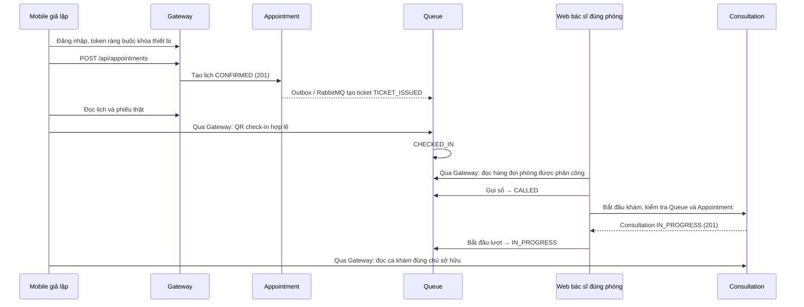

# Kết quả sửa luồng đặt lịch → phiếu khám → bác sĩ (16/10/2026)

## Kết luận và nguyên nhân

Đã sửa và triển khai trên bộ service thật đang chạy trên Mac. Đã mở lại đúng tài khoản và phiếu trong ảnh bằng trình duyệt: **NGO-001 hiển thị, không có 401**. Không thay response bằng mock, không reset dữ liệu của người dùng.

1. Lịch `52106adc-8f8c-4361-a621-1323d946c4db` thực tế thuộc **NGOAI / ROOM-03**, ngày 16/10/2026, 10:00–10:30, bác sĩ `d0000004-0000-0000-0000-000000000004`. Nó không thuộc danh sách bác sĩ Nội ROOM-01. Ticket NGO-001 có thật; lần 404 đầu xảy ra trước khi event tạo ticket hoàn tất.
2. Consultation, EMR, Prescription và Health Records còn bộ lọc HMAC cũ, chạy cùng bộ lọc Common kiểm tra session/DPoP với Identity đang dùng RSA. Vì vậy token mới hợp lệ vẫn bị 401. Đã bỏ bộ lọc cũ, giữ kiểm tra online session/DPoP/mTLS và quyền nghiệp vụ. Health Records nhận actor từ principal đã xác minh của Common.
3. Mobile refresh đồng thời và xóa token mới dù refresh đã thành công; màn hình chi tiết còn gom các lỗi thành “Không tìm thấy phiếu khám”. Đã sửa refresh dùng chung một lượt, giữ token khi lỗi dịch vụ, tạo proof mới khi thử lại, phân biệt lỗi. Ticket 404 được thử lại có giới hạn, không biến lỗi quyền thành chờ dữ liệu.
4. Mở đường dẫn chi tiết sớm hơn tải hồ sơ bệnh nhân gây từ chối nhầm. Đã đợi tải scope thật. Dashboard bác sĩ lấy phòng từ clinical context thay vì cố định ROOM-01 và hiển thị lỗi tải dữ liệu.
5. Khi bắt đầu khám, Consultation từng bỏ qua lỗi xác minh Appointment và cố cập nhật trạng thái Appointment không được hỗ trợ. Đã yêu cầu ticket thật đã CALLED/IN_PROGRESS, đúng bệnh nhân, bác sĩ được phân công; lỗi xác minh làm từ chối tạo ca. Appointment 404 chỉ được chấp nhận cho tiếp nhận trực tiếp sau khi Queue đã xác minh ticket và phân công.
6. Đọc Consultation của bệnh nhân khác từng trả 503 do gộp lỗi quyền vào lỗi kết nối. Đã trả 403 cho từ chối quyền, vẫn trả 503 nếu dịch vụ xác minh không hoạt động.

## Luồng đúng và ranh giới trạng thái

Đặt lịch không đồng nghĩa đã check-in. Trước check-in, lịch vẫn có trong danh sách lịch của bệnh nhân và có phiếu; chưa thuộc hàng đợi active của bác sĩ. Bác sĩ xem đúng phòng, gọi số rồi bắt đầu khám. Appointment không bị ép sang IN_PROGRESS khi bắt đầu Consultation; hoàn tất được đồng bộ qua luồng sự kiện tương ứng.

Mỗi service vẫn kiểm tra session/quyền cho request được chuyển tiếp. Registry riêng trên máy bổ sung scope `GET:/api/appointments/**` cho caller Consultation để xác minh quyền sở hữu; không đưa khóa hay cấu hình riêng vào Git.

## Ca thật để trình diễn tiếp

| Vai trò | Tài khoản | Mật khẩu mẫu |
|---|---|---|
| Bệnh nhân Nội | `mobile_noi_c1d9dc` | `Password123@` |
| BS. Nguyễn Văn An, Nội tổng quát | `an@careflow.vn` | `Password123@` |

- Bệnh nhân: Demo Nội c1d9dc, ID `f4e9929c-abd6-44ba-bf75-13741708e4ae`.
- Lịch: `65b8e77c-6396-4941-b30f-300e652fd8c6`, 16/10/2026, 10:30–11:00, ROOM-01.
- Phiếu: **NOI-010**, ID `2cbe5af3-2dca-4c65-90aa-f69024fdf4e9`.
- Ca khám: `5f0a2c7b-ec39-4e39-9083-bcf694df27cd`, **IN_PROGRESS**. Bác sĩ đã gọi và bắt đầu qua Web thật; giữ nguyên để người dùng vào khám tiếp.
- Mobile: http://localhost:3000. Web bác sĩ: http://localhost:5173/dashboard/queue. Tải lại cả hai giao diện, đăng nhập lại nếu tab cũ đã mất session.
- Tài khoản `mobile_case01` giữ nguyên lịch Ngoại NGO-001 của người dùng. Không đổi khoa, không hủy lịch để làm bài test trông thành công.

Một ca IN_PROGRESS cũ không có appointment, thời điểm bắt đầu và bệnh nhân tương ứng trong Patient đã chặn thao tác gọi số. Sau khi xác minh đây là fixture kiểm thử ngày 14/10 (chẩn đoán “Authorized update”), đã hủy **duy nhất ca đó bằng API có quyền của bác sĩ**, giữ lịch sử: `48653384-d68d-4285-a5ef-1ab464bd3e18`. Bằng chứng: `e2e-orphan-fixture-retirement.json`.

## Xác minh

| Phạm vi | Kết quả |
|---|---|
| Maven reactor backend | **610 test, 0 failure/error/skipped** |
| Flutter refresh, ticket và appointment journey | **25 test đạt** |
| RSA/session/DPoP thật trên 4 service | **31 kiểm tra đạt**: Gateway, direct mTLS, sai khóa, thiếu proof, RSA thiếu subject, truy cập chéo, session thu hồi |
| Browser lượt cuối trên cùng ca đã bắt đầu | **14 kiểm tra đạt**, không 401 bất thường, không lỗi JavaScript |
| Tài khoản và phiếu đúng trong ảnh | Browser mở **NGO-001 thành công**, không 401 |
| Triển khai | 12 JVM/backend health + Mobile và Hospital Web: **14 mục OK** |

Đặt lịch 201, sinh ticket, QR check-in, gọi số, tạo Consultation 201 đã được quan sát qua browser/API thật trên cùng ca. Trong lúc sửa, kịch bản được tiếp tục qua các chặng, **không tuyên bố một lượt chạy mới liền mạch từ đầu sau mọi bản sửa**. Lượt cuối mở lại chính ca IN_PROGRESS, kiểm tra hai giao diện và các API đọc. QR được tạo bởi API thật; tọa độ demo được nhập theo cấu hình bệnh viện, không phải xác minh GPS trên thiết bị vật lý.

Unit test có fixture/mock authority và transport riêng để tái hiện lỗi; runtime/browser kiểm tra DB, Identity và các service thật. Chưa dùng ca này để kiểm chứng trọn luồng CLS, phát thuốc, thanh toán hay hoàn tất toàn bộ vòng đời khám.

Bằng chứng đã lược bỏ token/mật khẩu request: `booking-doctor-e2e-results.json`, `original-booking-browser-results.json`, `rsa-consumer-results.json`. Script: `careflow-mobile-emulator-service/scripts/booking-doctor-e2e.mjs --audit-db`, `scripts/security/rsa-consumer-smoke.mjs --audit-db`. Các script chỉ chấp nhận Gateway audit loopback, cần cấu hình và tài khoản fixture thật trong thư mục `.runtime` bị ignore.

## Phạm vi Git và khôi phục trên Mac

Code chạy từ `.worktrees/security-integration`, nhánh `feature/dangkhoii/security-integration`. Giữ nguyên ba thay đổi Web đã có của người dùng ở root develop. Không stage, commit hay push.

GitNexus đã phân tích impact trước khi sửa. `ApiService`: HIGH, 15 caller trực tiếp/58 symbol bị ảnh hưởng. `requireReadAccess`: CRITICAL, 3 caller trực tiếp/6 flow. Đã cảnh báo và tiếp tục trong phạm vi người dùng đã cho phép sửa bảo mật. Sau cùng đã cập nhật graph và chạy detect-changes: **105 file tracked, 172 symbol, 146 process, CRITICAL** trên toàn bộ diff tích hợp, bao gồm nhiều sửa đổi tồn tại từ trước; số này không phải riêng đợt sửa hôm nay. Công cụ không thay thế review file mới chưa tracked; các lớp/filter mới được kiểm tra bằng build, test và JAR đang chạy. Graph hoạt động; full-text/BM25 index vẫn báo lỗi và chưa được sửa trong phạm vi này.

Đã đối chiếu bytecode Common/Consultation/HealthRecord adapter trong JAR đang chạy với bản build và xác nhận bốn bộ lọc HMAC cũ không còn trong JAR. Flutter và Doctor Web đã build production, đang phục vụ bundle mới.

Snapshot cấu hình/TLS/JAR và backup PostgreSQL mới nằm ngoài Git trong `~/Library/Application Support/CareFlow/mac-demo/`; DB backup cuối đợt: `backups/postgres-20261016-104211.sql.gz`. Có thể dùng `start-mac-demo.command` và `check-mac-demo.command` trong worktree tích hợp. Không reset/restore DB để chạy test. Chưa kiểm chứng chu trình khởi động lại toàn bộ máy Mac hoặc restore DB từ backup.
