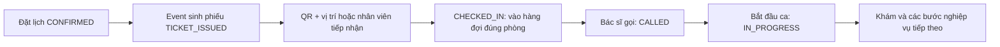

# Trình diễn check-in trên Mac — 16/10/2026

Đã triển khai hướng dẫn **Luồng khám trên Mac** tại http://localhost:3000 và nút **Sao chép nội dung QR** trên Hospital Web /staff/checkin. Không thêm endpoint bỏ qua quyền hoặc đổi trạng thái trực tiếp. Các thao tác dùng API và DB audit thật đang chạy trên máy.

## Mở ba vai trò cùng lúc

| Vai trò | Địa chỉ | Tài khoản | Mật khẩu mẫu |
|---|---|---|---|
| Bệnh nhân | http://localhost:3000 | `mobile_case03` | `Password123@` |
| Nhân viên | http://localhost:5173/staff/checkin | `staff` | `Password123@` |
| Bác sĩ Nội | http://localhost:5173/dashboard/queue | `an@careflow.vn` | `Password123@` |

Hospital Web lưu token theo origin trong localStorage: **mở nhân viên và bác sĩ ở hai hồ sơ trình duyệt khác nhau**, hoặc một cửa sổ thường và một cửa sổ ẩn danh. Hai tab thường cùng hồ sơ dùng chung phiên. Điện thoại giả lập đã tách phiên theo từng máy. Mỗi vai trò vẫn đăng nhập thật, tự tạo proof và bị backend kiểm tra quyền.

## Cách A: nhân viên hỗ trợ — không cần camera/GPS

1. Trên điện thoại, đặt một lịch hợp lệ cho bệnh nhân chưa có lượt hoạt động cùng khoa/ngày, rồi mở **Lịch khám → Chi tiết → Xem phiếu khám**. Lấy số phiếu và phòng từ dữ liệu thật; không dùng appointment UUID thay cho mã phiếu.
2. Ở quầy tiếp nhận, đăng nhập `staff`, chọn đúng phòng bằng danh mục API, nhập số phiếu (ví dụ **NOI-011**), bấm **Hỗ trợ check-in**.
3. Kết quả thật phải trả **Tiếp nhận thành công**, trạng thái CHECKED_IN; request `POST /api/queues/check-in` trả 200. Đây là luồng nhân viên xác nhận tại quầy theo contract, không giả GPS của bệnh nhân.
4. Ở hồ sơ trình duyệt của bác sĩ, đăng nhập BS. An, mở **Hàng đợi khám**, tải lại trang bằng ⌘R. Cùng bệnh nhân/phiếu xuất hiện ở ROOM-01 với “Đã check-in”.
5. Nếu không có ca đang khám, chọn **Gọi số → Bắt đầu khám**. Nếu đã có ca, dùng **Vào khám** và hoàn tất ca cũ theo dữ liệu nghiệp vụ trước khi gọi người tiếp theo.
6. Tải lại phiếu/hành trình ở điện thoại để theo dõi. Khám, CLS, kê đơn và phát thuốc là các thao tác thực tiếp theo của từng vai trò, không tự đánh dấu hoàn tất.

## Cách B: bệnh nhân tự check-in bằng QR trên web giả lập

1. Nhân viên mở quầy, bấm **Tạo mã mới** nếu QR hết hạn, sau đó **Sao chép nội dung QR**. Nếu clipboard bị chặn, mở **Nội dung QR để nhập trên web giả lập**, chọn và sao chép văn bản bằng ⌘C. QR là token ký do Queue phát hành thật, không phải token đăng nhập.
2. Bệnh nhân mở phiếu, bấm **Quét QR check-in tại bệnh viện**, dán mã vào ô **Nội dung QR check-in**.
3. Trên Mac có thể nhập tọa độ thử nghiệm. Cấu hình API thật được kiểm tra lúc chạy: vĩ độ **10.7769**, kinh độ **106.7009**, bán kính **150 m**, accuracy tối đa **50 m**. Nhập accuracy **10 m**. Nếu quản trị viên đổi vị trí bệnh viện, đọc giá trị mới tại **/admin/schedule** bằng tài khoản ADMIN; không dùng tọa độ cũ.
4. Bấm **Xác nhận check-in**. Backend kiểm tra chủ sở hữu, lịch/phiếu, ngày/phiên, chữ ký và hạn QR, khoảng cách, accuracy trước khi cập nhật DB. Tọa độ nhập tay là đầu vào kiểm thử; không coi đây là bằng chứng thiết bị vật lý đang có mặt ở bệnh viện.

## Luồng tổng quan

## Trạng thái hiện có sau kiểm tra thật

- **NOI-010 / Demo Nội c1d9dc**: IN_PROGRESS, ca khám `5f0a2c7b-ec39-4e39-9083-bcf694df27cd` giữ nguyên.
- **NOI-011 / Mẫu Mobile 03**: đã check-in thành công bằng trình duyệt nhân viên, lịch `24f4e43c-2b37-457e-a38a-7f64225aca63`, ngày 16/10/2026, 11:00–11:30, ROOM-01. Bác sĩ đã thấy bệnh nhân thứ hai.
- Không gọi hoặc bắt đầu NOI-011 khi NOI-010 còn đang khám. Không hủy, hoàn tất hoặc sửa nội dung ca đang khám để làm test đi tiếp.
- Lịch 11:00 mới đặt của Demo Nội không có ticket vì trùng lượt hoạt động. Đây là lỗi đồng bộ validation đã ghi riêng tại [duplicate-active-booking-issue.md](duplicate-active-booking-issue.md); không dùng lịch đó làm mẫu check-in, không reset DB để che lỗi.

Sau khi qua ngày mới, lịch hôm nay không dùng để check-in lại. Đặt lịch ngày hiện tại, chọn ca còn chỗ qua API và lấy QR mới; hoàn tất/hủy hợp lệ lượt cũ khi cần. Không dùng lại QR hết hạn hoặc số phiếu hôm trước. Script kiểm tra bên dưới cần một ticket Nội hợp lệ hiện tại; nó không tự seed hoặc reset.

## Kiểm chứng và giới hạn

- **28 test Node** của service giả lập đạt.
- **Hospital Web production build** đạt; đã khởi động bản mới tại 5173. Trang giả lập phục vụ HTML/CSS/JS mới tại 3000, không thay Flutter bundle trong đợt này.
- **11 kiểm tra browser thật** đạt qua `node scripts/security/mac-check-in-browser.mjs --audit-db`: chọn ticket thật, mở hướng dẫn, đăng nhập bệnh nhân, copy QR ký thật, trước check-in không có trong hàng đợi, check-in nhân viên 200, bác sĩ thấy cùng bệnh nhân, phiên STAFF/DOCTOR độc lập, bệnh nhân đọc CHECKED_IN, giữ nguyên ca cũ, không 401/lỗi JavaScript. Bằng chứng đã loại token: [mac-check-in-browser-results.json](mac-check-in-browser-results.json).
- Sau check-in, Queue ROOM-01 trả **2 bệnh nhân**. Đã kiểm tra screenshot Web bác sĩ và quầy tiếp nhận.
- Luồng bệnh nhân QR/geofence thành công đã được kiểm thử ở đợt trước trên NOI-010; đợt này kiểm tra QR copy và luồng nhân viên trên NOI-011. Không tuyên bố đợt này đã chạy lại trọn CLS, kê đơn hoặc phát thuốc.
- 14 mục runtime health OK. Snapshot/JAR/cấu hình và PostgreSQL backup thật ngoài Git: `~/Library/Application Support/CareFlow/mac-demo/backups/postgres-20261016-110159.sql.gz`.
- Code ở `.worktrees/security-integration`, nhánh `feature/dangkhoii/security-integration`; giữ nguyên root develop và ba thay đổi Web của người dùng. Không stage/commit/push, không sửa schema hay dữ liệu bằng SQL.
