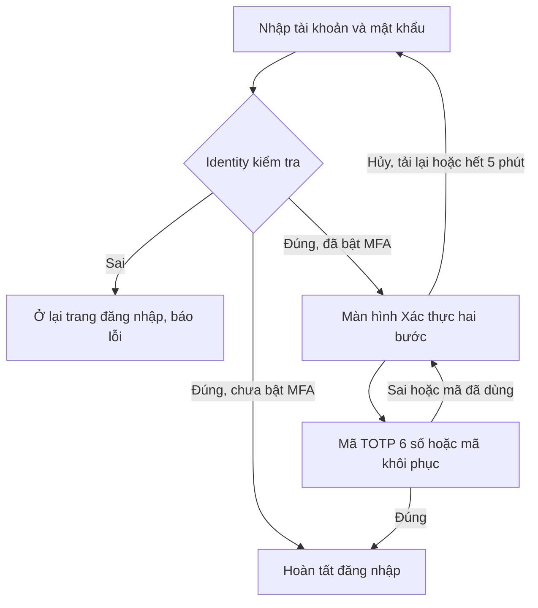

# Giao diện đăng nhập MFA hai bước — 16/10/2026

Đã triển khai trên **Mobile Emulator http://localhost:3000** và **Hospital Web http://localhost:5173**. Trang đăng nhập đầu tiên chỉ có tài khoản/mật khẩu, không còn ô MFA. Hai giao diện đã được kiểm tra hình ảnh sau khi chuyển trang hoàn tất.

## Luồng người dùng

- Mobile có màn hình riêng `/login/mfa`, tiêu đề **Xác thực hai bước**, bước 2/2, chế độ **Dùng mã khôi phục** và **Dùng tài khoản khác**.
- Hospital Web có trang riêng `/login/mfa` theo giao diện tím CareFlow, cùng các lựa chọn và thông báo lỗi tại chỗ.
- Chỉ thông báo Identity **401 `MFA_REQUIRED:`** sau khi mật khẩu đã đúng mới mở bước MFA. Đây là trạng thái giao thức hiện có, không phải lỗi kết nối. Backend vẫn chưa cấp token/session trước khi MFA đúng; tài khoản chưa bật MFA vẫn đăng nhập một bước.
- Thông tin chờ MFA chỉ giữ tạm trong bộ nhớ của client, tham chiếu được xóa khi thành công/hủy/đăng xuất/hết thời gian chờ. Không ghi mật khẩu vào URL, history, localStorage hoặc sessionStorage. Tải lại document cần nhập lại thông tin.
- Xác minh OTP/recovery vẫn dùng `POST /api/auth/login` có DPoP, được Identity kiểm tra thật. Không thêm pre-auth session, endpoint hoặc lối bỏ qua MFA.
- Bật/tắt MFA hiện có vẫn ở **Tài khoản → Bảo mật đăng nhập** trên mobile, sau khi đăng nhập; thao tác vẫn cần mật khẩu và mã xác thực, thu hồi các phiên cũ như trước. Không tự bật MFA cho tài khoản seed hoặc tài khoản đang dùng.

## Lỗi tải lại điện thoại tìm thấy và đã sửa

Nút **Tải lại** trước đây có thể chỉ chuyển hash về `/splash`, giữ nguyên JS/Dart document và không phát lại ready handshake. Bằng chứng trước sửa: `performance.timeOrigin` không đổi, thẻ điện thoại kẹt `loading`, nên thao tác điều khiển tiếp theo không tới ứng dụng.

`loadDevice` hiện thêm một nonce không nhạy cảm vào query URL khi nạp iframe để buộc tải lại document. Giữ nguyên `device`, `storageScope`, namespace secure storage và khóa DPoP của điện thoại. Browser thật đã xác nhận timeOrigin mới, ready handshake trở lại, MFA chờ bị xóa, đăng nhập/đăng xuất tiếp tục hoạt động. Đồng thời xóa Snackbar sai mật khẩu cũ khi chuyển từ đăng nhập sang MFA hoặc trang chính.

## Kiểm chứng

| Phạm vi | Kết quả |
|---|---|
| Flutter state MFA + refresh | **14 test đạt** (8 test MFA mới + 6 test refresh) |
| Phân tích 4 file Dart xác thực | **Không có vấn đề** |
| Unit test Node của emulator | **28 test đạt** |
| Browser MFA thật trên cả hai client | **20 kiểm tra đạt**, không lỗi JavaScript |
| Browser bật MFA hiện có, STOMP, key binding, thu hồi session | **8 kiểm tra đạt** trên bundle cuối |
| Browser đăng nhập thường/reload/logout bác sĩ | **4 kiểm tra đạt** |
| Build và triển khai | Flutter release web và Next production build đạt; đang phục vụ bản mới |
| Health runtime | **14 mục OK** |

20 kiểm tra browser gồm: không có ô MFA ở bước đầu, sai mật khẩu không mở MFA, đúng mật khẩu mở MFA nhưng chưa được đọc tài nguyên bảo vệ, mật khẩu không nằm trong browser storage/URL, OTP sai không cấp phiên, OTP thật thành công, hủy, tải lại document thật, mã khôi phục một lần bị từ chối khi dùng lại, MFA Web thành công bằng OTP/recovery và hết thời gian chờ. Kiểm tra thời hạn dùng clock của browser/test để chạy nhanh; API/Identity không được mock.

Hai tài khoản audit mới được đăng ký và bật MFA bằng API thật, không thay cài đặt của tài khoản người dùng hiện có. Tài khoản Web fixture mang vai trò STAFF nhưng không được bổ sung phân công phòng; dùng để kiểm tra xác thực, không coi là bằng chứng hoàn tất luồng tiếp nhận lâm sàng. Test MFA không thay trạng thái các ca khám đang có.

Bằng chứng đã lược bỏ token/secret/recovery code: [mfa-ui-browser-results.json](mfa-ui-browser-results.json). Fixture nhạy cảm nằm trong `careflow-mobile-emulator-service/.runtime/mfa-ui-accounts.json`, bị Git ignore, quyền 0600; không đưa nội dung file này vào báo cáo hoặc commit. Script `node scripts/security/mfa-ui-browser.mjs --audit-db` mặc định tạo và enroll hai tài khoản mới trên DB audit thật; `--reuse-fixtures` chỉ dành cho test lại, cần chọn cặp recovery code còn chưa dùng bằng `CAREFLOW_MFA_RECOVERY_OFFSET`, và chờ một chu kỳ TOTP trước khi chạy.

## Phạm vi và vận hành

Thay đổi ở client và tài liệu mô tả luồng, không sửa schema, backend MFA, chữ ký token, session authority hay DPoP. Các fixture/mock transport trong unit test chỉ dùng để tái hiện state/error, không được bật trong runtime. Luồng CLS/phát thuốc không nằm trong kiểm thử đợt này.

GitNexus đã chạy trước sửa: AuthNotifier MEDIUM (13 direct/34 affected), AuthService MEDIUM (1 direct/34 affected), AuthContextType MEDIUM (14 direct), Web AuthProvider/login LOW, Login screen state LOW, framework/enum/router entries UNKNOWN có kiểm tra source thủ công. Lỗi `loadDevice` phát hiện thêm có impact CRITICAL, 4 direct/7 process; đã cảnh báo trước khi sửa trong phạm vi người dùng cho phép sửa luồng bảo mật. Graph cuối đã cập nhật; detect-changes toàn bộ diff tích hợp: 109 file tracked, 178 symbol, 735 process, CRITICAL, bao gồm nhiều thay đổi từ trước và không đại diện riêng đợt UI MFA. Full-text/BM25 index vẫn báo lỗi; không sửa công cụ trong phạm vi này.

Code chạy tại `.worktrees/security-integration`, nhánh `feature/dangkhoii/security-integration`. Giữ nguyên ba thay đổi Web của người dùng ở root develop. Không stage/commit/push. Snapshot cấu hình/JAR/TLS và DB backup ngoài Git đã cập nhật: `~/Library/Application Support/CareFlow/mac-demo/backups/postgres-20261016-113927.sql.gz`.

Để dùng bản mới: tải lại trang giả lập và Hospital Web bằng ⌘R. Tài khoản đã bật MFA sẽ tới màn hình bước 2 sau khi nhập đúng mật khẩu; tài khoản chưa bật MFA không bị yêu cầu nhập mã. Secret/recovery của tài khoản nào vẫn do chủ tài khoản đó quản lý.
