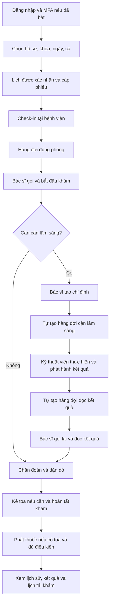

# Hướng dẫn sử dụng CareFlow Mobile Emulator và các luồng end-to-end

> Cập nhật: 16/10/2026. Dành cho trình diễn trên Mac bằng trình duyệt, không cần điện thoại vật lý.
> Các thao tác nghiệp vụ gửi API thật và ghi vào DB của môi trường đã kết nối.

## 1. Phạm vi của hướng dẫn

`careflow-mobile-emulator-service` mở nhiều điện thoại Flutter Web, phục vụ giao diện và proxy request tới Gateway. Các vai trò nhân viên, bác sĩ, kỹ thuật viên và cấp phát thuốc thao tác trên Hospital Web.

Hướng dẫn mô tả runtime tích hợp đang chạy trên Mac tại thời điểm cập nhật. Runtime này lấy mã từ worktree `.worktrees/security-integration`, nhánh `feature/dangkhoii/security-integration`. Những sửa bảo mật/MFA/check-in mới tại đó còn đang được quản lý riêng. Commit tài liệu trên nhánh `feature/dangkhoii/mobile-emulator-service` không đồng nghĩa các sửa mã nguồn đó đã được tích hợp hoặc phát hành cùng tài liệu. Clone riêng nhánh tài liệu không tự tạo đủ backend, dữ liệu, chứng thư hoặc bản build đang chạy trên Mac.

Phân biệt ba mức khi đọc:

- **Đã kiểm chứng thật:** đã quan sát các chặng tương ứng qua API/trình duyệt và dữ liệu thật.
- **Có luồng nghiệp vụ và implementation:** có contract/mã nguồn nhưng chưa đủ bằng chứng chạy liền mạch toàn bộ vòng đời trên bộ dữ liệu hiện tại.
- **Chưa hoàn thiện:** không dùng làm bằng chứng tính năng thật đã hoàn tất, đặc biệt thanh toán, eKYC và các chức năng ngoài phạm vi đã nghiệm thu.

## 2. Chuẩn bị môi trường

### Địa chỉ sử dụng trên Mac hiện tại

| Giao diện | Địa chỉ | Vai trò |
|---|---|---|
| Điện thoại giả lập | <http://localhost:3000> | PATIENT |
| Đăng nhập Hospital Web | <http://localhost:5173/login> | Tài khoản nội bộ |
| Quầy tiếp nhận | <http://localhost:5173/staff/checkin> | STAFF được phân công |
| Hàng đợi bác sĩ | <http://localhost:5173/dashboard/queue> | DOCTOR đúng phòng |
| Hàng đợi xét nghiệm | <http://localhost:5173/lab/queue> | LAB_TECHNICIAN được phân công |
| Quầy thuốc | <http://localhost:5173/staff/pharmacy> | STAFF cấp phát được phân công |
| Quản lý cơ sở | <http://localhost:5173/admin/facility> | ADMIN |
| Lịch và cấu hình check-in | <http://localhost:5173/admin/schedule> | ADMIN |

Gateway của runtime bảo mật trên Mac là **`https://localhost:18080`**. Trình duyệt gọi API cùng origin của giả lập/Hospital Web; proxy chuyển tiếp tới Gateway với cấu hình TLS phù hợp. Không dùng cổng 8080 hoặc tự đổi HTTPS thành HTTP để xử lý lỗi kết nối. Một số hướng dẫn snapshot cũ sử dụng HTTP 18080; cần đối chiếu đúng môi trường trước khi làm theo.

Nếu hệ thống đang mở, dùng ngay các URL trên. Để kiểm tra bộ launcher cục bộ đã được chuẩn bị trên Mac:

```sh
# Chạy từ gốc worktree tích hợp hiện có, nơi chứa hai file này:
./check-mac-demo.command
./start-mac-demo.command
```

Launcher là công cụ phục hồi môi trường Mac đã được cấu hình; không phải bộ cài mới từ Git. Nó cần các tài nguyên runtime/DB/chứng thư riêng còn được lưu trên máy.

Nếu chỉ khởi động service giả lập trong một môi trường backend đã chuẩn bị:

```sh
cd careflow-mobile-emulator-service
npm start
```

Lệnh này chỉ mở frontend/proxy, không khởi động toàn bộ microservice hoặc tạo/reset DB. Nếu chưa có `app/build/web`, làm phần **Sửa source và build lại** trong [README](../README.md). Với HTTPS audit, dùng cấu hình CA riêng được cấp cho môi trường đó; không tắt kiểm tra chứng thư.

### Tách phiên giữa các vai trò

- Mỗi điện thoại giả lập có namespace và phiên riêng theo thiết bị/Gateway. Dùng tài khoản bệnh nhân khác nhau trên các máy.
- Hospital Web dùng chung phiên giữa các tab cùng hồ sơ trình duyệt. Mở nhân viên và bác sĩ bằng hai hồ sơ trình duyệt riêng hoặc một cửa sổ thường và một cửa sổ ẩn danh.
- Khi cần thêm kỹ thuật viên/quầy thuốc đồng thời, dùng thêm hồ sơ trình duyệt. Role đúng vẫn phải có phân công phòng/điểm phục vụ tương ứng.

### Tài khoản mẫu của DB audit trên Mac

Các mật khẩu dưới đây là mật khẩu seed/demo đã công bố cho môi trường test; không phải thông tin truy cập production. Chỉ dùng nếu tài khoản chưa đổi mật khẩu hoặc bật thêm MFA.

| Mục đích | Tài khoản | Mật khẩu demo |
|---|---|---|
| Bệnh nhân Nội đang khám | `mobile_noi_c1d9dc` | `Password123@` |
| Ba bệnh nhân mẫu | `mobile_case01`, `mobile_case02`, `mobile_case03` | `Password123@` |
| Bác sĩ An, Nội tổng quát, ROOM-01 | `an@careflow.vn` | `Password123@` |
| Nhân viên tiếp nhận | `staff` | `Password123@` |
| Kỹ thuật viên xét nghiệm | `lab` | `Password123@` |
| Quản trị | `admin` | `Password123@` |

Tài khoản `lab` đã được kiểm tra đăng nhập và vai trò; điều đó chưa chứng minh đã hoàn tất luồng xét nghiệm. Với quầy thuốc, dùng STAFF có phân công cấp phát tại điểm phục vụ cần thao tác; không giả định tài khoản tiếp nhận có toàn bộ quyền quầy thuốc.

Ca mẫu thay đổi sau mỗi thao tác thật. Mô tả ban đầu “chưa đặt lịch”, “đã hủy” dưới điện thoại hoặc trong [MOBILE-DATASET.md](MOBILE-DATASET.md) là dữ liệu lịch sử, không thay thế trạng thái mới nhất từ API.

## 3. Điều khiển điện thoại và quan sát API

1. Mở trang giả lập, bấm **Phóng to** điện thoại muốn thao tác.
2. Đăng nhập tài khoản PATIENT thật trên từng máy.
3. Dùng **Trang chủ**, **Lịch khám**, **Quay lại**, **Tải lại** trên đúng thẻ điện thoại. Checkbox dùng cho thao tác nhóm ở thanh trên.
4. **Tạm dừng** giải phóng ứng dụng đang chạy và giữ dữ liệu phiên để tiếp tục; **Gỡ** đóng máy và xử lý dữ liệu cục bộ của máy đó theo hộp xác nhận.
5. Mở **Nhật ký API**, chọn điện thoại để xem đường dẫn, phương thức và mã trạng thái. Nhật ký không ghi token, mật khẩu hoặc nội dung hồ sơ.
6. Sau khi cập nhật bundle, bấm **Tải lại** trên điện thoại hoặc ⌘R cả trang. Trạng thái đang chờ MFA phải bắt đầu lại từ bước nhập tài khoản khi document được tải mới.

Để theo dõi xuyên suốt một ca, ghi lại mã phiếu và tham chiếu appointment/consultation/order/prescription khi có. Không dùng UUID lịch hẹn thay cho mã phiếu ở ô tiếp nhận.

## 4. Sơ đồ tổng thể



## 5. Luồng đăng nhập, MFA và thu hồi phiên

1. Trên Mobile hoặc Hospital Web, nhập tài khoản và mật khẩu.
2. Sai mật khẩu: ở lại trang đăng nhập, không cấp phiên.
3. Đúng mật khẩu, chưa bật MFA: đăng nhập thành công.
4. Đúng mật khẩu, đã bật MFA: chuyển sang màn hình xác thực hai bước; chưa được truy cập tài nguyên bảo vệ.
5. Nhập OTP từ ứng dụng xác thực hoặc chuyển sang chế độ mã khôi phục. Mã khôi phục chỉ dùng một lần.
6. Đúng yếu tố thứ hai: hoàn tất đăng nhập. Sai mã: ở lại bước MFA và báo lỗi.
7. Hủy, tải lại document hoặc hết thời gian chờ năm phút: nhập lại thông tin đăng nhập.
8. Muốn bật MFA trên Mobile: đăng nhập trước, vào **Tài khoản → Bảo mật đăng nhập**, làm theo màn hình thiết lập và lưu mã khôi phục riêng.
9. Đăng xuất: phiên tương ứng bị thu hồi; request dùng phiên đó phải bị từ chối.

`401 MFA_REQUIRED:` ở bước kiểm tra mật khẩu là tín hiệu chuyển sang màn hình MFA, không phải lỗi mất kết nối. Không đưa secret TOTP, QR thiết lập, token hoặc mã khôi phục vào Git/ảnh báo cáo.

Đường đi request: **Client → Gateway → service nghiệp vụ**. Service kiểm tra phiên/quyền sở hữu/phân công, không chỉ tin các header định danh. Token được ràng buộc khóa bằng DPoP; request liên service dùng cơ chế caller/delegation được cấu hình qua TLS/mTLS. Các service được tiến trình runtime khởi động; đăng nhập hoặc gọi API không tự bật một service đang tắt.

## 6. Luồng đặt lịch → phiếu khám → check-in → hàng đợi

### Đặt lịch và lấy phiếu

1. Chọn bệnh nhân chưa có lượt hoạt động cùng khoa/ngày. Nếu thử từ đầu, dùng hồ sơ test phù hợp thay vì tạo thêm lịch cho ca đang khám.
2. Vào **Đặt lịch khám**, chọn hồ sơ, khoa, ngày và ca còn chỗ từ danh mục API.
3. Xác nhận đặt lịch. API tạo appointment phải thành công; lịch có trạng thái `CONFIRMED`.
4. Mở **Lịch khám → Chi tiết → Xem phiếu khám**, kiểm tra mã phiếu, đúng bệnh nhân, khoa, phòng và thời gian.
5. Queue cấp phiếu từ sự kiện Appointment qua outbox/RabbitMQ nên có thể xuất hiện sau response đặt lịch. Chờ ngắn rồi tải lại; nếu 404 kéo dài, kiểm tra event/consumer và lỗi trùng lượt, không tạo phiếu giả.

**Có lịch hoặc phiếu chưa đồng nghĩa đã check-in.** Bác sĩ xem active queue đúng phòng; bệnh nhân chưa đến chưa nằm trong hàng đợi phục vụ.

### Cách A: nhân viên hỗ trợ check-in trên Mac

1. Nhân viên vào `/staff/checkin`, chọn đúng phòng từ danh mục.
2. Đối chiếu bệnh nhân, nhập **mã phiếu** từ điện thoại.
3. Bấm **Hỗ trợ check-in**.
4. Kết quả phải là tiếp nhận thành công, trạng thái `CHECKED_IN`.
5. Bác sĩ đúng phòng vào `/dashboard/queue`, tải lại nếu cần; cùng bệnh nhân phải xuất hiện.

Đây là luồng quầy tiếp nhận thật, phù hợp trình diễn không có camera/GPS. Không cần nhập tọa độ thay cho bệnh nhân ở cách này.

### Cách B: bệnh nhân nhập QR và vị trí kiểm thử

1. Nhân viên tạo QR phòng/phiên còn hiệu lực và bấm **Sao chép nội dung QR**. Có thể mở phần nội dung văn bản rồi ⌘C nếu clipboard bị chặn.
2. Trên phiếu của bệnh nhân, mở **Quét QR check-in tại bệnh viện**.
3. Dán chuỗi QR vào ô **Nội dung QR check-in**. Đây là QR do Queue ký, không phải ảnh QR, token đăng nhập hoặc UUID phiếu.
4. Lấy vị trí trình duyệt hoặc nhập latitude/longitude/accuracy để kiểm thử trên Mac. Đọc cấu hình bệnh viện hiện hành qua ADMIN ở `/admin/schedule`; không dùng tọa độ cũ khi cấu hình đã thay đổi.
5. Bấm **Xác nhận check-in**. Backend kiểm tra quyền sở hữu, ngày/phiên/phòng, chữ ký/hạn QR và điều kiện geofence trước khi cập nhật.

Nhập tọa độ là đầu vào kiểm thử thực gửi tới API; nó không chứng minh Mac hoặc điện thoại vật lý đang ở bệnh viện. Sau khi qua ngày mới, dùng lịch đúng ngày và QR mới.

## 7. Luồng khám không cần cận lâm sàng

1. Bác sĩ đăng nhập đúng phòng, mở hàng đợi.
2. Chọn bệnh nhân đã check-in, **Gọi số**: lượt chuyển sang `CALLED`.
3. Khi bệnh nhân đến, **Bắt đầu khám**: tạo/khôi phục đúng Consultation và bắt đầu lượt phục vụ `IN_PROGRESS`.
4. Nhập sinh hiệu, triệu chứng, khám thực thể, chẩn đoán và lời dặn.
5. Nếu cần thuốc: tạo toa nháp, chọn thuốc từ danh mục thật, kiểm tra rồi xác nhận toa.
6. Hoàn tất khám theo thao tác của Doctor Web.
7. Trên điện thoại, tải lại hành trình/kết quả; phải liên kết đúng lượt khám và chỉ hiển thị toa đã phát hành.

Nếu đã có ca đang khám, vào ca đó để tiếp tục. Chỉ hoàn tất/hủy theo tình huống nghiệp vụ thực trước khi bắt đầu người tiếp theo; không reset queue hoặc đổi trạng thái bằng SQL để chạy demo.

Appointment, VisitTicket, QueueEntry và Consultation là những tài nguyên khác nhau; không yêu cầu chúng có cùng chuỗi trạng thái. Theo dõi đúng tài nguyên và event đồng bộ khi đánh giá kết quả.

## 8. Luồng có cận lâm sàng → đọc kết quả

1. Từ ca đang khám, bác sĩ tạo chỉ định với hạng mục/điểm phục vụ hợp lệ.
2. Lab lưu order; sự kiện tạo lượt `LAB_EXECUTION` tại từng điểm phục vụ cần thiết.
3. Kỹ thuật viên mở `/lab/queue`, chọn đúng điểm phục vụ và gọi bệnh nhân.
4. Đối chiếu danh tính, bắt đầu lượt Queue rồi bắt đầu order.
5. Nhập kết quả từng hạng mục, phát hành khi đủ điều kiện. Kết quả chưa phát hành không được lộ cho bệnh nhân.
6. Khi đủ tất cả kết quả bắt buộc, hệ thống tạo lượt `RESULT_REVIEW` tại phòng khám ban đầu.
7. Bác sĩ gọi từ làn đọc kết quả, tiếp tục ca cũ, đọc kết quả, kết luận và kê toa nếu cần.
8. Hoàn tất khám; Mobile hiển thị kết quả đã phát hành đúng bệnh nhân/lượt khám.

Bệnh nhân không check-in lần hai tại xét nghiệm hoặc đặt lịch mới để đọc kết quả. Queue phòng khám điều phối ba làn `PRIORITY`, `NORMAL`, `RESULT_REVIEW` theo Round Robin; mỗi làn giữ FIFO. Lượt đọc kết quả không mặc nhiên đứng đầu toàn bộ hàng đợi.

Mobile đọc xét nghiệm bằng API dành cho chính bệnh nhân và lọc đúng consultation. `GET /api/labs/orders/consultation/{id}` dành cho bác sĩ được phân công; bệnh nhân gọi API đó nhận 403 là đúng phân quyền.

## 9. Luồng kê toa → hàng đợi → cấp phát thuốc

1. Bác sĩ tạo toa `DRAFT`, kiểm tra bệnh nhân, ca khám, thuốc và cách dùng.
2. Xác nhận toa: `CONFIRMED`, phát sự kiện `PrescriptionIssued`.
3. Queue tạo lượt `PHARMACY_DISPENSING` tại điểm cấp phát được cấu hình.
4. Nhân viên được phân công vào `/staff/pharmacy`, gọi theo FIFO.
5. Đối chiếu bệnh nhân và toa, bắt đầu lượt để đạt `IN_PROGRESS`.
6. Chỉ xác nhận phát thuốc khi đúng toa, đúng điểm phục vụ và đủ điều kiện.
7. Toa chuyển sang `DISPENSED`, lượt phát thuốc hoàn tất; bệnh nhân xem lại toa đã phát.

Không check-in lần nữa ở quầy thuốc. Bệnh nhân không xem toa nháp. Toa đã xác nhận không sửa trực tiếp; thay đổi phải theo quy trình hủy/thay thế và giữ lịch sử.

**Giới hạn quyết toán:** nghiệp vụ yêu cầu `PAYMENT_DUE` chặn phát thuốc, còn `SETTLED`, `REFUND_PENDING`, `REFUNDED` cho phép tiếp tục. Luồng thanh toán/quyết toán thật và việc thực thi đầy đủ điều kiện này chưa được nghiệm thu xuyên suốt trên runtime Mac. Không dùng giá mẫu, biên lai cục bộ hoặc thao tác adapter làm bằng chứng đã thu/hoàn tiền thật.

## 10. Luồng sau khám, hồ sơ và tái khám

1. Bệnh nhân mở **Kết quả khám và toa thuốc**, chọn đúng lượt đã hoàn tất.
2. Kiểm tra chẩn đoán, lời dặn, xét nghiệm đã phát hành và toa được phép xem.
3. Nếu bác sĩ yêu cầu tái khám, tạo lịch liên kết ca trước bằng ngày/slot còn chỗ.
4. Khi tới ngày tái khám: phiếu → check-in → hàng đợi → bác sĩ, như một lượt mới có liên kết lịch sử.
5. Khi cần bổ sung tài liệu, vào **Hồ sơ sức khỏe**, chọn đúng hồ sơ và tải tệp qua file picker; mở lại để kiểm tra tài liệu đã lưu thật.

Patient quản lý hồ sơ/tệp do bệnh nhân cung cấp; EMR tổng hợp dữ liệu khám lâm sàng. Cần kiểm tra từng phần, không lấy việc upload thành công làm bằng chứng toàn bộ EMR đã đồng bộ.

## 11. Luồng ngoại lệ và kiểm tra quyền

| Tình huống | Kết quả cần kiểm tra |
|---|---|
| Hủy lịch còn được phép hủy | Lịch/phiếu/lượt liên quan được xử lý nhất quán; lịch sử còn được giữ |
| Bệnh nhân chưa đến khi gọi | Gọi lại trong giới hạn; đánh dấu vắng/đưa lại hàng đúng điều kiện |
| Nút **Gọi lại** ở quầy tiếp nhận | Lần đầu trên lượt đủ điều kiện dùng thao tác gọi; lượt đã CALLED mới dùng recall; giữ giới hạn ba lần hiện có |
| QR hết hạn/sai phòng/sai phiên hoặc vị trí không đạt | Backend từ chối check-in, trạng thái không bị đổi |
| Bệnh nhân đọc dữ liệu người khác | Từ chối theo quyền sở hữu |
| Bác sĩ/nhân viên ngoài phân công | Từ chối thao tác tại phòng/điểm phục vụ đó |
| Token sai khóa, thiếu proof hoặc phiên bị thu hồi | Từ chối request |
| Dịch vụ xác minh quyền không hoạt động | Từ chối thao tác cần xác minh; không cho đi tiếp bằng cách bỏ qua kiểm tra |

Các kiểm tra từ chối cần xác nhận cả response và dữ liệu sau request; một thông báo lỗi trên giao diện chưa đủ chứng minh DB giữ nguyên.

## 12. Kịch bản tiếp tục trên dữ liệu hiện có

Mốc đã kiểm chứng ngày **16/10/2026**:

- `mobile_noi_c1d9dc`: phiếu **NOI-010**, Nội tổng quát, ROOM-01; Consultation đang `IN_PROGRESS` với bác sĩ An. Mobile đã hiển thị lại **Hành trình đang diễn ra → Đang khám bệnh** sau sửa lỗi gọi nhầm API Lab.
- Để tiếp tục demo, đăng nhập bệnh nhân này ở một điện thoại và bác sĩ An ở hồ sơ trình duyệt riêng; vào ca đang khám, chọn nhánh không CLS hoặc có CLS theo kịch bản muốn kiểm thử.
- Lịch Nội 11:00 thứ hai của cùng bệnh nhân đã được tạo nhưng không có phiếu do xung đột quy tắc lượt hoạt động giữa Appointment và Queue. Không dùng lịch này làm mẫu check-in; không gắn phiếu NOI-010 vào lịch thứ hai.
- `mobile_case03` đã được dùng check-in và gọi thật; `mobile_case02` đã được dùng kiểm tra gọi lại. Không coi các tài khoản đó còn ở trạng thái seed ban đầu.

Luôn đọc lại trạng thái mới nhất trước buổi trình diễn. Ngày khám, mã phiếu và QR của ngày 16/10 không phải fixture dùng được cho mọi ngày. Nếu cần demo từ đầu, chuẩn bị hồ sơ test và slot đúng ngày qua API; không tự reset các ca đang dùng.

## 13. Đọc lỗi qua Nhật ký API

| Quan sát | Kiểm tra tiếp |
|---|---|
| Trang giả lập HTTP 200 nhưng đăng nhập/API lỗi | Trang web đang được phục vụ chưa chứng minh Gateway/backend hoạt động; xem cấu hình Gateway, TLS và health |
| Không kết nối Gateway | Đúng `https://localhost:18080` trong runtime này, CA phù hợp, tiến trình Gateway đang chạy |
| 401 ở tài nguyên bảo vệ | Phiên/token/proof còn hợp lệ; đăng nhập lại nếu đã hết/thu hồi; không tắt xác thực |
| 401 `MFA_REQUIRED:` sau đúng mật khẩu | Tiếp tục màn hình MFA |
| 403 | Đúng tài khoản, quyền sở hữu, role, phân công và API dành cho vai trò đó |
| 404 phiếu ngay sau đặt lịch | Chờ xử lý sự kiện; nếu kéo dài kiểm tra consumer và ràng buộc trùng lượt |
| Bác sĩ không thấy bệnh nhân | Kiểm tra đã check-in, đúng ngày/phiên/phòng; phiếu Nội không xuất hiện ở bác sĩ Ngoại và ngược lại |
| 409 thao tác hàng đợi | Trạng thái hiện tại không cho phép, giới hạn số lần gọi, ca đang phục vụ hoặc xung đột dữ liệu; tải lại trước khi xử lý |
| 5xx | Lỗi backend/dependency; dùng thời điểm, đường dẫn và correlation ID nếu có để truy log service |
| Không thể tải hành trình khám | Kiểm tra từng API Appointment, Queue, Consultation, Lab, Prescription; lỗi một API có thể làm phần tổng hợp không tải được |

Không đưa Authorization, DPoP proof, token, OTP, QR thiết lập MFA hoặc nội dung bệnh án vào báo cáo lỗi công khai.

## 14. Bằng chứng và giới hạn hiện tại

| Phạm vi | Trạng thái tại mốc cập nhật |
|---|---|
| Đăng nhập, MFA, refresh, thu hồi phiên và kiểm tra bảo mật | Đã có kiểm chứng API/trình duyệt thật |
| Đặt lịch → cấp phiếu → check-in → bác sĩ gọi → bắt đầu khám | Đã quan sát các chặng trên ca thật; không coi là một lượt chạy mới liền mạch sau mọi bản sửa |
| Check-in nhân viên trên Mac; QR ký thật và vị trí kiểm thử | Đã có kiểm chứng; tọa độ nhập tay không phải bằng chứng GPS vật lý |
| Khôi phục Home cho bệnh nhân đang khám | Đã kiểm chứng lại sau sửa API Lab: 71 test đạt, một test cũ bỏ qua; bảy kiểm tra browser/API thật đạt |
| CLS → đọc kết quả → hoàn tất → phát thuốc → hồ sơ sau khám | Có contract/mã nguồn; chưa đủ bằng chứng một lượt chạy trọn vòng đời trên dữ liệu hiện tại |
| Trùng lượt hoạt động cùng khoa/ngày | Còn lỗi không nhất quán giữa nhận lịch và cấp phiếu; cần sửa và kiểm thử riêng |
| Thanh toán/quyết toán, eKYC thật, FCM/native push | Chưa được coi là hoàn tất; không thay bằng dữ liệu mô phỏng để báo thành công |

Một ca E2E chỉ được đánh dấu đạt khi cùng bệnh nhân và các ID liên quan đi qua đủ chặng cần kiểm tra, dữ liệu các vai trò khớp nhau, thao tác bị từ chối không làm đổi trạng thái, và không có response nghiệp vụ bị thay bằng mock.

## 15. Tài liệu liên quan

- [README của service](../README.md): khởi động, build, cấu hình và các lệnh test.
- [Dataset ban đầu](MOBILE-DATASET.md): tài khoản và mốc seed lịch sử.
- [Bản đồ API](API-MAP.md).
- [Nghiệp vụ tổng thể](../../docs/patient-journey-and-system-workflow.md).
- [Quy ước service contracts](../../docs/service-contracts/README.md).
- [Queue](../../docs/service-contracts/06-queue-management.md), [Consultation](../../docs/service-contracts/08-doctor-consultation.md), [Lab](../../docs/service-contracts/10-laboratory-order.md), [Prescription](../../docs/service-contracts/09-prescription.md).
