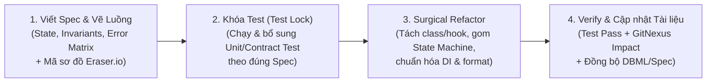
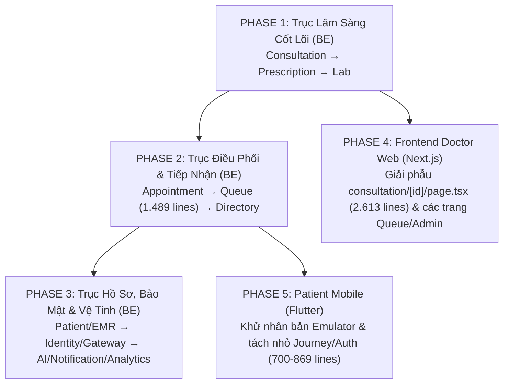

# CareFlow — Master Plan Refactor Toàn Dự Án theo Spec-Driven Development (SDD)

> **Mục tiêu cốt lõi**:
> 1. **Làm chủ 100% luồng hệ thống** (BE, FE, Mobile) để tự tin xử lý mọi lỗi phát sinh và mở rộng tính năng nâng cao cho đồ án.
> 2. **Dọn sạch "mùi code AI" (Code Smells)**: Xóa bỏ các God Class (1.400–2.600 dòng), code viết dồn 1 dòng (`if(...)throw...`), trộn lẫn `@Autowired` với Constructor Injection, kiểm tra trạng thái bằng chuỗi (`String`) rải rác và nhân bản code giữa Mobile thật / Mobile Emulator.
> 3. **Áp dụng thực chiến Spec-Driven Development (SDD)**: Mỗi tính năng/module đều có Spec chuẩn + Sơ đồ trên **Eraser.io** trước khi sửa code.

---

## 1. Quy trình SDD 4 Bước cho Mọi Lát Cắt (Slice)

Mỗi khi bắt tay vào 1 business rule trong bất kỳ Phase nào dưới đây, chúng ta luôn đi theo đúng 4 bước:

---

## 2. Bản Đồ 5 Giai Đoạn (Phases) Refactor Toàn Dự Án

Thứ tự được sắp xếp theo nguyên tắc **"Từ Trục Lõi Nghiệp Vụ → Đến Khối Điều Phối Phức Tạp → Ra Giao Diện Web & Mobile"**:

---

### PHASE 1: Trục Lâm Sàng Cốt Lõi (Core Clinical Triad — Backend)
*Lý do đi đầu tiên*: Kích thước vừa phải (300–600 dòng/service), nắm giữ toàn bộ nghiệp vụ khám chữa bệnh của Bác sĩ.

| Thứ tự | Module / File trọng tâm | Vấn đề hiện tại ("Code Smells") | Mục tiêu Refactor theo SDD |
|---|---|---|---|
| **1.1** | **`careflow-consultation-service`** - [`ConsultationService.java`](file:///d:/PTIT/CareFlow/careflow-consultation-service/src/main/java/com/careflow/consultation/service/ConsultationService.java) (531 dòng) - [`ClinicalCompletionGuard.java`](file:///d:/PTIT/CareFlow/careflow-consultation-service/src/main/java/com/careflow/consultation/service/ClinicalCompletionGuard.java) - [`ClinicalFinalizationService.java`](file:///d:/PTIT/CareFlow/careflow-consultation-service/src/main/java/com/careflow/consultation/service/ClinicalFinalizationService.java) - [`HandoverService.java`](file:///d:/PTIT/CareFlow/careflow-consultation-service/src/main/java/com/careflow/consultation/handover/HandoverService.java) (221 dòng) | - Trộn `@Autowired` field với `@RequiredArgsConstructor`. - Code nén 1 dòng trong `ClinicalCompletionGuard` & `ClinicalFinalizationService`. - Gọi trùng `completeClinical` ở cả `completeConsultation` và `finalizeVisit`. - Logic xác minh `APPOINTMENT` vs `WALK_IN` rối rắm. | - **Slice 1.1a**: Chuẩn hóa State Machine (`IN_PROGRESS` ↔ `AWAITING_CLS` ↔ `AWAITING_REVIEW` → `COMPLETED`) vào Domain [`Consultation.java`](file:///d:/PTIT/CareFlow/careflow-consultation-service/src/main/java/com/careflow/consultation/model/Consultation.java) & bỏ `@Autowired` rời. - **Slice 1.1b**: Tách `ConsultationStartPolicy` (Đặt lịch vs Walk-in). - **Slice 1.1c**: Hợp nhất luồng `complete` & `finalize` + làm sạch `ClinicalCompletionGuard`. - **Slice 1.1d**: Clean code & format lại `HandoverService`. |
| **1.2** | **`careflow-prescription-service`** - [`PrescriptionService.java`](file:///d:/PTIT/CareFlow/careflow-prescription-service/src/main/java/com/careflow/prescription/service/PrescriptionService.java) (612 dòng) | - Kiểm tra trạng thái ca khám bằng `Set.of("IN_PROGRESS", ...)` dạng chuỗi. - Trộn lẫn quản lý đơn thuốc (`DRAFT` → `CONFIRMED` → `DISPENSED`), sửa đơn (`amend`), và gọi tạo lịch tái khám (`AppointmentClient`) trong cùng 1 class. | - **Slice 1.2a**: Đóng gói State Machine của `Prescription` và rule kiểm tra thuốc (`drugs_dictionary` vs thuốc ngoài danh mục). - **Slice 1.2b**: Tách riêng `FollowUpSchedulingService` xử lý tái khám từ toa thuốc (idempotent, không làm hỏng toa đã ký khi lỗi mạng). |
| **1.3** | **`careflow-lab-service`** - [`LabOrderService.java`](file:///d:/PTIT/CareFlow/careflow-lab-service/src/main/java/com/careflow/lab/service/LabOrderService.java) (334 dòng) - [`LabAccessService.java`](file:///d:/PTIT/CareFlow/careflow-lab-service/src/main/java/com/careflow/lab/service/LabAccessService.java) (170 dòng) | - Code viết liền dòng (`order.setSourceQueueEntryId(source);order.setSourceVerifiedBy...`). - Logic kiểm tra khi nào đủ kết quả bắt buộc để bắn `AllRequiredResultsAvailable` nằm lẫn với CRUD. | - **Slice 1.3a**: Chuẩn hóa vòng đời `LabOrder` & `LabOrderItem` (`ORDERED` → `IN_PROGRESS` → `RESULT_AVAILABLE` → `REVIEWED`). - **Slice 1.3b**: Làm sạch `LabAccessService` và Outbox Event. |

---

### PHASE 2: Trục Điều Phối & Tiếp Nhận (Orchestration & Intake — Backend)
*Lý do làm ở Phase 2*: Sau khi quen tay ở Phase 1, chúng ta xử lý 2 **God Class** lớn nhất của hệ thống Backend.

| Thứ tự | Module / File trọng tâm | Vấn đề hiện tại ("Code Smells") | Mục tiêu Refactor theo SDD |
|---|---|---|---|
| **2.1** | **`careflow-appointment-service`** - [`AppointmentService.java`](file:///d:/PTIT/CareFlow/careflow-appointment-service/src/main/java/com/careflow/appointment/service/AppointmentService.java) (840 dòng) - [`RoomScheduleService.java`](file:///d:/PTIT/CareFlow/careflow-appointment-service/src/main/java/com/careflow/appointment/service/RoomScheduleService.java) (132 dòng) | - Class 840 dòng ôm cả đặt lịch Mobile, tái khám, khóa slot (`AppointmentSlotLock`), phân phòng tự động từ khoa, và `ConcurrentHashMap` idempotency trong RAM. | - **Slice 2.1a**: Tách `RoomSlotAllocationPolicy` (chọn phòng active, kiểm tra lịch & capacity). - **Slice 2.1b**: Chuẩn hóa vòng đời `AppointmentStatus` & đồng bộ Idempotency xuống DB (`AppointmentCommandStore`). |
| **2.2** | **`careflow-queue-service`** - [`QueueManagementService.java`](file:///d:/PTIT/CareFlow/careflow-queue-service/src/main/java/com/careflow/queue/service/QueueManagementService.java) (**1.489 dòng**) | - **God Class lớn nhất Backend**: 4 constructors chồng nhau, 2 biến `@Autowired` field, ôm trọn Config, QR Check-in, Geofence, Walk-in Intake, Round-Robin 3 làn (`1:1:1`), Queue CLS, Queue Dược, Recall/Miss/Requeue. | Chia `QueueManagementService` thành 4 thành phần rõ ràng: - **Slice 2.2a**: `QueueCheckInService` (QR Token, Geofence Haversine, Manual Walk-in Intake). - **Slice 2.2b**: `ClinicLaneScheduler` (Thuật toán Round-Robin `1:1:1` cho `PRIORITY`, `NORMAL`, `RESULT_REVIEW`). - **Slice 2.2c**: `QueueStateTransitionService` (`call`, `recall`, `miss`, `requeue`, `start`, `complete`). - **Slice 2.2d**: `ServicePointQueueService` (Hàng đợi FIFO cho CLS & Nhà thuốc). |
| **2.3** | **`careflow-hospital-directory-service`** - [`DirectoryService.java`](file:///d:/PTIT/CareFlow/careflow-hospital-directory-service/src/main/java/com/careflow/directory/service/DirectoryService.java) (334 dòng) | - Chứa các truy vấn master data Khoa/Phòng/Bác sĩ và kiểm tra phân công. | - Rà soát và chuẩn hóa contract trả về phân công bác sĩ/phòng làm nguồn dữ liệu chuẩn cho Appointment, Queue và Consultation. |

---

### PHASE 3: Trục Hồ Sơ, Bảo Mật & Các Service Vệ Tinh (Backend)

| Thứ tự | Module / File trọng tâm | Mục tiêu Refactor theo SDD |
|---|---|---|
| **3.1** | **`careflow-patient-service` & `careflow-emr-service`** - [`PatientService.java`](file:///d:/PTIT/CareFlow/careflow-patient-service/src/main/java/com/careflow/patient/service/PatientService.java), [`HealthRecordService.java`](file:///d:/PTIT/CareFlow/careflow-patient-service/src/main/java/com/careflow/patient/service/HealthRecordService.java), [`MedicalRecordService.java`](file:///d:/PTIT/CareFlow/careflow-emr-service/src/main/java/com/careflow/emr/service/MedicalRecordService.java) | - Chuẩn hóa `PatientAccessPolicy` (phân biệt rõ quyền đọc tối thiểu của `STAFF` tiếp nhận vs quyền đọc bệnh án của `DOCTOR` đang khám ca hẹn trước hoặc walk-in). - Làm sạch luồng upload/xem file PDF/ảnh bệnh án và tổng hợp timeline EMR. |
| **3.2** | **`careflow-identity-service` & `careflow-api-gateway`** - [`AuthService.java`](file:///d:/PTIT/CareFlow/careflow-identity-service/src/main/java/com/careflow/identity/service/AuthService.java), [`StaffAccountService.java`](file:///d:/PTIT/CareFlow/careflow-identity-service/src/main/java/com/careflow/identity/administration/StaffAccountService.java), [`DocumentIdentityService.java`](file:///d:/PTIT/CareFlow/careflow-identity-service/src/main/java/com/careflow/identity/document/DocumentIdentityService.java) | - Chuẩn hóa Spec luồng xác thực (JWT + DPoP proof + Service-to-service caller headers), quản trị tài khoản nội bộ và đối chiếu CCCD/eKYC local. |
| **3.3** | **`careflow-ai-service`, `careflow-notification-service`, `careflow-analytics-service`** - [`AiClinicalAssistantService.java`](file:///d:/PTIT/CareFlow/careflow-ai-service/src/main/java/com/careflow/ai/service/AiClinicalAssistantService.java), [`NotificationService.java`](file:///d:/PTIT/CareFlow/careflow-notification-service/src/main/java/com/careflow/notification/service/NotificationService.java) | - Thống nhất cấu hình DataSource/pgvector trong `application.yml` của `ai-service` (tránh phải đè biến môi trường tạm). - Chuẩn hóa Event Consumer chống trùng (`eventId`) của Notification và Analytics. |

---

### PHASE 4: Frontend Hospital Web App (`frontend/doctor-web`)
*Lưu ý*: Bạn có thể làm Phase 4.1 ngay sau khi xong Phase 1 để vừa sửa BE lâm sàng vừa dọn luôn màn hình Khám bệnh trên Web!

| Thứ tự | Màn hình / File trọng tâm | Vấn đề hiện tại ("Code Smells") | Mục tiêu Refactor theo SDD |
|---|---|---|---|
| **4.1** | **Màn hình Khám bệnh Bác sĩ** - [`consultation/[id]/page.tsx`](file:///d:/PTIT/CareFlow/frontend/doctor-web/src/app/(dashboard)/consultation/[id]/page.tsx) (**2.613 dòng**) | - **File lớn nhất toàn dự án**: >60 `useState`, nhồi chung 6 tab khám + kê đơn + 2 hệ thống ghi âm Voice + AI RAG + modals + dữ liệu hardcode `SEED_PATIENTS`, `ICD10_CATALOG`. | Bóc tách thành kiến trúc Modular (<250 dòng ở `page.tsx`): - **Custom Hooks**: `useConsultationData`, `usePrescriptionForm`, `useLabOrderForm`, `useClinicalAi`. - **Sub-components**: `PatientHeaderBar`, `VitalsTab`, `ClinicalExamTab`, `DiagnosisTab`, `LabOrdersTab`, `EmrSummaryTab`, `AiClinicalTab`, `PrescriptionRightPanel`. |
| **4.2** | **Các màn hình Hàng đợi & Tiếp nhận** - [`staff/checkin/page.tsx`](file:///d:/PTIT/CareFlow/frontend/doctor-web/src/app/(dashboard)/staff/checkin/page.tsx) (479 dòng) - [`dashboard/queue/page.tsx`](file:///d:/PTIT/CareFlow/frontend/doctor-web/src/app/(dashboard)/dashboard/queue/page.tsx) (442 dòng) - [`lab/queue/page.tsx`](file:///d:/PTIT/CareFlow/frontend/doctor-web/src/app/(dashboard)/lab/queue/page.tsx) (407 dòng) - [`staff/pharmacy/page.tsx`](file:///d:/PTIT/CareFlow/frontend/doctor-web/src/app/(dashboard)/staff/pharmacy/page.tsx) (314 dòng) | - Lặp lại logic polling/fetch queue, xử lý trạng thái loading và gọi số giữa 4 màn hình. | - Tạo hook dùng chung `useQueueOperations` và đảm bảo 100% tuân thủ **3-State Loading Pattern** (`isLoading` → `error` → `EmptyState` → `data`). |
| **4.3** | **Các màn hình Quản trị & Dashboard** - [`admin/facility/page.tsx`](file:///d:/PTIT/CareFlow/frontend/doctor-web/src/app/(dashboard)/admin/facility/page.tsx) (676 dòng) - [`dashboard/general/page.tsx`](file:///d:/PTIT/CareFlow/frontend/doctor-web/src/app/(dashboard)/dashboard/general/page.tsx) (532 dòng) | - Nhiều form cấu hình Khoa/Phòng/Bác sĩ/Lịch khám dồn chung trong 1 file. | - Tách từng panel quản trị (Khoa, Phòng, Bác sĩ, Lịch trực) thành component độc lập, dùng chuẩn Searchable Combobox. |

---

### PHASE 5: Patient Mobile App (`frontend/patient-mobile`)

| Thứ tự | Màn hình / File trọng tâm | Vấn đề hiện tại ("Code Smells") | Mục tiêu Refactor theo SDD |
|---|---|---|---|
| **5.1** | **Khử nhân bản giữa Mobile & Emulator** - [`frontend/patient-mobile/lib/`](file:///d:/PTIT/CareFlow/frontend/patient-mobile/lib/features/journey/domain/journey_models.dart) - [`careflow-mobile-emulator-service/app/lib/`](file:///d:/PTIT/CareFlow/careflow-mobile-emulator-service/app/lib/features/journey/domain/journey_models.dart) | - Toàn bộ code Flutter đang bị copy làm 2 bản gần như giống hệt nhau (sửa 1 tính năng phải nhớ sửa 2 nơi). | - Quy chuẩn `frontend/patient-mobile` làm **Single Source of Truth**, tạo script đồng bộ tự động những file dùng chung sang `careflow-mobile-emulator-service/app`. |
| **5.2** | **Tách nhỏ tầng Journey & Màn hình lớn** - [`journey_models.dart`](file:///d:/PTIT/CareFlow/frontend/patient-mobile/lib/features/journey/domain/journey_models.dart) (869 dòng) - [`backend_journey_repository.dart`](file:///d:/PTIT/CareFlow/frontend/patient-mobile/lib/features/journey/data/backend_journey_repository.dart) (715 dòng) - [`login_methods_screen.dart`](file:///d:/PTIT/CareFlow/frontend/patient-mobile/lib/screens/auth/login_methods_screen.dart) (768 dòng) - [`appointment_detail_screen.dart`](file:///d:/PTIT/CareFlow/frontend/patient-mobile/lib/screens/appointment/appointment_detail_screen.dart) (696 dòng) | - Gom tất cả model, mapper và API call của cả hành trình khám vào 1–2 file Dart khổng lồ. | - Tách `journey_models.dart` theo từng giai đoạn (Booking, Check-in/Queue, Lab, Prescription/Settlement) và tách nhỏ các Widget trong `appointment_detail_screen.dart`. |
