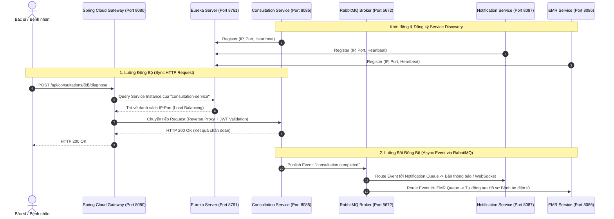

# Kiến Trúc Hạ Tầng & Thiết Kế Mẫu (Patterns) - CareFlow

Tài liệu này giải thích chi tiết về các khái niệm cốt lõi: **Message Broker (RabbitMQ vs Kafka vs Messenger)**, cơ chế phối hợp giữa **API Gateway - Eureka - RabbitMQ**, và danh mục các **Architecture/Design Patterns** được áp dụng trong hệ thống CareFlow.

---

## 1. Phân Biệt Các Khái Niệm: RabbitMQ, Kafka, Messenger là gì?

### 1.1. Message Broker là gì?
- **Message Broker (Trình môi giới tin nhắn)** là một phần mềm trung gian cho phép các ứng dụng, hệ thống hoặc microservice giao tiếp với nhau bằng cách gửi và nhận các tin nhắn (messages) bất đồng bộ (asynchronous).
- **Mục đích**: Giúp các service không bị phụ thuộc trực tiếp (decoupling), tăng khả năng chịu tải (buffering/load shedding), và xử lý tác vụ nền mà không bắt người dùng phải chờ (non-blocking).

### 1.2. RabbitMQ vs Kafka vs Messenger (Facebook/Meta)

| Tiêu chí | **RabbitMQ** (Đang dùng trong CareFlow) | **Apache Kafka** | **Facebook/Meta Messenger** |
| :--- | :--- | :--- | :--- |
| **Bản chất** | **Message Broker truyền thống (AMQP)** | **Distributed Event Streaming Platform** | **Ứng dụng chat/nhắn tin người dùng cuối** |
| **Mô hình hoạt động** | **Queue-based / Smart broker, dumb consumer**: Broker quản lý việc gửi, định tuyến (Exchange) và xóa message khi consumer đã ACK. | **Log-based / Dumb broker, smart consumer**: Lưu trữ dòng sự kiện (stream logs) theo thứ tự thời gian trên partition, consumer tự lưu offset để đọc lại bất kỳ lúc nào. | Client-Server qua giao thức XMPP/MQTT/WebSockets phục vụ giao tiếp giữa người với người. |
| **Độ trễ & Lưu lượng** | Độ trễ cực thấp (< vài ms), phù hợp xử lý giao dịch nghiệp vụ phức tạp, routing linh hoạt. | Băng thông cực lớn (hàng triệu msg/giây), phù hợp Big Data, Log aggregation, Event Sourcing dài hạn. | Phụ thuộc mạng Internet, tối ưu cho audio/video/text giữa người dùng. |
| **Routing** | Rất mạnh mẽ nhờ **Exchange (Direct, Topic, Fanout, Headers)**. | Đơn giản dựa trên Topic và Partition Key. | Không áp dụng (Routing theo User ID của app chat). |
| **Lưu trữ dữ liệu** | Tạm thời (xóa ngay khi consumer xác nhận đã xử lý xong). | Lâu dài (theo cấu hình retention time: 7 ngày, 30 ngày, v.v.). | Lưu trữ trên CSDL tin nhắn của Meta. |
| **Vai trò trong CareFlow** | **Truyền sự kiện nghiệp vụ giữa các service** (`patient-service`, `consultation-service`, `notification-service`...). | *Không sử dụng* (RabbitMQ đáp ứng trọn vẹn nghiệp vụ y tế với routing linh hoạt và độ tin cậy cao). | *Không sử dụng* (Khác hoàn toàn mục đích kỹ thuật). |

> [!NOTE]
> **Đính chính trong dự án CareFlow**: Hệ thống đang sử dụng **RabbitMQ** làm Message Broker chính (qua `spring-boot-starter-amqp` và image `rabbitmq:3-management-alpine`). Dự án **không dùng Kafka**.

---

## 2. Cách Hoạt Động Của API Gateway, Eureka và RabbitMQ

### Chi tiết vai trò:
1. **Eureka Server (`careflow-eureka-server`)**:
   - Đóng vai trò như "danh bạ điện thoại" của toàn hệ thống.
   - Khi bất kỳ microservice nào khởi động, nó gửi IP và Port lên Eureka để đăng ký (`Service Registration`). Định kỳ 30s gửi heartbeat (`Liveness check`).
2. **Spring Cloud Gateway (`careflow-api-gateway`)**:
   - Cửa ngõ duy nhất đón nhận request từ Client (Web/Mobile) tại cổng `8080`.
   - Kết nối với Eureka để giải mã URI dạng `lb://<service-name>` (Client-side Load Balancing).
   - Xác thực JWT Token, chặn truy cập trái phép, xử lý CORS tập trung và giới hạn kích thước gói tin (`RequestSize`).
3. **RabbitMQ Broker (`careflow-rabbitmq`)**:
   - Xử lý các nghiệp vụ bất đồng bộ và phân tán sự kiện.
   - Khi Bác sĩ hoàn thành khám, `consultation-service` chỉ cần publish 1 event `consultation.completed` lên RabbitMQ Exchange.
   - RabbitMQ tự động đẩy event này đến `notification-service` (gửi thông báo cho bệnh nhân) và `emr-service` (đồng bộ hồ sơ bệnh án) mà không làm chậm thời gian phản hồi của bác sĩ.

---

## 3. Các Architecture & Design Patterns Được Sử Dụng

### 3.1. Architecture Patterns (Kiến Trúc Tổng Thể)

1. **Microservices Architecture Pattern**:
   - Chia nhỏ hệ thống y tế thành các service độc lập theo Domain nghiệp vụ (Patient, Consultation, Prescription, Queue, Lab, EMR, Identity).
   - Mỗi service sở hữu database logic riêng biệt, độc lập deploy và scale.
2. **API Gateway Pattern**:
   - Gom tất cả endpoint phân tán về 1 điểm truy cập duy nhất (`/api/*`), ẩn giấu cấu trúc mạng nội bộ và giảm bớt gánh nặng xác thực JWT cho từng service.
3. **Service Discovery Pattern**:
   - Sử dụng mô hình Dynamic Registry với Netflix Eureka, giải quyết bài toán IP/Port thay đổi động khi scale hoặc restart container.
4. **Event-Driven Architecture (EDA) & Publish-Subscribe Pattern**:
   - Giao tiếp bất đồng bộ qua RabbitMQ Topics & Exchanges, giảm tối đa sự phụ thuộc (tight-coupling) giữa các domain.
5. **Database-per-Service (Logical Isolation)**:
   - Các service quản lý schema bảng riêng biệt, không truy vấn chéo database bằng SQL JOIN mà giao tiếp qua REST API hoặc Message Event.

### 3.2. Integration & Reliability Patterns (Tích Hợp & Độ Tin Cậy)

1. **Idempotent Consumer Pattern**:
   - Đảm bảo khi một event (như thanh toán, tạo số thứ tự, phát thuốc) bị gửi lặp lại do sự cố mạng, consumer kiểm tra mã định danh duy nhất (`event_id` hoặc `ticket_id`) để không xử lý trùng lặp.
2. **Idempotent Data Seeding Pattern**:
   - Trong `DataInitializer.java`, kiểm tra `existsById` / `findByCode` trước khi thêm mới master data (User, Patient, Drug, Room) để tránh trùng lặp dữ liệu và crash hệ thống khi restart.
3. **Circuit Breaker & Retry Pattern**:
   - Sử dụng trong giao tiếp liên service (Resilience4j / Spring Cloud Circuit Breaker) nhằm ngăn chặn sự cố sập dây chuyền (cascading failure) khi một service bị gián đoạn.

### 3.3. Application & Frontend Patterns (Tầng Ứng Dụng)

1. **Data Transfer Object (DTO) & Mapper Pattern**:
   - Sử dụng MapStruct / Mapper classes tách biệt hoàn toàn giữa JPA Entity và dữ liệu trả về cho Client (Response Envelope: `{ success, data, message, timestamp }`).
2. **Role-Based Access Control (RBAC) & Route Guard Pattern**:
   - Phân quyền theo vai trò (`ROLE_DOCTOR`, `ROLE_STAFF`, `ROLE_ADMIN`) ở cả Gateway Filter và Frontend React Router Guard (`AccessDenied.tsx`).
3. **3-State Data Fetching Pattern (Frontend Rule)**:
   - Quản lý trạng thái danh sách trên React/Next.js: `null` (Chưa fetch) -> `Skeleton Loading` -> `Data Display` / `Empty State` để tránh hiện tượng giật giao diện (flash empty state).
