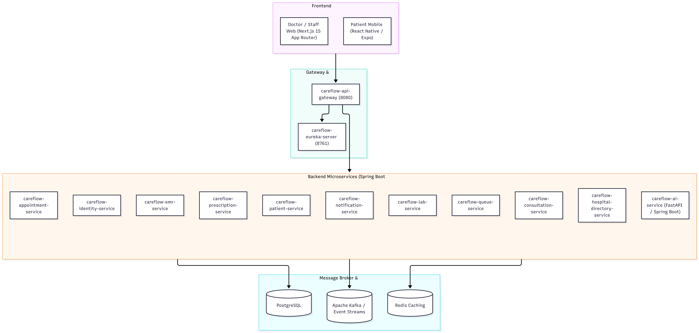
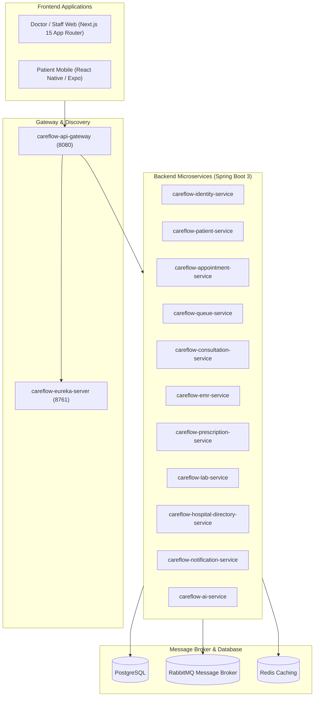

# Tổng Quan Kiến Trúc Dự Án CareFlow & Trạng Thái Phát Triển

## 1. Trạng Thái Git & Nhánh Phát Triển

- **Origin/Main**: Đồng bộ các cập nhật cơ sở hạ tầng, kết nối CSDL và cấu hình bảo mật JWT.
- **Origin/Develop**: Đã tích hợp các tính năng phân quyền dược sĩ, xác nhận đơn thuốc trước khi hoàn tất phiên khám, và bảo toàn trạng thái hàng đợi/check-in.
- **Feature Branch (`feature/vi/ai-service`)**:
  - Đã tích hợp đầy đủ mã nguồn từ `develop`.
  - Đang trong quá trình hoàn thiện tích hợp AI Voice-to-Text vào giao diện khám bệnh.

---

## 2. Tổng Quan Kiến Trúc Hệ Thống

CareFlow là hệ thống Quản lý Khám Chữa bệnh Thông minh được xây dựng theo mô hình **Microservices phân tán** kết hợp **Event-Driven Architecture**:

### Danh Sách Microservices Backend
- `careflow-eureka-server`: Service Discovery quản lý định danh và trạng thái các services.
- `careflow-api-gateway`: Cổng API duy nhất phân tuyến, xác thực token JWT và xử lý CORS.
- `careflow-identity-service`: Quản lý tài khoản, xác thực, phân quyền người dùng (Bác sĩ, Bệnh nhân, Nhân viên, Kỹ thuật viên, Quản trị).
- `careflow-patient-service`: Quản lý thông tin hành chính, tiền sử bệnh, dị ứng thuốc và thẻ BHYT.
- `careflow-appointment-service`: Đặt lịch khám, quản lý khung giờ và xác nhận cuộc hẹn.
- `careflow-queue-service`: Điều phối hàng đợi khám bệnh thông minh (FIFO/ưu tiên) theo phòng khám, cận lâm sàng và quầy thuốc.
- `careflow-consultation-service`: Quản lý phiên khám của bác sĩ, ghi chép quá trình chẩn đoán và diễn biến lâm sàng.
- `careflow-emr-service`: Hồ sơ bệnh án điện tử, lưu trữ lịch sử các lần khám và kết quả tổng hợp.
- `careflow-prescription-service`: Quản lý danh mục thuốc, tương tác thuốc và kê đơn thuốc điện tử.
- `careflow-lab-service`: Tiếp nhận chỉ định xét nghiệm, điều phối hàng đợi cận lâm sàng và trả kết quả.
- `careflow-hospital-directory-service`: Danh mục khoa phòng, trang thiết bị, phòng ban và hồ sơ bác sĩ.
- `careflow-notification-service`: Thông báo đẩy qua Firebase và WebSocket thời gian thực.
- `careflow-ai-service`: Xử lý bóc tách giọng nói sang văn bản (STT), phân tích tóm tắt bệnh án và hỗ trợ chẩn đoán.

---

## 3. Các Phân Hệ & Tính Năng Web App (`doctor-web`)

1. **Xác thực & Kiểm soát truy cập (`/login`, Role Guard, AccessDenied)**:
   - Đăng nhập JWT, phân quyền theo vai trò (`DOCTOR`, `STAFF`, `LAB_TECHNICIAN`, `ADMIN`).
   - Trang 403 Forbidden chuẩn UX tự động điều hướng người dùng về đúng khu vực chuyên môn.
2. **Khu vực Khám bệnh của Bác sĩ (`/consultation/[id]`, `/dashboard/queue`, `/dashboard/general`)**:
   - Theo dõi danh sách chờ theo từng phòng khám chuyên khoa (`ROOM-XX`).
   - Màn hình phiên khám trực quan: Bệnh sử, triệu chứng, chẩn đoán theo mã ICD-10, chỉ định cận lâm sàng (Lab Order) và kê đơn thuốc.
   - Trợ lý ghi âm hội thoại bác sĩ - bệnh nhân để tự động điền form bệnh án bằng AI.
3. **Quản lý Đơn thuốc & Dược lâm sàng (`/dashboard/prescriptions`, `/staff/pharmacy`)**:
   - Tra cứu danh mục dược phẩm, liều dùng, cảnh báo tương tác và dị ứng.
   - Quy trình cấp phát thuốc tại quầy dược: Tiếp nhận đơn -> Soạn thuốc -> Xác nhận phát thuốc.
4. **Tiếp đón & Check-in (`/staff/checkin`)**:
   - Tiếp nhận bệnh nhân tại quầy lễ tân, quét mã / tìm kiếm hồ sơ và cấp số thứ tự vào phòng khám.
5. **Kỹ thuật viên Cận lâm sàng / Xét nghiệm (`/lab`, `/lab/queue`)**:
   - Quản lý hàng đợi thực hiện xét nghiệm/chẩn đoán hình ảnh.
   - Nhập chỉ số kết quả, tải file đính kèm và gửi trả về hồ sơ bệnh án.
6. **Quản trị Bệnh viện (`/admin`)**:
   - Quản lý danh mục chuyên khoa và sơ đồ phòng khám (`/admin/facility`).
   - Phân ca trực và lịch làm việc của bác sĩ (`/admin/schedule`).
   - Quản lý tài khoản nhân viên y tế và phân quyền (`/admin/accounts`).

---

## 4. Các Phần Đang Dang Dở & Cần Hoàn Thiện

1. **Tính Năng AI Service & Voice Transcription**:
   - Hoàn thiện kiểm thử tích hợp các component `VoiceRecorderButton` và `VoicePreviewModal` với `careflow-ai-service`.
   - Chuẩn hóa luồng map dữ liệu tự động từ kết quả bóc tách AI vào các trường triệu chứng, chẩn đoán sơ bộ trên form khám bệnh.
2. **Khép Kín Quy Trình Phát Thuốc & Hoàn Tất Phiên Khám**:
   - Đồng bộ trạng thái chuyển tiếp giữa các dịch vụ: Hoàn tất phát thuốc tại `prescription-service` -> Cập nhật trạng thái phiên khám tại `consultation-service` -> Đóng lượt trong `queue-service`.
3. **Đồng Bộ Dữ Liệu Thời Gian Thực (Real-time Sync)**:
   - Thay thế các đoạn polling/refetch thủ công bằng kết nối WebSocket qua `careflow-notification-service` cho hàng đợi tiếp đón và hàng đợi xét nghiệm.
4. **Kiểm Thử Tích Hợp Toàn Diện (End-to-End Workflow)**:
   - Kiểm thử thông suốt chu trình khám: *Đặt lịch -> Check-in cấp số -> Khám lâm sàng -> Chỉ định cận lâm sàng -> Trả kết quả CLS -> Kê đơn thuốc -> Quầy phát thuốc -> Đóng bệnh án điện tử*.
