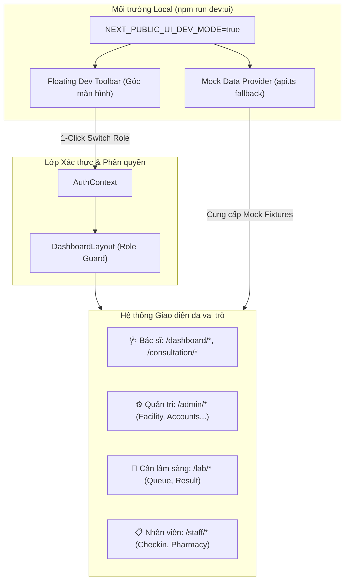

# KẾ HOẠCH TRIỂN KHAI: UI DEV WORKBENCH & DESIGN ENHANCEMENT

> [!IMPORTANT]
> **THÔNG TIN QUẢN TRỊ NHÁNH GIT (BRANCH METADATA)**
> - **Nhánh áp dụng (Target Branch):** `feature/vi/ui-workbench` (dựa trên commit mới nhất từ `origin/main`).
> - **Phạm vi cho phép (Scope):** **STRICT UI-ONLY**. Chỉ được phép chỉnh sửa và commit các file liên quan thuần túy đến Presentation, Styling (Tailwind, CSS), Layout TSX/JSX, Icons, Visual States, và Dev Mock Fixtures/Toolbars.
> - **Vùng cấm (Forbidden):** TUYỆT ĐỐI KHÔNG thay đổi logic nghiệp vụ (domain logic), state machine, database schemas, API contracts, backend microservices, hoặc cơ chế bảo mật authentication/authorization thật trên nhánh này.
> - **Cờ bảo vệ:** Toàn bộ công cụ dev/mock phải được bọc trong cờ môi trường `process.env.NODE_ENV !== 'production'` hoặc `process.env.NEXT_PUBLIC_UI_DEV_MODE === 'true'`.

---

## 1. TỔNG QUAN & MỤC TIÊU (OVERVIEW & OBJECTIVES)

Kế hoạch này giải quyết 2 bài toán lớn cho việc hoàn thiện giao diện CareFlow:
1. **UI Test Mode Without Auth (UI Dev Workbench):** Cung cấp môi trường dev cục bộ giúp kiểm thử, thiết kế và sửa đổi toàn bộ các trang giao diện (Bác sĩ, Quản trị viên, Kỹ thuật viên CLS, Nhân viên tiếp đón/dược) mà không cần đăng nhập thật, không cần token JWT từ backend, và không bị chặn bởi Role Guard.
2. **Nâng cấp Animation & Alignment (Lấy cảm hứng từ Saigon Digital Design System):** Ứng dụng các quy chuẩn thiết kế về nhịp chuyển động siêu nhanh (fast motion tokens), hiệu ứng bấm cơ học tức thì (tactile micro-interactions), hiệu ứng mở Modal tinh gọn và căn gióng chỉ số (metric alignment) để giao diện y tế đạt độ sắc nét, dứt khoát và tối ưu tối đa tốc độ lâm sàng (loại bỏ hiệu ứng bay/nhấc thẻ và text-wrap nặng nề).

---

## 2. KIẾN TRÚC GIẢI PHÁP (ARCHITECTURE)



---

## 3. CÁC HẠNG MỤC TRIỂN KHAI CHI TIẾT (IMPLEMENTATION BREAKDOWN)

### PHẦN A: FLOATING UI DEV TOOLBAR & AUTH BYPASS

#### A.1. Cấu hình Script khởi chạy
- File: `frontend/doctor-web/package.json`
- Thêm script chuyên dụng:
  ```json
  "scripts": {
    "dev": "next dev",
    "dev:ui": "NEXT_PUBLIC_UI_DEV_MODE=true next dev"
  }
  ```

#### A.2. AuthContext Dev Bypass
- File: `frontend/doctor-web/src/contexts/AuthContext.tsx`
- Bổ sung logic tự động inject `devUser` khi `process.env.NEXT_PUBLIC_UI_DEV_MODE === 'true'` hoặc khi người dùng kích hoạt từ Toolbar.
- Cung cấp hàm `setDevRole(role: string)` cho phép chuyển đổi tức thì giữa các quyền:
  - `DOCTOR`: Bác sĩ Chuyên khoa Nội
  - `ADMIN`: Quản trị viên Bệnh viện
  - `LAB_TECHNICIAN`: Kỹ thuật viên Xét nghiệm
  - `STAFF`: Nhân viên Tiếp nhận & Dược

#### A.3. Floating Dev Toolbar Component
- File mới: `frontend/doctor-web/src/components/dev/UiDevToolbar.tsx`
- Chỉ render khi `process.env.NODE_ENV !== 'production'` và `NEXT_PUBLIC_UI_DEV_MODE === 'true'`.
- **Tính năng nổi bật:**
  - **Thanh chuyển Role (1-Click Switch):** Bấm chọn vai trò để chuyển đổi quyền hạn ngay lập tức mà không cần logout.
  - **Quick Jump Navigator:** Dropdown liên kết trực tiếp tới toàn bộ các trang con:
    - Bác sĩ: Tổng quan (`/dashboard/general`), Hàng đợi (`/dashboard/queue`), Đơn thuốc (`/dashboard/prescriptions`), Phòng khám (`/consultation/c101`).
    - Quản trị: Cơ sở vật chất (`/admin/facility`), Tài khoản (`/admin/accounts`), Lịch trực (`/admin/schedule`).
    - Cận lâm sàng: Hàng đợi xét nghiệm (`/lab/queue`).
    - Nhân viên: Quầy tiếp đón (`/staff/checkin`), Quầy phát thuốc (`/staff/pharmacy`).
  - **State Simulator (Giả lập trạng thái hiển thị):**
    - `Normal`: Dữ liệu mẫu đầy đủ.
    - `Skeleton Loading`: Ép giao diện hiển thị trạng thái đang tải (pulse loading) để kiểm tra layout giật lag.
    - `Empty State`: Ép giao diện hiển thị trạng thái chưa có bản ghi nào.
    - `Error State`: Ép giao diện hiển thị banner lỗi kết nối.
  - **Thu gọn thông minh (Collapsible):** Có nút thu nhỏ thành icon chấm tròn nhỏ ở góc màn hình để không che khuất tầm nhìn khi sửa UI.

---

### PHẦN B: MOCK DATA FALLBACK CHO API (OFFLINE UI DEVELOPMENT)

#### B.1. Network Interceptor trong `lib/api.ts`
- File: `frontend/doctor-web/src/lib/api.ts`
- Khi `NEXT_PUBLIC_UI_DEV_MODE === 'true'`, nếu backend không khả dụng hoặc trả về lỗi kết nối mạng (Network Error / 401 Unauthorized), hàm `request<T>()` sẽ tự động chuyển hướng lấy dữ liệu từ `mockFixtures`.
- Đảm bảo dev có thể tắt hoàn toàn Docker/Backend mà giao diện vẫn hiển thị trực quan, sinh động.

#### B.2. Bộ Mock Data Fixtures
- File mới: `frontend/doctor-web/src/lib/mock-ui-fixtures.ts`
- Chuẩn bị dữ liệu mẫu chuẩn y tế:
  - Danh sách 5 bệnh nhân đang chờ khám (nhiều độ tuổi, trạng thái khác nhau: WAITING, IN_PROGRESS, COMPLETED).
  - Hồ sơ bệnh án mẫu (chẩn đoán ICD-10, sinh hiệu huyết áp/nhịp tim, tiền sử dị ứng).
  - Danh sách thuốc kê đơn mẫu (Panadol, Amoxicillin, Nexium...).
  - Danh sách kết quả xét nghiệm sinh hóa / huyết học mẫu.
  - Danh sách Khoa chuyên môn và Phòng khám mẫu.

---

### PHẦN C: NÂNG CẤP ANIMATION & ALIGNMENT (SAIGON DIGITAL INFLUENCE - CLINICAL SPEED OPTIMIZED)

#### C.1. Motion Tokens (Siêu nhanh & dứt khoát)
- File: `frontend/doctor-web/src/app/globals.css`
- Tối ưu biến nhịp chuyển động cho môi trường khám bệnh (100ms - 140ms), không sử dụng `text-wrap` gây tốn CPU render:
  ```css
  /* Motion Variables - Siêu nhanh, không làm trễ thao tác lâm sàng */
  :root {
    --dur-fast: 100ms;
    --dur-base: 140ms;
    --ease-standard: cubic-bezier(0.4, 0, 0.2, 1);
    --ease-out: cubic-bezier(0.16, 1, 0.3, 1);
  }
  ```

#### C.2. Tactile Button Click (Hiệu ứng lún cơ học - Phản hồi tức thì)
- Mọi nút bấm tương tác (Button, IconButton) áp dụng:
  - `active:translate-y-[1px]`: Lún xuống 1px khi nhấn chuột.
  - `active:scale-[0.99]`: Co nhẹ tạo cảm giác bấm dứt khoát.
  - `transition-all duration-100 ease-out`: Phản hồi 0ms latency qua GPU, giúp bác sĩ nhận biết tức thì nút đã nhận lệnh (tránh double-click nhầm).

#### C.3. Hiệu ứng Mở Modal Nhanh (Crisp Modal Entrance & Không Bay/Nhấc Thẻ)
- **Modal Opening:** Mở nhanh, thanh thoát trong 120ms (`duration-120 ease-out`), kết hợp fade-in nhẹ và scale cực nhẹ (`scale-98 -> scale-100`), không gây trễ nhịp thao tác.
- **Loại bỏ Hoàn toàn Hover Pick-up trên Card/Bảng:** 
  - Tuyệt đối **KHÔNG dùng `hover:-translate-y`** hay hiệu ứng nhấc thẻ lên/xuống khi di chuột. Giữ nguyên vị trí cố định của thẻ và dòng dữ liệu để tránh rung giật mắt (visual jitter) và tránh click trượt khi bác sĩ lia chuột nhanh qua danh sách.
  - Chỉ dùng viền tĩnh hoặc đổi màu nền nhẹ nhàng (`hover:bg-[#F9F6FA]`).

#### C.4. Metric Alignment (Đồng bộ chiều cao form & control)
- Chuẩn hóa toàn bộ chiều cao của các phần tử tương tác:
  - `h-9` (36px): Cho bảng dữ liệu gọn, nút phụ trong hàng (table action buttons).
  - `h-11` (44px): Cho các ô Input tìm kiếm, Select combobox, nút Submit chính của form.
- Icon đặt bên trong Input phải căn giữa tuyệt đối theo trục dọc với khoảng cách đệm chuẩn xác (`left-3`, `pl-10`), tránh tình trạng chữ đè lên icon.

#### C.5. Tab Navigation Seamless Border
- Khi chia tab (ví dụ: Thông tin hành chính / Kết quả CLS / Kê đơn thuốc):
  - Áp dụng kỹ thuật âm lề: `border-b-2 -mb-[1px]` để thanh active border nằm khít hoàn hảo trên đường viền chia khung, không bị hiện tượng nét đôi hay giật vị trí khi đổi tab.

---

## 4. KẾ HOẠCH KIỂM THỬ & NGHIỆM THU (VERIFICATION PLAN)

### 4.1. Kiểm tra Môi trường Dev (Automated & Manual)
- Chạy thử `npm run dev:ui`:
  - [ ] Truy cập trực tiếp vào `http://localhost:3000/dashboard/general` mà không bị redirect về `/login`.
  - [ ] Thấy Floating Dev Toolbar xuất hiện ở góc dưới màn hình.
  - [ ] Thử đổi Role sang `LAB_TECHNICIAN` và truy cập `/lab/queue` -> Không bị màn hình 403 Access Denied chặn.
  - [ ] Thử đổi Role sang `ADMIN` và truy cập `/admin/facility` -> Hiển thị danh mục cơ sở vật chất mẫu.
  - [ ] Thử toggle trạng thái `Skeleton Loading` -> Các dòng placeholder nhấp nháy giữ nguyên layout không bị giật.

### 4.2. Kiểm tra Độ an toàn Production (Production Tree-Shaking Check)
- Chạy lệnh build kiểm tra:
  ```bash
  npm run build
  ```
- Xác nhận:
  - [ ] Quá trình build production hoàn tất mà không có lỗi TypeScript hay Linting.
  - [ ] Khi chạy `npm run start` (chế độ production chuẩn), Floating Toolbar và mock interceptor hoàn toàn biến mất, cơ chế bảo mật JWT hoạt động bình thường 100%.

---

## 5. HƯỚNG DẪN KHI BẮT ĐẦU CODE (ACTION GUIDE)

Khi bạn quay lại và sẵn sàng thực hiện:
1. Xác nhận đang ở đúng nhánh: `git branch --show-current` (phải là `feature/vi/ui-workbench`).
2. Mở file này ra và tiến hành theo thứ tự từng phần:
   - Bước 1: Tạo `UiDevToolbar.tsx` và gắn vào Root/Dashboard Layout.
   - Bước 2: Tích hợp Mock Interceptor vào `lib/api.ts`.
   - Bước 3: Áp dụng CSS Motion & Typography tokens vào `globals.css`.
   - Bước 4: Sửa và làm đẹp từng trang theo mong muốn!
