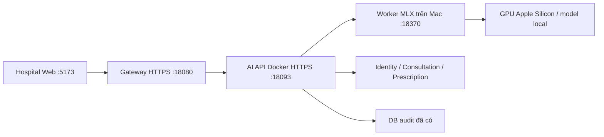

# 26 — Voice và Docker trên Mac

[Mục lục](README.md) · [Thao tác nhập toa](23-nhap-toa-giong-noi-ai.md)

Mốc24/10/2026, worktree `release-r7`, nhánh `feature/dangkhoii/release-r7`, nền907cba2 kèm thay đổi chưa commit. Bộ thử trên Mac đã provision, chưa phải bộ cài production hoặc nghiệm thu đầy đủ R7.

## Thành phần hiện tại



Container **careflow-r7-ai-api** chỉ publish127.0.0.1:18093 vào8092. Non-root, root filesystem read-only, cap-drop, health check mTLS,2CPU/768MiB, heap384MiB. Config/khóa mount read-only từ thư mục private ngoài Git. Image chứa JAR đã kiểm, không chứa dataset/model/SQLite prototype/secret.

Worker MLX giữ model thường trú trên Mac để dùng GPU. Docker không tự tăng độ chính xác/tốc độ. GPU passthrough `--gpus` cho Linux container theo [Docker](https://docs.docker.com/desktop/features/gpu/) hiện chỉ hỗ trợ Windows/WSL2; Model Runner là cơ chế khác, không thay trực tiếp runtime MLX/adapter này.

## Mở lại bộ hiện có

Mở Docker Desktop, từ worktree R7:

```sh
/usr/bin/python3 scripts/mac-demo/demo.py start
/usr/bin/python3 scripts/mac-demo/demo.py status
```

Cần thấy **ai-service :18093 (Docker)** và backend/web còn lại OK. Launcher chỉ chấp nhận tên/owner/image ID/cổng loopback đã ghi trong descriptor private; không tự thay image, giữ DB/khóa/hàng đợi. Descriptor đã thêm vào snapshot để phục hồi khi `/tmp` bị dọn.

Worker18370 là tiến trình riêng, cấu hình/chạy theo trang23; health Java chưa chứng minh model sẵn sàng. Trước buổi thử kiểm readiness worker có auth và thử audio tổng hợp. Cầu nối iPhone theo trang11/25. Web http://localhost:5173/login, tài khoản ở trang01.

```sh
docker ps --filter name=careflow-r7-ai-api
docker compose \
  --env-file "$HOME/Library/Developer/CareFlow/voice-parity-20261023/docker-private-v2/compose.env" \
  -f docker-compose.voice.yml ps
```

`restart: unless-stopped` xử lý process thoát/Docker khởi động theo chính sách Docker; health check không tự restart worker GPU. Sao lưu cả bundle private Docker, model release và snapshot runtime. Chưa thử DR production/khôi phục bộ Docker trên Mac khác.

## Đóng gói artifact mới

Chạy kiểm backend phù hợp theo trang25 để có JAR đúng nguồn trong `careflow-ai-service/target/`. `Dockerfile.runtime` chỉ đóng gói JAR có sẵn, không compile Java hoặc tự xác nhận artifact cũ đúng nguồn mới. Ignore riêng chỉ đưa JAR cần thiết vào context.

Với state audit đã provision, dùng **thư mục mới** ngoài repo:

```sh
python3 scripts/voice/prepare_docker.py \
  --output-dir "$HOME/Library/Developer/CareFlow/voice-docker-new"
docker compose \
  --env-file "$HOME/Library/Developer/CareFlow/voice-docker-new/compose.env" \
  -f docker-compose.voice.yml config --quiet
docker compose \
  --env-file "$HOME/Library/Developer/CareFlow/voice-docker-new/compose.env" \
  -f docker-compose.voice.yml build
```

Helper chỉ nhận state audit cục bộ, từ chối DB remote/shared hoặc dependency HTTP. Nó sao chép chứng thư/khóa AI/truststore cần dùng, không sao chép CA private key/khóa service khác và không tạo khóa mới. Thư mục ngoài0700 bảo vệ bundle; file bên trong được non-root container đọc qua mount. Không đưa bundle/config/TLS/compose.env lên Git hoặc ảnh chụp.

Trước `up -d ai-api` lên18093 phải chuyển đúng instance AI, kiểm job đang xử lý, PID/JAR sở hữu, health và fallback. Mac này đã chuyển với cùng JAR/khóa, giữ native artifact để quay lại. Build không tự chuyển traffic. Khi đổi image phải kiểm chứng rồi ghi image ID mới vào descriptor; launcher từ chối ID khác. Đây không phải lệnh cài cho máy chưa provision.

## Giới hạn

Worker bật context tối đa50 tên từ danh mục bệnh viện, dùng cùng adapter checksum với prototype, không còn ép768 token đầu ra. Phép đo nhỏ cùng audio tổng hợp tách model/worker/API, không phải KPI tải hoặc đánh giá giọng bác sĩ độc lập. Xem [biên bản/số đo](../.planning/ai-service/voice-parity-docker-2026-10-24.md).

CareFlow vẫn kiểm mã thuốc/quyền/ca trước lưu Prescription. Catalog DAV tham khảo không tự thành thuốc được phép kê. Full R7, push và chuyên môn AI vẫn còn điều kiện chưa nghiệm thu.
