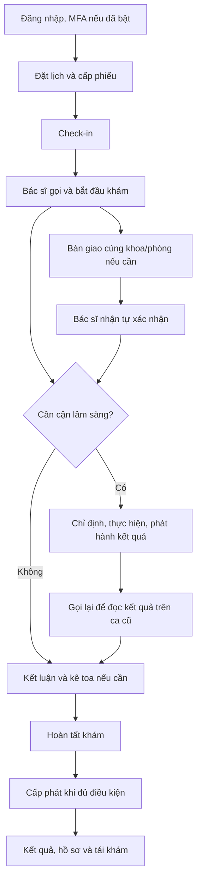

# Hướng dẫn sử dụng CareFlow

Đây là **nơi duy nhất quản lý hướng dẫn sử dụng và trình diễn end-to-end**. Bắt đầu ở đây; cập nhật nội dung tại thư mục này khi chức năng thay đổi. README của service và các đường dẫn cũ chỉ dẫn về đây. Contract kỹ thuật và báo cáo kiểm thử vẫn thuộc thư mục chuyên môn của chúng.

**Mốc đối chiếu: 16/10/2026, runtime tích hợp trên Mac.** Nhánh tài liệu không chứa toàn bộ sửa bảo mật/MFA/bàn giao đang chạy ở worktree tích hợp. Đọc [chuẩn bị môi trường](00-chuan-bi.md) trước khi dùng trên máy khác.

## Chọn việc cần làm

| Thứ tự | Hướng dẫn | Dùng khi |
|---|---|---|
| 00 | [Chuẩn bị, khởi động và tách phiên](00-chuan-bi.md) | Mở hệ thống trên Mac |
| 01 | [Tài khoản và dữ liệu demo](01-tai-khoan-va-du-lieu.md) | Chọn đúng bệnh nhân, bác sĩ và phòng |
| 02 | [Đăng nhập, MFA và đăng xuất](02-dang-nhap-mfa.md) | Đăng nhập hai bước; bật MFA sau đăng nhập |
| 03 | [Đặt lịch → phiếu → check-in → hàng đợi](03-dat-lich-check-in.md) | Đưa đúng bệnh nhân tới hàng đợi bác sĩ |
| 04 | [Khám không cần cận lâm sàng](04-kham-khong-cls.md) | Gọi bệnh nhân, khám, kê toa và hoàn tất |
| 05 | [Cận lâm sàng → đọc kết quả](05-can-lam-sang.md) | Làm việc giữa bác sĩ và kỹ thuật viên |
| 06 | [Kê toa → quầy thuốc](06-toa-va-cap-phat-thuoc.md) | Phát hành toa và đối chiếu cấp phát |
| 07 | [Bàn giao ca giữa bác sĩ](07-ban-giao-ca-kham.md) | Gửi/nhận/từ chối/hủy và điều phối ngoại lệ |
| 08 | [Sau khám, hồ sơ, thông báo và tái khám](08-sau-kham.md) | Theo dõi kết quả ở mobile |
| 09 | [Ngoại lệ và xử lý lỗi](09-ngoai-le-va-xu-ly-loi.md) | 401/403/404/409, không thấy phiếu hoặc bệnh nhân |
| 10 | [Kịch bản trình diễn và cách nghiệm thu](10-trinh-dien-va-nghiem-thu.md) | Chạy theo thứ tự và ghi kết quả đúng phạm vi |
| — | [Lịch sử cập nhật](CHANGELOG.md) | Xem thay đổi của hướng dẫn |

## Luồng tổng thể

Mỗi trang có điều kiện bắt đầu, thao tác, kết quả cần thấy và cách chạy lại. Thao tác tạo/hủy lịch, check-in, khám và toa ghi vào DB thật. Giữ cùng bệnh nhân và các mã liên quan để đối chiếu; không dựng response giả hoặc sửa SQL trạng thái để đánh dấu đạt.

## Quy tắc duy trì

Khi sửa UI, API, quyền, trạng thái hoặc dữ liệu mẫu làm thay đổi thao tác người dùng, cập nhật trang tương ứng **cùng commit/PR**, mục lục nếu cần và `CHANGELOG.md`. Nêu rõ phần đã kiểm tra, phần chưa kiểm tra, phiên bản/runtime và điều kiện lặp lại. Tài khoản/mật khẩu demo chỉ quản lý tại trang 01. Không tạo bản hướng dẫn song song trong `.planning/`, `docs/` hoặc service. Quy tắc bắt buộc cũng được ghi ở `AGENTS.md` và `.agents/AGENTS.md` của repo.
