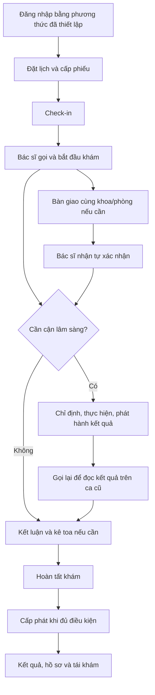

# Hướng dẫn sử dụng CareFlow

Đây là **nơi duy nhất quản lý hướng dẫn sử dụng và trình diễn end-to-end**. Bắt đầu ở đây; cập nhật nội dung tại thư mục này khi chức năng thay đổi. README của service và các đường dẫn cũ chỉ dẫn về đây. Contract kỹ thuật và báo cáo kiểm thử vẫn thuộc thư mục chuyên môn của chúng.

**Mốc đối chiếu:21/10/2026, runtime test trên Mac, backend/web `5a8c6e5` và native `e5fc9c1` kèm thay đổi chưa commit. iPhone đã cài/mở bản1.0.0(20) ở R4; R5 chỉ cập nhật backend/web.** Đợt xuất bản develop ngày21/10/2026 hợp nhất source backend/web và mobile; runtime hiện tại vẫn chạy artifact từ worktree đã kiểm tra. [Biên bản xuất bản](../.planning/deployment/publish-r0-r5-2026-10-21.md) ghi phạm vi và giới hạn. Đọc [chuẩn bị môi trường](00-chuan-bi.md) trước khi dùng trên máy khác.

**Demo luồng chính:** dùng bộ Nội tổng quát ROOM-01 ở [trang tài khoản](01-tai-khoan-va-du-lieu.md), đọc trạng thái lượt mới nhất theo [kịch bản trình diễn](10-trinh-dien-va-nghiem-thu.md). Web đã đối chiếu với `origin/develop` (`e5fc9c1`).

**Chuẩn hóa R0:** [biên bản phiên bản và giới hạn nghiệm thu](../.planning/architecture/05-r0-baseline-results.md). R0 không đổi chức năng hoặc cài app mới; bản16 vẫn đang sử dụng.

**R1 — 20/10/2026:** người dùng đã chấp nhận chuyển sang R2; tài khoản/quản trị xem [trang17](17-tai-khoan-va-quan-tri-r1.md). Các nhánh phần cứng/UI chưa xác nhận riêng vẫn được giữ ở [trang18](18-nghiem-thu-r1-thiet-bi.md).

**R2 — 20/10/2026:** lịch phòng, tiếp nhận không hẹn, liên kết hồ sơ và lỡ lượt xem [trang19](19-tiep-nhan-lich-va-hang-doi-r2.md). Mobile 1.0.0 (17) đã cài lên iPhone; nghiệm thu camera/GPS và xác nhận của người dùng còn mở.

**R3 — 20/10/2026:** hồ sơ upload, đọc kết quả chủ động, ký toa/tái khám và đối soát hoàn tất xem [trang20](20-ho-so-va-hanh-trinh-lam-sang-r3.md). API/web thật đã kiểm tra; phần nghiệm thu iPhone ghi riêng.

## Chọn việc cần làm

| Thứ tự | Hướng dẫn | Dùng khi |
|---|---|---|
| 00 | [Chuẩn bị, khởi động và tách phiên](00-chuan-bi.md) | Mở hệ thống trên Mac |
| 01 | [Tài khoản và dữ liệu demo](01-tai-khoan-va-du-lieu.md) | Chọn đúng bệnh nhân, bác sĩ và phòng |
| 02 | [Đăng nhập, hình thức thay thế và khôi phục](02-dang-nhap-mfa.md) | Mật khẩu, passkey và đăng xuất |
| 03 | [Đặt lịch → phiếu → check-in → hàng đợi](03-dat-lich-check-in.md) | Đưa đúng bệnh nhân tới hàng đợi bác sĩ |
| 04 | [Khám không cần cận lâm sàng](04-kham-khong-cls.md) | Gọi bệnh nhân, khám, kê toa và hoàn tất |
| 05 | [Cận lâm sàng → đọc kết quả](05-can-lam-sang.md) | Làm việc giữa bác sĩ và kỹ thuật viên |
| 06 | [Kê toa → quầy thuốc](06-toa-va-cap-phat-thuoc.md) | Phát hành toa và đối chiếu cấp phát |
| 07 | [Bàn giao ca giữa bác sĩ](07-ban-giao-ca-kham.md) | Gửi/nhận/từ chối/hủy và điều phối ngoại lệ |
| 08 | [Sau khám, hồ sơ, thông báo và tái khám](08-sau-kham.md) | Theo dõi kết quả ở mobile |
| 09 | [Ngoại lệ và xử lý lỗi](09-ngoai-le-va-xu-ly-loi.md) | 401/403/404/409, không thấy phiếu hoặc bệnh nhân |
| 10 | [Kịch bản trình diễn và cách nghiệm thu](10-trinh-dien-va-nghiem-thu.md) | Chạy theo thứ tự và ghi kết quả đúng phạm vi |
| 11 | [Cài app CareFlow lên iPhone](11-cai-app-iphone.md) | Cài app iOS độc lập, ký ứng dụng và kết nối backend trên Mac |
| 12 | [Đăng nhập và quên mật khẩu trên app native](12-dang-nhap-mobile.md) | Face ID/vân tay và mã email đặt lại mật khẩu |
| 13 | [Bản vá bảo mật và vận hành](13-ban-va-bao-mat-va-van-hanh.md) | Phạm vi chưa phát hành, cấu hình production và nghiệm thu |
| 14 | [Tệp, thiết bị sinh trắc học và bảng giá](14-tep-thiet-bi-va-bang-gia.md) | Tải tài liệu trên app (11), thu hồi thiết bị và quản lý giá dịch vụ |
| 15 | [Đọc giấy tờ và đối chiếu trực tiếp](15-doc-giay-to-va-doi-chieu.md) | Đọc ảnh trên điện thoại, gửi ba trường và nhân viên kiểm tra bản gốc |
| 16 | [Bảo mật đợt 2](16-bao-mat-dot-2.md) | Đăng ký email, passkey nhân viên, khóa thiết bị và nghiệm thu bản (13) |
| 17 | [Tài khoản và quản trị R1](17-tai-khoan-va-quan-tri-r1.md) | Tạo/khóa tài khoản thật, phân công, passkey và xử lý lỗi bệnh sử |
| 18 | [Nghiệm thu R1 trên thiết bị](18-nghiem-thu-r1-thiet-bi.md) | Face ID, camera mẫu giả, UI email và passkey thật trước chốt R1 |
| 19 | [Lịch phòng, tiếp nhận và hàng đợi R2](19-tiep-nhan-lich-va-hang-doi-r2.md) | Cấu hình thật, walk-in, liên kết có xác minh/chấp thuận, lỡ lượt và kiểm tra trên iPhone |
| 20 | [Hồ sơ và hành trình lâm sàng R3](20-ho-so-va-hanh-trinh-lam-sang-r3.md) | Upload, CLS, ký toa, tái khám, retry và phạm vi iPhone |
| 21 | [Thông báo và đồng bộ R4](21-thong-bao-va-dong-bo-r4.md) | Inbox, cập nhật toàn app và điều kiện push thật còn thiếu |
| 22 | [Thống kê và đối soát R5](22-thong-ke-va-doi-soat-r5.md) | Dashboard ADMIN, KPI thật, độ mới, backfill và dựng lại Analytics |
| 23 | [Nhập toa giọng nói — backend thử nghiệm](23-nhap-toa-giong-noi-ai.md) | Source AI/worker được lưu cùng bản gộp; mặc định tắt, web ghi âm và nghiệm thu R6 còn mở |
| — | [Lịch sử cập nhật](CHANGELOG.md) | Xem thay đổi của hướng dẫn |

## Luồng tổng thể

Mỗi trang có điều kiện bắt đầu, thao tác, kết quả cần thấy và cách chạy lại. Thao tác tạo/hủy lịch, check-in, khám và toa ghi vào DB thật. Giữ cùng bệnh nhân và các mã liên quan để đối chiếu; không dựng response giả hoặc sửa SQL trạng thái để đánh dấu đạt.

## Quy tắc duy trì

Khi sửa UI, API, quyền, trạng thái hoặc dữ liệu mẫu làm thay đổi thao tác người dùng, cập nhật trang tương ứng **cùng commit/PR**, mục lục nếu cần và `CHANGELOG.md`. Nêu rõ phần đã kiểm tra, phần chưa kiểm tra, phiên bản/runtime và điều kiện lặp lại. Tài khoản/mật khẩu demo chỉ quản lý tại trang 01. Không tạo bản hướng dẫn song song trong `.planning/`, `docs/` hoặc service. Quy tắc bắt buộc cũng được ghi ở `AGENTS.md` và `.agents/AGENTS.md` của repo.

**R5 —21/10/2026:** Analytics Service và dashboard ADMIN đã chạy/kiểm chứng trên stack Mac. Xem trang22; R4 push thật vẫn còn mở.
